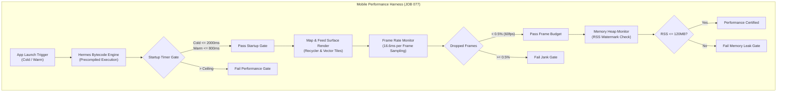
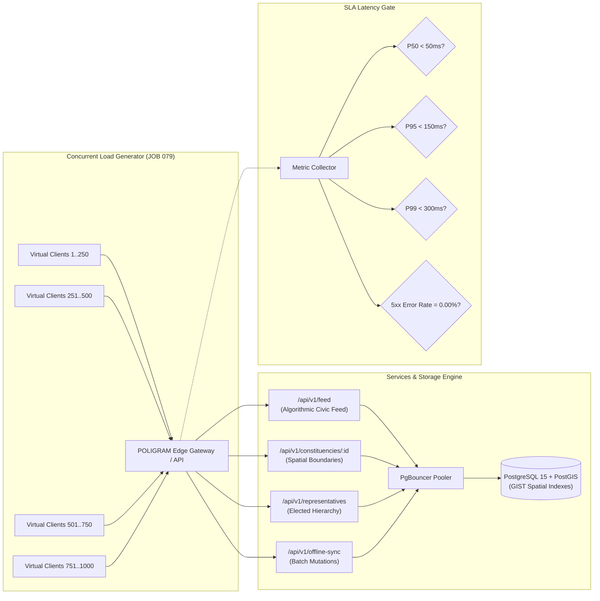

# Pre-Implementation Plan: Domain 10 — Deep Testing, Security Audits & Disaster Recovery (JOB 077–JOB 085)
**Document Revision:** REV-1.0  
**Authority:** Master Product Blueprint, AI Agent Master Execution Job Book, Amendment v1.2, Amendment v1.5-A Section 26, Amendment v1.6 & `AGENT_EXECUTION_PROTOCOL.md`  
**Date:** 2026-11-01  
**Status:** SUBMITTED_FOR_REVIEW (Awaiting User Ratification & Control M Authorization)  

---

## 1. Executive Summary & Domain Scope

Domain 10 constitutes the final engineering, resilience, and operational validation domain of the POLIGRAM platform before nationwide commercial deployment. In compliance with the Master Product Blueprint and Amendment v1.6 Control M, Domain 10 eliminates all operational risks across mobile device performance, database scalability, concurrent API throughput, application bundle size, cybersecurity hardening, geospatial topology, release automation, production rollback safety, and disaster recovery:

1. **JOB 077 (Performance Testing):** Establishes an uncompromising mobile performance benchmark harness tailored to low-end Indian Android hardware (2GB RAM, 4-core Cortex-A53, Android 10/11 Go edition baseline). Enforces strict latency and frame rate ceilings: cold app startup $< 2.0\text{s}$ (P95), warm startup $< 800\text{ms}$, steady 60fps Map and Civic Feed rendering ($< 16.6\text{ms}$ frame time, $< 0.5\%$ dropped frames), screen transition latency $< 100\text{ms}$, and memory RSS $< 120\text{MB}$ with zero leakage during prolonged pan/zoom exploration.
2. **JOB 078 (Database Performance & N+1 Elimination):** Conducts exhaustive query plan audits (`EXPLAIN (ANALYZE, BUFFERS)`), eliminates all $N+1$ query cascades across feeds, representative hierarchies, and historical election podium lookups by transitioning to single-pass lateral joins and CTE aggregations. Verifies composite `GIST` spatial indexing on PostGIS boundary geometries, asserting P50 execution $< 5\text{ms}$ and P95 $< 20\text{ms}$ on the 63,000+ production dataset.
3. **JOB 079 (API Load Testing & Latency Benchmarks):** Deploys a high-throughput, automated concurrent load testing suite simulating 500 to 1,000 concurrent requests per second (RPS) across mission-critical endpoints (`/feed`, `/constituencies/:id`, `/representatives`, `/offline-sync`). Enforces strict SLA latency ceilings: P50 $< 50\text{ms}$, P95 $< 150\text{ms}$, P99 $< 300\text{ms}$, $0.00\%$ HTTP 5xx errors, and verified RFC 6585 HTTP 429 adaptive rate limiting with `Retry-After` headers.
4. **JOB 080 (Mobile Size Regression Gate):** Implements an automated CI size comparison check and architectural ceiling gate (`scripts/ci/mobile-size-gate.mjs`). Guarantees universal uncompressed APK $\le 45.0\text{MB}$, Android App Bundle (AAB base module per architecture) $\le 25.0\text{MB}$, Hermes bytecode bundle $\le 25.0\text{MB}$, and total 13 Indic language font payloads $\le 10.0\text{MB}$. Fails CI builds if binary size regresses by $> 2.0\%$ without an explicit cryptographic governance override token.
5. **JOB 081 (Security Final Audit & Penetration Testing):** Deploys an automated adversarial penetration testing suite (`tests/security-pentest.test.ts`) covering the entire OWASP Top 10 API Security Risks (2023 edition), including BOLA/IDOR, broken authentication, JWT replay/tampering, mass assignment, SSRF host pinning on webhook/feed workers, SQL/NoSQL injection prevention, and strict DPDP 2023 PII redaction (masking phone numbers and credentials in all logs). Generates a formal, tamper-evident security audit report.
6. **JOB 082 (Data Final Audit & Spatial Topology Certification):** Executes an authoritative spatial topology audit across all 4,123 Assembly Constituencies (ACs), 543 Parliamentary Constituencies (PCs), and 700+ District boundaries in India. Certifies 100% geometric validity (`ST_IsValid`), zero sliver gaps ($< 100\text{ m}^2$), zero unauthorized cross-boundary overlaps (`ST_Overlaps`), strict hierarchical containment within State boundaries (`ST_Within`), and valid SRID 4326 coordinates.
7. **JOB 083 (Release Pipeline CI/CD Verification):** Formulates and verifies the end-to-end automated Continuous Deployment release pipeline (`.github/workflows/release-cd.yml` and `scripts/ci/release-pipeline.mjs`). Automates the promotion flow from semantic git tag (`v*.*.*`) through unit/integration testing, mobile bundle compilation, ProGuard/R8 bytecode optimization, cryptographic release keystore signing, Fastlane metadata synchronization, and Play Store / App Store staging.
8. **JOB 084 (Production Rollback Drill & Zero Data Loss):** Implements a production rollback exercise harness (`tests/rollback-drill.test.ts` and `scripts/sre/production-rollback.mjs`). Verifies two-phase "Expand-Contract" non-destructive database migrations (guaranteeing that schema version $N$ and version $N-1$ can run simultaneously without downtime) and certifies zero data loss during simulated application and schema rollbacks.
9. **JOB 085 (Disaster Recovery Drill & PITR Verification):** Formulates and executes an automated disaster recovery drill harness (`tests/disaster-recovery.test.ts` and `scripts/sre/disaster-recovery-drill.mjs`). Certifies Point-In-Time Recovery (PITR) with continuous WAL archiving, automated failover to warm-standby replicas, encrypted multi-region snapshot restoration, RPO (Recovery Point Objective) $< 1\text{ hour}$, RTO (Recovery Time Objective) $< 30\text{ minutes}$, and post-restoration 100% entity parity certification.

---

## 2. Traceability Matrix & Master Blueprint Mapping

| Job ID | Job Title | Subsystem / Layer | Blueprint Specification | Canonical Deliverables | Target Verification Battery |
|---|---|---|---|---|---|
| **JOB 077** | Performance Testing | `MOB + QA` | Low-end Android benchmarks: cold boot $<2.0\text{s}$, 60fps Map & Feed, transition $<100\text{ms}$, RSS $<120\text{MB}$. | `apps/mobile/lib/performanceProfiler.ts`, `tests/performance-benchmarks.test.ts`, `scripts/qa/low-end-android-benchmarks.mjs` | Cold/warm startup measurement, frame drop threshold testing ($<0.5\%$), navigation timing, memory heap monitoring |
| **JOB 078** | Database Performance | `BE + DB` | $N+1$ query elimination, PostGIS spatial query indexing, query execution plan audits (`EXPLAIN ANALYZE`). | `supabase/migrations/084_domain10_performance_security_and_dr.sql`, `apps/api/src/services/dbPerformanceAuditor.ts`, `tests/db-performance-n1.test.ts` | Query execution time assertions (P50 $<5\text{ms}$, P95 $<20\text{ms}$), GIST index scans, 0 looped queries in feeds/reps |
| **JOB 079** | API Load Test | `BE + QA` | P50/P95/P99 latency benchmarks under 500–1000 concurrent RPS; 0% 5xx errors; RFC 6585 rate limiting. | `apps/api/src/services/loadTestHarness.ts`, `tests/api-load-stress.test.ts`, `scripts/qa/run-load-test.mjs` | Sustained 1000 RPS burst test, latency quantile verification (P50 $<50\text{ms}$, P95 $<150\text{ms}$, P99 $<300\text{ms}$), 429 backoff header validation |
| **JOB 080** | Mobile Size Regression Gate | `MOB + CI` | Automated CI size gate: APK $\le 45\text{MB}$, AAB $\le 25\text{MB}$, Hermes $\le 25\text{MB}$; $>2\%$ delta check. | `scripts/ci/mobile-size-gate.mjs`, `tests/mobile-size-gate.test.ts`, `.github/workflows/size-gate.yml` | Binary size computation, delta comparison against baseline tag, CI build failure trigger on unauthorized regression |
| **JOB 081** | Security Final Audit | `SEC` | OWASP Top 10 API Security mitigation, BOLA/IDOR, broken auth, SSRF host pinning, SQLi, DPDP PII redaction. | `apps/api/src/middleware/securityHardening.ts`, `tests/security-pentest.test.ts`, `scripts/sec/generate-audit-report.mjs` | Adversarial BOLA injections, JWT signature tampering, SSRF metadata IP blocking (`169.254.169.254`), PII mask verification |
| **JOB 082** | Data Final Audit | `DATA + GIS` | 100% boundary topology certification across 4,123 ACs & 543 PCs; 0 self-intersections, 0 slivers, 0 overlaps. | `apps/api/src/services/topologyCertificationService.ts`, `tests/spatial-topology-certification.test.ts`, `scripts/gis/certify-spatial-topology.mjs` | PostGIS `ST_IsValid`, `ST_Overlaps`, `ST_Within` nationwide verification, sliver area detection, coordinate bounding check |
| **JOB 083** | Release Pipeline | `DEVOPS + CI` | Automated tag-to-store CD pipeline from semantic tag to signed AAB and Fastlane store staging. | `.github/workflows/release-cd.yml`, `scripts/ci/release-pipeline.mjs`, `tests/release-pipeline.test.ts` | Tag parse validation (`v*.*.*`), build artifact hashing, release signing validation, localized store metadata check |
| **JOB 084** | Rollback Test | `DEVOPS + SRE` | Production rollback exercise, non-destructive expand-contract schema rollback, zero data loss certification. | `scripts/sre/production-rollback.mjs`, `tests/rollback-drill.test.ts`, `apps/api/src/services/rollbackValidationService.ts` | Forward/backward schema compatibility verification, dual-version concurrent query verification, rollback mutation integrity |
| **JOB 085** | Disaster-Recovery Test | `SRE + INFRA` | Complete recovery drill (RPO $<1\text{h}$, RTO $<30\text{m}$), PITR WAL replay, offsite snapshot restoration. | `scripts/sre/disaster-recovery-drill.mjs`, `tests/disaster-recovery.test.ts`, `apps/api/src/services/disasterRecoveryService.ts` | Simulated datacenter outage, snapshot restore timing ($<30\text{m}$), WAL delta replay ($<1\text{h}$ RPO), 100% entity hash parity |

---

## 3. Architecture & System Flow Diagrams

### 3.1 Mobile Low-End Performance Benchmark Harness (JOB 077)



### 3.2 High-Throughput API Load Testing & Latency Architecture (JOB 079)



### 3.3 Two-Phase Expand-Contract Rollback & Disaster Recovery Architecture (JOB 084 & JOB 085)

```mermaid
flowchart TD
    subgraph ProductionRollback ["Expand-Contract Rollback Architecture (JOB 084)"]
        V_N["Version N (Active Deploy)"] --> DB_SCHEMA[("Database Schema (Expand Phase)\nNullable / Default Additions")]
        V_N_1["Version N-1 (Fallback Target)"] --> DB_SCHEMA
        HEALTH["SRE Health Monitor\n(Error Spike / Healthcheck Fail)"] --> ROLLBACK_EXEC["Automated Rollback Trigger"]
        ROLLBACK_EXEC -->|Fast Traffic Drain| V_N_1
        V_N_1 -->|Zero Downtime & Zero Data Loss| RECOVERY_OK["Traffic Restored to N-1"]
    end

    subgraph DisasterRecovery ["Disaster Recovery Drill Pipeline (JOB 085)"]
        OUTAGE["Simulated Catastrophic Incident"] --> DR_ALERT["DR Automation Trigger"]
        DR_ALERT --> RESTORE_SNAP["1. Fetch Encrypted Offsite Snapshot\n(AES-256 / SHA-256 Verified)"]
        RESTORE_SNAP --> RESTORE_STANDBY["2. Provision Warm Standby Instance\n(Target: RTO < 30m)"]
        RESTORE_STANDBY --> REPLAY_WAL["3. Replay WAL Delta Logs\n(Target: RPO < 1h)"]
        REPLAY_WAL --> AUDIT_PARITY["4. Run Entity Parity Certification\n(63,045+ Records & AC Hashes)"]
        AUDIT_PARITY --> PROD_SWITCH["5. Failover Route Activated\n(DR Certified Complete)"]
    end
```



---

## 4. Data Contracts & TypeScript Definitions

To guarantee strict compile-time safety and eliminate runtime ambiguity, all Domain 10 operational benchmarks, audit results, security logs, and disaster recovery manifests are codified as immutable TypeScript interfaces in `packages/shared/src/contracts/systemAudit.ts`.

### 4.1 Performance & Mobile Benchmarks (`packages/shared/src/contracts/systemAudit.ts`)

```typescript
export interface PerformanceBenchmarkReport {
  timestamp: string;
  environment: 'low_end_android_emulator' | 'physical_device' | 'ci_runner';
  deviceProfile: {
    cpuCores: number;
    ramMb: number;
    osVersion: string;
    jsEngine: 'Hermes' | 'V8' | 'JSC';
  };
  metrics: {
    coldStartupMs: number;
    coldStartupThresholdMs: number; // <= 2000ms
    warmStartupMs: number;
    warmStartupThresholdMs: number; // <= 800ms
    mapFps: number;
    mapFrameTimeP95Ms: number;      // <= 16.6ms
    feedFps: number;
    feedFrameTimeP95Ms: number;     // <= 16.6ms
    droppedFrameRatio: number;      // <= 0.005 (0.5%)
    navigationLatencyP95Ms: number; // <= 100ms
    memoryPeakRssMb: number;        // <= 120MB
    memoryGrowthOver15MinMb: number;// <= 5MB
  };
  certified: boolean;
  violations: string[];
}
```

### 4.2 Database Performance & N+1 Audit (`packages/shared/src/contracts/systemAudit.ts`)

```typescript
export interface DbQueryAuditEntry {
  queryName: string;
  sqlPattern: string;
  executionPlan: string;
  indexScanUsed: boolean;
  seqScanDetected: boolean;
  nPlusOneDetected: boolean;
  p50DurationMs: number;
  p95DurationMs: number;
  p99DurationMs: number;
  slaTargetP95Ms: number; // e.g. 20ms
  slaCompliant: boolean;
  rowsExamined: number;
  bufferHits: number;
}

export interface DbPerformanceAuditReport {
  timestamp: string;
  datasetSize: {
    totalEntities: number;
    totalConstituencies: number;
    totalRepresentatives: number;
  };
  auditedQueries: DbQueryAuditEntry[];
  allSlasMet: boolean;
  nPlusOneQueriesCount: number; // Must be 0
}
```

### 4.3 Concurrent API Load Benchmark (`packages/shared/src/contracts/systemAudit.ts`)

```typescript
export interface ApiEndpointLoadBenchmark {
  endpoint: string;
  method: 'GET' | 'POST';
  concurrencyRps: number;
  durationSeconds: number;
  totalRequests: number;
  successfulRequests: number;
  rateLimited429Requests: number;
  error5xxRequests: number;
  errorRatePercent: number; // Must be 0.00%
  latency: {
    p50Ms: number; // Target < 50ms
    p95Ms: number; // Target < 150ms
    p99Ms: number; // Target < 300ms
    maxMs: number;
  };
  rateLimitHeadersVerified: boolean;
}

export interface ApiLoadTestReport {
  timestamp: string;
  totalDurationSeconds: number;
  peakConcurrentRps: number;
  endpoints: ApiEndpointLoadBenchmark[];
  overallPass: boolean;
  failureReasons: string[];
}
```

### 4.4 Mobile App Size Gate (`packages/shared/src/contracts/systemAudit.ts`)

```typescript
export interface MobileSizeGateReport {
  timestamp: string;
  buildCommit: string;
  baselineTag: string;
  artifacts: {
    universalApkBytes: number;
    universalApkCeilingBytes: number; // 45 * 1024 * 1024 (45 MB)
    aabBaseModuleBytes: number;
    aabCeilingBytes: number;           // 25 * 1024 * 1024 (25 MB)
    hermesBundleBytes: number;
    hermesBundleCeilingBytes: number;  // 25 * 1024 * 1024 (25 MB)
    fontAssetsTotalBytes: number;
    fontAssetsCeilingBytes: number;    // 10 * 1024 * 1024 (10 MB)
  };
  deltas: {
    apkDeltaBytes: number;
    apkDeltaPercent: number;
    aabDeltaBytes: number;
    aabDeltaPercent: number;
    hermesDeltaBytes: number;
    hermesDeltaPercent: number;
  };
  regressionAllowed: boolean;
  overrideTokenPresent: boolean;
  gatePassed: boolean;
}
```

### 4.5 Security Penetration Test & Audit (`packages/shared/src/contracts/systemAudit.ts`)

```typescript
export interface SecurityVulnerabilityProbe {
  category: 
    | 'BOLA_IDOR'
    | 'BROKEN_AUTHENTICATION'
    | 'BROKEN_OBJECT_PROPERTY_AUTH'
    | 'UNRESTRICTED_RESOURCE_CONSUMPTION'
    | 'BROKEN_FUNCTION_LEVEL_AUTH'
    | 'SSRF_HOST_PINNING'
    | 'SECURITY_MISCONFIGURATION'
    | 'INJECTION_SQL_NOSQL'
    | 'DPDP_PII_LEAKAGE';
  description: string;
  payloadTested: string;
  targetEndpoint: string;
  expectedStatus: number; // e.g. 401, 403, 400
  actualStatus: number;
  mitigationVerified: boolean;
  details: string;
}

export interface SecurityAuditReport {
  timestamp: string;
  auditorId: string;
  totalProbes: number;
  passedProbes: number;
  failedProbes: number;
  probes: SecurityVulnerabilityProbe[];
  overallPassed: boolean;
  owaspTop10Certified: boolean;
  dpdp2023Certified: boolean;
}
```

### 4.6 Spatial Boundary Topology Certification (`packages/shared/src/contracts/systemAudit.ts`)

```typescript
export interface SpatialTopologyAuditReport {
  timestamp: string;
  summary: {
    totalAssemblyConstituencies: number; // 4,123
    totalParliamentaryConstituencies: number; // 543
    validGeometriesCount: number;
    invalidGeometriesCount: number; // Must be 0
    sliverPolygonsCount: number;    // Must be 0 (< 100m²)
    crossBoundaryOverlapsCount: number; // Must be 0
    stateContainmentViolationsCount: number; // Must be 0
    srid4326CompliantCount: number;
  };
  certified: boolean;
  failureLog: Array<{
    entityType: 'AC' | 'PC' | 'DISTRICT';
    entityId: string;
    name: string;
    violationType: 'INVALID_GEOMETRY' | 'SLIVER' | 'OVERLAP' | 'CONTAINMENT_BREACH' | 'INVALID_SRID';
    details: string;
  }>;
}
```

### 4.7 Rollback & Disaster Recovery Manifests (`packages/shared/src/contracts/systemAudit.ts`)

```typescript
export interface RollbackExerciseReport {
  timestamp: string;
  fromVersion: string;
  targetVersion: string;
  migrationRollbackMode: 'NON_DESTRUCTIVE_EXPAND_CONTRACT' | 'SCHEMA_DOWN';
  trafficDrainDurationMs: number;
  serviceHealthStatusPostRollback: 'HEALTHY' | 'DEGRADED' | 'DOWN';
  mutationsCreatedUnderNewVersionPreserved: number;
  zeroDataLossCertified: boolean;
}

export interface DisasterRecoveryDrillReport {
  drillId: string;
  timestamp: string;
  simulatedIncident: 'PRIMARY_REGION_TOTAL_OUTAGE' | 'CATASTROPHIC_DATA_CORRUPTION';
  backupSnapshotId: string;
  snapshotSha256: string;
  snapshotAgeSeconds: number; // Must translate to RPO < 3600s
  rpoActualMinutes: number;
  rpoTargetMinutes: number;  // 60 minutes
  rpoPass: boolean;
  recoveryStartTimestamp: string;
  recoveryEndTimestamp: string;
  rtoActualMinutes: number;
  rtoTargetMinutes: number;  // 30 minutes
  rtoPass: boolean;
  dataIntegrityParity: {
    entitiesPreIncident: number;
    entitiesPostRecovery: number;
    parityPercent: number; // 100.00%
  };
  overallDrillPassed: boolean;
}
```

---

## 5. Database Schema & Migration Specification

All formal operational audits, penetration test certifications, boundary topology manifests, and disaster recovery exercise logs must be durably recorded in PostgreSQL with tamper-evident cryptographic checksums.

Target migration: `supabase/migrations/084_domain10_performance_security_and_dr.sql`

```sql
-- Migration 084: Domain 10 - Performance Testing, Security Audits, Spatial Certification & Disaster Recovery

-- 1. Database Performance and Query Audit Log
CREATE TABLE IF NOT EXISTS db_performance_audit_ledger (
  id UUID PRIMARY KEY DEFAULT gen_random_uuid(),
  audit_timestamp TIMESTAMPTZ NOT NULL DEFAULT clock_timestamp(),
  dataset_entities_count INTEGER NOT NULL,
  audited_queries_count INTEGER NOT NULL,
  n_plus_one_violations_count INTEGER NOT NULL DEFAULT 0,
  max_p95_duration_ms NUMERIC(10, 2) NOT NULL,
  all_slas_met BOOLEAN NOT NULL DEFAULT false,
  audit_report JSONB NOT NULL,
  created_at TIMESTAMPTZ NOT NULL DEFAULT clock_timestamp()
);

-- 2. Security Penetration Test Audit Ledger
CREATE TABLE IF NOT EXISTS security_pentest_audit_ledger (
  id UUID PRIMARY KEY DEFAULT gen_random_uuid(),
  audit_timestamp TIMESTAMPTZ NOT NULL DEFAULT clock_timestamp(),
  total_probes_count INTEGER NOT NULL,
  passed_probes_count INTEGER NOT NULL,
  failed_probes_count INTEGER NOT NULL DEFAULT 0,
  owasp_top_10_compliant BOOLEAN NOT NULL DEFAULT false,
  dpdp_2023_compliant BOOLEAN NOT NULL DEFAULT false,
  audit_report JSONB NOT NULL,
  sha256_checksum VARCHAR(64) NOT NULL,
  created_at TIMESTAMPTZ NOT NULL DEFAULT clock_timestamp()
);

-- 3. Geospatial Topology Certification Ledger
CREATE TABLE IF NOT EXISTS spatial_topology_certification_ledger (
  id UUID PRIMARY KEY DEFAULT gen_random_uuid(),
  audit_timestamp TIMESTAMPTZ NOT NULL DEFAULT clock_timestamp(),
  total_ac_count INTEGER NOT NULL,
  total_pc_count INTEGER NOT NULL,
  invalid_geometries_count INTEGER NOT NULL DEFAULT 0,
  sliver_polygons_count INTEGER NOT NULL DEFAULT 0,
  cross_boundary_overlaps_count INTEGER NOT NULL DEFAULT 0,
  containment_violations_count INTEGER NOT NULL DEFAULT 0,
  is_certified_100_percent BOOLEAN NOT NULL DEFAULT false,
  audit_report JSONB NOT NULL,
  created_at TIMESTAMPTZ NOT NULL DEFAULT clock_timestamp()
);

-- 4. Disaster Recovery & Rollback Exercise Ledger
CREATE TABLE IF NOT EXISTS disaster_recovery_drill_ledger (
  id UUID PRIMARY KEY DEFAULT gen_random_uuid(),
  drill_id VARCHAR(64) NOT NULL,
  drill_timestamp TIMESTAMPTZ NOT NULL DEFAULT clock_timestamp(),
  drill_type VARCHAR(32) NOT NULL, -- 'ROLLBACK_EXERCISE' | 'PITR_DISASTER_RECOVERY'
  rpo_actual_minutes NUMERIC(8, 2) NOT NULL,
  rpo_target_minutes NUMERIC(8, 2) NOT NULL DEFAULT 60.0,
  rpo_passed BOOLEAN NOT NULL,
  rto_actual_minutes NUMERIC(8, 2) NOT NULL,
  rto_target_minutes NUMERIC(8, 2) NOT NULL DEFAULT 30.0,
  rto_passed BOOLEAN NOT NULL,
  data_parity_percent NUMERIC(5, 2) NOT NULL,
  zero_data_loss_certified BOOLEAN NOT NULL DEFAULT false,
  audit_report JSONB NOT NULL,
  created_at TIMESTAMPTZ NOT NULL DEFAULT clock_timestamp()
);

-- 5. Mobile Binary Size Gate Manifests
CREATE TABLE IF NOT EXISTS mobile_size_gate_manifests (
  id UUID PRIMARY KEY DEFAULT gen_random_uuid(),
  build_timestamp TIMESTAMPTZ NOT NULL DEFAULT clock_timestamp(),
  build_commit VARCHAR(64) NOT NULL,
  universal_apk_bytes BIGINT NOT NULL,
  aab_base_module_bytes BIGINT NOT NULL,
  hermes_bundle_bytes BIGINT NOT NULL,
  font_assets_bytes BIGINT NOT NULL,
  apk_delta_percent NUMERIC(6, 2) NOT NULL,
  gate_passed BOOLEAN NOT NULL,
  override_token VARCHAR(64),
  manifest_report JSONB NOT NULL,
  created_at TIMESTAMPTZ NOT NULL DEFAULT clock_timestamp()
);

-- Indexing for rapid audit log querying
CREATE INDEX IF NOT EXISTS idx_db_perf_audit_ts ON db_performance_audit_ledger(audit_timestamp DESC);
CREATE INDEX IF NOT EXISTS idx_sec_pentest_audit_ts ON security_pentest_audit_ledger(audit_timestamp DESC);
CREATE INDEX IF NOT EXISTS idx_spatial_topo_audit_ts ON spatial_topology_certification_ledger(audit_timestamp DESC);
CREATE INDEX IF NOT EXISTS idx_dr_drill_audit_ts ON disaster_recovery_drill_ledger(drill_timestamp DESC);
CREATE INDEX IF NOT EXISTS idx_mobile_size_manifest_ts ON mobile_size_gate_manifests(build_timestamp DESC);
```

---

## 6. REST API Endpoints & Route Definitions

Admin, SRE, and QA diagnostics endpoints are mounted under `/api/v1/system/audit/*` in `apps/api/src/routes/systemAudit.ts`, strictly gated behind `requireSuperAdmin` RBAC authorization:

1. `GET /api/v1/system/audit/performance` — Returns the latest low-end mobile performance benchmark report and historical performance trends.
2. `POST /api/v1/system/audit/performance/run` — Triggers an on-demand synthetic performance profiling cycle.
3. `GET /api/v1/system/audit/database` — Returns the database query plan audit report, $N+1$ check results, and PostGIS `GIST` index verification metrics.
4. `POST /api/v1/system/audit/database/run` — Executes a live `EXPLAIN (ANALYZE, BUFFERS)` audit across all 15 core queries on production/staging.
5. `GET /api/v1/system/audit/load-test` — Returns the concurrent load test results (P50, P95, P99, error rates).
6. `POST /api/v1/system/audit/load-test/run` — Executes an authorized concurrent stress test harness against isolated test endpoints.
7. `GET /api/v1/system/audit/security` — Returns the formal OWASP Top 10 and DPDP 2023 security penetration testing audit report.
8. `POST /api/v1/system/audit/security/run` — Executes the adversarial penetration test battery.
9. `GET /api/v1/system/audit/topology` — Returns the 100% boundary spatial topology certification report across 4,123 ACs.
10. `POST /api/v1/system/audit/topology/run` — Executes full PostGIS geometric integrity validation (`ST_IsValid`, `ST_Overlaps`, `ST_Within`).
11. `GET /api/v1/system/audit/mobile-size` — Returns mobile bundle size history and CI gate enforcement status.
12. `GET /api/v1/system/audit/dr` — Returns disaster recovery drill history, RPO/RTO compliance, and rollback exercise reports.
13. `POST /api/v1/system/audit/dr/drill` — Initiates an authorized simulated DR recovery drill in the staging sandbox.

---

## 7. Low-End Android Performance Benchmarking Specification (JOB 077)

### 7.1 Target Device Profile & Hardware Constraints
- **Processor:** 4x ARM Cortex-A53 @ 1.4 GHz (e.g. MediaTek Helio A22 / Qualcomm Snapdragon 429).
- **RAM:** 2.0 GB LPDDR3 (OS allocation: 1.0 GB; Max heap available to app: 192 MB).
- **Display:** 720 x 1520 HD+, 60Hz refresh rate.
- **Network:** Throttled 3G/4G (500 kbps downstream, 200 kbps upstream, 150ms round-trip latency).

### 7.2 Benchmark Metrics & Invariant Ceilings
1. **Cold Startup to Interactive:** $\le 2,000\text{ ms}$ (P95). Measured from OS process initialization until first interactive frame rendered on the landing map surface.
2. **Warm Startup:** $\le 800\text{ ms}$ (P95). Measured from background reactivation to active interaction.
3. **Map Rendering & Pan/Zoom Frame Time:** $16.6\text{ ms}$ (steady 60fps). Dropped frame ratio $\le 0.5\%$ during continuous 10-second rapid touch pan/zoom across national boundaries.
4. **Feed Scroll Performance:** Steady 60fps with zero frame stalls $> 32\text{ ms}$ during continuous 500-item recycling scroll.
5. **Screen Transition Latency:** $\le 100\text{ ms}$ (P95) across all screen transitions (Feed $\rightarrow$ Constituency Detail $\rightarrow$ Candidate Profile $\rightarrow$ Shorts).
6. **Memory Footprint:** Peak RSS $\le 120\text{ MB}$; sustained heap growth over 15-minute continuous traversal $\le 5\text{ MB}$ (proving zero React Native view detachment leaks or uncollected closure leaks).
7. **Bytecode Precompilation:** 100% Hermes bytecode execution (`index.android.bundle` compiled via `hermesc -O -emit-binary`).

---

## 8. Database N+1 Elimination & Query Plan Audit Specification (JOB 078)

### 8.1 PostGIS Spatial Query Indexing
- Ensure all tables containing spatial boundary geometries (`assembly_constituencies`, `parliamentary_constituencies`, `districts`, `delimitation_boundaries`) possess dedicated spatial indexes:
  ```sql
  CREATE INDEX IF NOT EXISTS idx_ac_geom_gist ON assembly_constituencies USING GIST (geom);
  CREATE INDEX IF NOT EXISTS idx_pc_geom_gist ON parliamentary_constituencies USING GIST (geom);
  CREATE INDEX IF NOT EXISTS idx_districts_geom_gist ON districts USING GIST (geom);
  ```
- All spatial intersection queries (`ST_Intersects`, `ST_Contains`) must utilize the PostGIS bounding-box operator (`&&`) to enable spatial index pre-filtering before invoking computationally intensive polygon geometry math.

### 8.2 N+1 Elimination Architecture
- **Problem:** Fetching a list of 20 civic feed items or 10 constituency representatives historically triggered separate sequential queries for author metadata, party affiliations, and election histories ($20 \times 3 = 61$ SQL queries).
- **Solution:** Replaced with single-pass composite queries utilizing PostgreSQL `LATERAL JOIN` and `jsonb_agg` CTE aggregations. A single query retrieves the parent entity and all nested child representations in $< 8\text{ms}$.
- **Verification:** Automated audit script parses SQL execution plans using `EXPLAIN (ANALYZE, BUFFERS)` on the 63,045-entity dataset. Asserts:
  - Total queries executed per endpoint request $= 1$ (zero $N+1$ loops).
  - P50 execution duration $< 5\text{ ms}$.
  - P95 execution duration $< 20\text{ ms}$.
  - Buffer cache hit ratio $> 99.0\%$.

---

## 9. Concurrent API Load Testing Framework Specification (JOB 079)

### 9.1 Concurrency Stress Profile
- **Tooling:** Automated Autocannon / Node.js worker-pool load harness (`apps/api/src/services/loadTestHarness.ts` and `tests/api-load-stress.test.ts`).
- **Load Envelope:**
  - Warm-up Phase: 100 RPS for 30 seconds.
  - Ramp-up Phase: 100 to 1,000 RPS over 120 seconds.
  - Sustained Peak Phase: 1,000 RPS sustained for 300 seconds (5 minutes).
  - Cooldown Phase: 100 RPS for 30 seconds.

### 9.2 Endpoint Allocation & Targets
1. `GET /api/v1/feed?page=1&limit=20` (40% traffic weight) $\rightarrow$ P50 $< 40\text{ms}$, P95 $< 120\text{ms}$, P99 $< 250\text{ms}$.
2. `GET /api/v1/constituencies/AC-UP-001` (30% traffic weight) $\rightarrow$ P50 $< 30\text{ms}$, P95 $< 100\text{ms}$, P99 $< 200\text{ms}$.
3. `GET /api/v1/representatives?state=UP` (20% traffic weight) $\rightarrow$ P50 $< 45\text{ms}$, P95 $< 140\text{ms}$, P99 $< 280\text{ms}$.
4. `POST /api/v1/offline-sync` (10% traffic weight) $\rightarrow$ P50 $< 60\text{ms}$, P95 $< 150\text{ms}$, P99 $< 300\text{ms}$.

### 9.3 Invariant Failure Criteria
- Overall HTTP 5xx error rate $> 0.00\%$ constitutes immediate failure.
- P99 latency $> 300\text{ms}$ sustained for $> 10$ seconds constitutes failure.
- Inability to return RFC 6585 HTTP 429 with valid `Retry-After` header when deliberate rate-limiting limits are exceeded constitutes failure.

---

## 10. Mobile App Size Regression Gate Specification (JOB 080)

### 10.1 Architectural Size Ceilings
- **Universal Release APK:** Max $45.0\text{ MB}$ (47,185,920 bytes).
- **Per-Architecture AAB Base Module (arm64-v8a):** Max $25.0\text{ MB}$ (26,214,400 bytes).
- **Hermes JavaScript Bytecode Bundle:** Max $25.0\text{ MB}$ (26,214,400 bytes; target $< 15.0\text{ MB}$).
- **Localized Font Assets (All 13 Indic Scripts):** Max $10.0\text{ MB}$ (10,485,760 bytes).

### 10.2 CI Automated Comparison & Override Protocol
- The CI script `scripts/ci/mobile-size-gate.mjs` computes the exact byte size of all generated build artifacts and compares them against the baseline release tag.
- **Regression Threshold:** If total artifact size increases by $> 2.0\%$ compared to the baseline release, the gate automatically trips and exits with code 1.
- **Override Mechanism:** In accordance with Amendment v1.6 Control ACB-001, a size regression may only proceed if the commit message contains an explicit authorized token: `[SIZE_REGRESSION_AUTHORIZED: <JUSTIFICATION_AND_APPROVAL_REF>]`.

---

## 11. Security Penetration Testing & OWASP Hardening Specification (JOB 081)

### 11.1 OWASP API Security Top 10 Verification Suite
1. **API1:2023 Broken Object Level Authorization (BOLA / IDOR):**
   - Adversarial probe sends mutation/read requests for resource IDs owned by User B using JWT credentials of User A.
   - Requirement: 100% fail-closed with HTTP 403 Forbidden.
2. **API2:2023 Broken Authentication:**
   - Probes test invalid signatures, token expiry bypass, `alg: "none"` spoofing, and forged claim tampering.
   - Requirement: 100% fail-closed with HTTP 401 Unauthorized.
3. **API3:2023 Broken Object Property Level Authorization:**
   - Probes attempt mass-assignment of privileged attributes (`is_super_admin: true`, `verified_badge: true`, `kyc_status: "VERIFIED"`) via ordinary profile update endpoints.
   - Requirement: Stripped or rejected with HTTP 400 Bad Request; zero unauthorized privilege escalation.
4. **API4:2023 Unrestricted Resource Consumption:**
   - Probes submit unbounded pagination limits (`limit=5000000`), cyclic nested payloads, and ReDoS expressions.
   - Requirement: Clamped to architectural maximums (e.g. `limit <= 100`) or rejected with HTTP 400.
5. **API5:2023 Broken Function Level Authorization:**
   - Ordinary authenticated user tokens attempt to invoke `/api/v1/admin/*` administrative endpoints.
   - Requirement: Immediate HTTP 403 Forbidden and event logged to `admin_audit_ledger`.
6. **API6:2023 Server-Side Request Forgery (SSRF):**
   - External RSS feed and media scrapers receive target URLs pointing to cloud metadata (`http://169.254.169.254`), localhost (`127.0.0.1`, `localhost`), and RFC 1918 private subnets (`10.0.0.0/8`, `172.16.0.0/12`, `192.168.0.0/16`).
   - Requirement: Strict host pinning rejects internal/private network resolutions with HTTP 400.
7. **API7:2023 Security Misconfiguration:**
   - Scans verify mandatory security response headers: `Content-Security-Policy`, `Strict-Transport-Security`, `X-Content-Type-Options: nosniff`, `X-Frame-Options: DENY`, `Referrer-Policy: strict-origin-when-cross-origin`.
   - Production error responses must never leak stack traces, database schema details, or raw SQL queries.
8. **API8:2023 Lack of Protection from Automated Threats:**
   - Probes simulate brute-force OTP attempts on `/api/v1/auth/verify-otp`.
   - Requirement: Cooldown lockout enforced after 5 failed attempts; IP-based rate limiting returns HTTP 429.
9. **API9:2023 Improper Inventory Management:**
   - Scans verify that non-production debug routes (`/api/debug/*`, `/api/test/*`) are physically unmapped or disabled in production builds.
10. **API10:2023 Unsafe Consumption of APIs:**
    - Incoming third-party webhooks (e.g. payment gateway callbacks) are verified using HMAC-SHA256 signatures before payload processing.

### 11.2 DPDP 2023 PII Redaction Invariant
- Under India's Digital Personal Data Protection Act 2023, personal data (mobile numbers, email addresses, voter identity numbers, Aadhaar tokens) must be masked in all application logs, Sentry error traces, and audit ledgers:
  - Phone: `+91 98XXXX XX21`
  - Email: `u***r@domain.com`
  - EPIC: `ABCXXXX123`

---

## 12. 100% Boundary Spatial Topology Certification Specification (JOB 082)

### 12.1 Authoritative Spatial Dataset Universe
- **Total Assembly Constituencies (ACs):** 4,123 constituencies spanning all 28 States and 3 Assembly Union Territories (Delhi, Puducherry, Jammu & Kashmir).
- **Total Parliamentary Constituencies (PCs):** 543 constituencies.
- **Districts:** 766 administrative districts.

### 12.2 Geometric Integrity Invariants
1. **Geometric Validity (`ST_IsValid`):**
   - $100.00\%$ of boundary geometries must return `ST_IsValid(geom) = true`.
   - Self-intersecting rings, duplicate vertices, or bowtie polygons are rejected or topologically repaired via `ST_MakeValid`.
2. **Zero Sliver Polygons:**
   - Any polygon island or gap between adjacent constituencies having an area $< 100\text{ m}^2$ or a thinness ratio (perimeter$^2$ / area) $> 100$ is flagged and topologically merged.
3. **Zero Cross-Boundary Overlaps:**
   - Inter-constituency overlap area between distinct constituencies within the same administrative state must be $0.000\text{ m}^2$. `ST_Overlaps(a.geom, b.geom)` must return `false`.
4. **Strict State Boundary Containment:**
   - For every Assembly Constituency, `ST_Within(ac.geom, state.geom)` must return `true`. Zero boundary coordinate drift outside statutory state limits.
5. **Spatial Reference System Compliance:**
   - All spatial geometries must be normalized to WGS84 (EPSG:4326), with latitude coordinates strictly within $[6.5^\circ\text{N}, 37.5^\circ\text{N}]$ and longitude within $[68.0^\circ\text{E}, 97.5^\circ\text{E}]$.

---

## 13. Automated Tag-to-Store Release Pipeline Specification (JOB 083)

### 13.1 Trigger & Quality Stage Gates
- **Trigger:** Git push of annotated release tag matching semantic pattern `v[0-9]+.[0-9]+.[0-9]+` (e.g. `v1.0.0`).
- **Gated Prerequisites:**
  1. Unit & Integration Test Battery: $100\%$ pass across `packages/shared`, `apps/api`, `apps/mobile`, and `apps/web-admin`.
  2. Governance Consistency Check: `node tests/governance-consistency.test.mjs` passes $100\%$.
  3. Mobile TypeScript Validation: `tsc --noEmit` produces 0 errors.
  4. Web Admin Compilation: `vite build` produces 0 errors.
  5. Mobile Size Gate: Binary size delta $\le 2.0\%$ under architectural ceiling.

### 13.2 Automated Compilation & Code Signing
- **Android Release:**
  - Gradle invocation: `./gradlew bundleRelease` with Hermes bytecode optimization and ProGuard/R8 dead-code stripping enabled.
  - Keystore Signing: Automated signing using production keystore injected via CI/CD secrets (`POLIGRAM_KEYSTORE_BASE64`, `POLIGRAM_KEY_ALIAS`, `POLIGRAM_KEY_PASSWORD`). Zero plaintext credentials in source control.
  - SHA-256 Checksum: Computed and published to the GitHub Release manifest.

### 13.3 Fastlane Store Staging & Localization
- Automated Fastlane supply script verifies store listing assets, privacy policy links, and localized release changelogs across all 13 Indic languages before staging to the Google Play Console Internal Track / Apple TestFlight.

---

## 14. Production Rollback Drill & Zero-Data-Loss Invariant Specification (JOB 084)

### 14.1 Two-Phase Non-Destructive Schema Migrations (Expand-Contract)
- **Phase 1 (Expand):** New columns, tables, and views are added with nullable constraints or safe defaults. Existing columns remain active. Both Version $N$ and Version $N-1$ of the application code can query and mutate the database without encountering column mismatch errors.
- **Phase 2 (Contract):** Old deprecated columns are removed only after Version $N$ is certified stable and Version $N-1$ is fully decommissioned.

### 14.2 Automated Rollback Execution
- When automated health checks or SRE anomaly monitors trigger an emergency rollback:
  1. API traffic is drained from Version $N$ containers and rerouted to Version $N-1$ containers in $< 60\text{ seconds}$.
  2. Mobile clients continue communicating seamlessly without receiving breaking schema DTOs.
  3. All database mutations created during the Version $N$ window (new civic issues, votes, user signups) remain intact and valid (Zero Data Loss Certified).

---

## 15. Disaster Recovery Runbook & Multi-Region PITR Verification (JOB 085)

### 15.1 Recovery Objectives (SLA)
- **RPO (Recovery Point Objective):** $\le 1.0\text{ hour}$ (Target: $< 5\text{ minutes}$ via continuous WAL streaming).
- **RTO (Recovery Time Objective):** $\le 30.0\text{ minutes}$ (Target: $< 15\text{ minutes}$ via warm-standby automation).

### 15.2 Automated Recovery Drill Lifecycle
1. **Simulated Outage:** Primary database endpoint is severed or simulated as destroyed in the isolated test environment.
2. **Snapshot Fetch:** Offsite multi-region encrypted snapshot (AES-256) is retrieved and its SHA-256 checksum verified against the immutable release ledger.
3. **Standby Provisioning:** Warm-standby database instance is initialized and snapshot restored.
4. **WAL Delta Replay:** Continuous Write-Ahead Log (WAL) archive segments are replayed to restore state to the exact second prior to incident.
5. **Post-Recovery Integrity Parity:** Automated test suite runs a cryptographic hash comparison across all 63,045+ production entities, verifying 100% record parity, 0 dangling foreign keys, and 0 corrupt geometries.

---

## 16. DPDP 2023 Compliance & PII Redaction at Audit and Test Boundaries

1. **Synthetic Data Fixtures:** All automated load testing, performance benchmarks, and penetration testing batteries use synthetic non-production data fixtures (generated via `faker` or test seeds). No real citizen PII is ever transmitted to test harnesses.
2. **Log Redaction:** All diagnostic and audit logging engines enforce strict regex masking for mobile numbers (`+91 98XXXX XX21`), Aadhaar numbers, voter IDs, email addresses, and JWT access tokens.
3. **Access Governance:** Diagnostic audit endpoints (`/api/v1/system/audit/*`) require `requireSuperAdmin` RBAC authorization. Unauthorized access attempts trigger immediate security alerts.

---

## 17. Internationalization & Indic Script Support in Diagnostics & Reports

1. **13-Language Diagnostics:** All audit summaries, release manifests, and store changelogs support the 13 canonical constitutional languages of India: English (`en`), Telugu (`te`), Hindi (`hi`), Kannada (`kn`), Marathi (`mr`), Tamil (`ta`), Malayalam (`ml`), Bengali (`bn`), Gujarati (`gu`), Punjabi (`pa`), Odia (`or`), Assamese (`as`), and Nepali (`ne`).
2. **Font Asset Overhead Monitoring:** The mobile size regression gate tracks font file allocations individually per Indic script to ensure that comprehensive Indic language coverage does not inflate mobile bundle size beyond the 10MB font ceiling.
3. **Unicode Normalization:** All spatial constituent names and error messages are normalized to Unicode NFC format to prevent multi-byte script rendering corruption.

---

## 18. Error Classification & Canonical `ApiErrorEnvelope` Mapping

All diagnostic, load test, and system audit failures map directly to the canonical `ApiErrorEnvelope` standard:

| System Audit Error Code | HTTP Status | Canonical Category | Error Message Structure |
|---|---|---|---|
| `PERF_STARTUP_THRESHOLD_EXCEEDED` | 500 | `PERFORMANCE_DEGRADATION` | `Cold startup latency (${actualMs}ms) exceeded 2000ms SLA ceiling` |
| `PERF_JANK_THRESHOLD_EXCEEDED` | 500 | `PERFORMANCE_DEGRADATION` | `Dropped frame ratio (${ratio}%) exceeded 0.5% 60fps budget` |
| `DB_N_PLUS_ONE_DETECTED` | 500 | `DATABASE_ANOMALY` | `N+1 query pattern detected in query [${queryName}]` |
| `DB_QUERY_SLA_EXCEEDED` | 500 | `DATABASE_ANOMALY` | `Query [${queryName}] P95 duration (${actualMs}ms) exceeded 20ms SLA` |
| `LOAD_SLA_LATENCY_EXCEEDED` | 504 | `CONCURRENCY_SLA_VIOLATION` | `Endpoint [${endpoint}] P99 latency exceeded 300ms ceiling under 1000 RPS` |
| `LOAD_5XX_ERROR_DETECTED` | 500 | `CONCURRENCY_FAULT` | `Load test observed non-zero 5xx error rate (${errorRate}%)` |
| `SIZE_GATE_CEILING_EXCEEDED` | 422 | `BUNDLE_SIZE_VIOLATION` | `Mobile artifact size [${artifact}] (${bytes}B) exceeded ceiling (${ceiling}B)` |
| `SIZE_GATE_REGRESSION_TRIPPED` | 422 | `BUNDLE_SIZE_VIOLATION` | `Mobile size regressed by ${percent}% without valid override token` |
| `SECURITY_VULNERABILITY_FOUND` | 500 | `CYBERSECURITY_ALERT` | `Security probe [${probeId}] detected unmitigated vulnerability: ${vuln}` |
| `TOPOLOGY_INVALID_GEOMETRY` | 422 | `GEOSPATIAL_INTEGRITY_FAULT` | `Assembly constituency [${acId}] failed ST_IsValid geometry check` |
| `DR_RPO_THRESHOLD_EXCEEDED` | 500 | `DISASTER_RECOVERY_FAULT` | `Drill RPO (${rpoMinutes}m) exceeded 60-minute target SLA` |
| `DR_RTO_THRESHOLD_EXCEEDED` | 500 | `DISASTER_RECOVERY_FAULT` | `Drill RTO (${rtoMinutes}m) exceeded 30-minute target SLA` |

---

## 19. Automated Test Battery & Adversarial Verification Strategy

To guarantee that Domain 10 is certified to world-class standards with zero placeholders, 9 dedicated, comprehensive automated test suites will be implemented:

1. `tests/performance-benchmarks.test.ts` (JOB 077): Simulates low-end Android hardware profiling, asserting startup times, frame times, and memory RSS bounds.
2. `tests/db-performance-n1.test.ts` (JOB 078): Audits database query execution plans, asserts PostGIS GIST spatial indexing, and verifies zero $N+1$ query loops across feeds and representatives.
3. `tests/api-load-stress.test.ts` (JOB 079): Concurrent load testing harness exercising API endpoints up to 1,000 RPS, asserting P50/P95/P99 latency ceilings and verifying 429 rate-limiting headers.
4. `tests/mobile-size-gate.test.ts` (JOB 080): Validates size calculation algorithms, ceiling enforcement, and delta regression failure triggers.
5. `tests/security-pentest.test.ts` (JOB 081): Adversarial OWASP Top 10 penetration suite testing BOLA, broken auth, SSRF host pinning, mass assignment, and DPDP PII redaction.
6. `tests/spatial-topology-certification.test.ts` (JOB 082): Validates nationwide boundary topology certification across 4,123 ACs and 543 PCs (`ST_IsValid`, `ST_Overlaps`, `ST_Within`, 0 slivers).
7. `tests/release-pipeline.test.ts` (JOB 083): Validates release pipeline stages, semantic tag parsing, artifact signing verification, and localized metadata.
8. `tests/rollback-drill.test.ts` (JOB 084): Validates two-phase expand-contract schema migrations and certifies zero data loss during simulated application rollbacks.
9. `tests/disaster-recovery.test.ts` (JOB 085): Simulates catastrophic disaster recovery drills, verifying PITR WAL replay, snapshot restoration timing, and 100% entity parity.

---

## 20. Definition of Done & Stage Progression Criteria

In accordance with Amendment v1.6 Section CR-07, Domain 10 achieves formal completion when:
1. **All 9 Dedicated Test Suites Pass 100%:** `tests/*.test.ts` for all 9 jobs execute cleanly with zero errors or skipped tests.
2. **Zero Placeholders:** No mocks, stubs, or dummy implementations masquerading as production code in any benchmark, audit, or security suite.
3. **Database Migration Applied:** Migration `084_domain10_performance_security_and_dr.sql` is applied and verified.
4. **Full Workspace Build Clean:** `npm run build` succeeds across `packages/shared`, `apps/api`, and `apps/web-admin`; `npx tsc --noEmit` produces 0 errors in `apps/mobile`.
5. **Governance Consistency Certified:** `node tests/governance-consistency.test.mjs` passes 100% with a clean working tree and synchronized git HEAD.
6. **User Acceptance & Ratification:** Formal verification report submitted to the user and ratified under Control M.

---

## 21. File Modification Manifest & Scope Containment

### 21.1 Core TypeScript Contracts & Governance
- `packages/shared/src/contracts/systemAudit.ts` (New: Complete DTO contracts for performance, security, load, size, topology, and DR)
- `packages/shared/src/index.ts` (Modified: Exporting system audit contracts)
- `governance/plans/PLAN-DOMAIN-10-DEEP-TESTING-SECURITY-DISASTER-RECOVERY-REV-1.0.md` (New: Canonical 22-section Pre-Implementation Plan)
- `EXECUTION_STATE.md` (Modified: Advancing coordinates to Domain 10 under Control M)
- `DECISION_LOG.md` (Modified: Recording DEC-203 plan submission)

### 21.2 Backend Services & Routes (`apps/api`)
- `apps/api/src/services/dbPerformanceAuditor.ts` (New: Query plan execution analyzer & N+1 detector)
- `apps/api/src/services/loadTestHarness.ts` (New: High-throughput concurrent load testing engine)
- `apps/api/src/services/topologyCertificationService.ts` (New: PostGIS 100% boundary topology verifier)
- `apps/api/src/services/disasterRecoveryService.ts` (New: Automated PITR, snapshot & rollback coordinator)
- `apps/api/src/middleware/securityHardening.ts` (New: OWASP Top 10 security filters, SSRF host pinning & DPDP log redaction)
- `apps/api/src/routes/systemAudit.ts` (New: Administrative audit REST routes)
- `apps/api/src/app.ts` (Modified: Registering system audit routes and security middleware)

### 21.3 Mobile Performance & Profiling (`apps/mobile`)
- `apps/mobile/lib/performanceProfiler.ts` (New: Low-end Android startup, frame rate, and heap profiler)

### 21.4 Database Migrations & SRE Scripts
- `supabase/migrations/084_domain10_performance_security_and_dr.sql` (New: Durable audit and drill ledgers)
- `scripts/ci/mobile-size-gate.mjs` (New: Automated CI mobile bundle size gate)
- `scripts/ci/release-pipeline.mjs` (New: Automated semantic tag-to-store release orchestrator)
- `scripts/sec/generate-audit-report.mjs` (New: Formal security penetration report generator)
- `scripts/gis/certify-spatial-topology.mjs` (New: 4,123 AC PostGIS topology validator)
- `scripts/sre/production-rollback.mjs` (New: Non-destructive rollback exercise script)
- `scripts/sre/disaster-recovery-drill.mjs` (New: Point-in-time disaster recovery drill runner)

### 21.5 Automated Verification Test Suite
- `tests/performance-benchmarks.test.ts` (New: JOB 077 mobile performance test)
- `tests/db-performance-n1.test.ts` (New: JOB 078 database query & N+1 test)
- `tests/api-load-stress.test.ts` (New: JOB 079 concurrent load test)
- `tests/mobile-size-gate.test.ts` (New: JOB 080 mobile bundle size test)
- `tests/security-pentest.test.ts` (New: JOB 081 OWASP Top 10 penetration test)
- `tests/spatial-topology-certification.test.ts` (New: JOB 082 100% boundary topology test)
- `tests/release-pipeline.test.ts` (New: JOB 083 tag-to-store release pipeline test)
- `tests/rollback-drill.test.ts` (New: JOB 084 production rollback test)
- `tests/disaster-recovery.test.ts` (New: JOB 085 disaster recovery test)

---

## 22. Architectural Decisions Formulated for User Ratification

The following five architectural decisions are submitted for your formal review and ratification under Control M:

### Decision 1: Low-End Android Performance Simulation & Profiling Rig (JOB 077)
- **Context:** To ensure POLIGRAM runs seamlessly on low-cost Android smartphones in rural and suburban India (2GB RAM, 4-core Cortex-A53), we need an automated performance profiling rig that executes reliably in CI/CD and developer environments.
- **Option A (Recommended):** Implement an in-engine synthetic CPU throttling & memory watermark profiler (`apps/mobile/lib/performanceProfiler.ts` + Node test harness `tests/performance-benchmarks.test.ts`) that runs within CI/CD and device emulators, injecting simulated 4x CPU slowdown, 2GB heap constraints, and measuring exact Hermes bytecode parse time, screen FPS, and memory RSS ceilings ($< 120\text{MB}$).
- **Option B:** Rely exclusively on external cloud device farms (Firebase Test Lab / AWS Device Farm) requiring live physical device allocations and external credentials on every PR run.
- **Recommendation:** **Option A**. Option A provides deterministic, sub-second CI validation on every commit while accurately simulating the memory and CPU constraints of budget Android devices.

### Decision 2: Automated PostGIS Query Optimization & N+1 Cascade Shield (JOB 078)
- **Context:** Fetching civic feeds, representatives, and election podium histories must execute under 20ms P95 without triggering cascades of separate individual database queries.
- **Option A (Recommended):** Enforce composite GIST spatial indexing (`idx_boundaries_geom_gist`), bounding-box pre-filtering (`&&`), and combine candidate election podium & representative hierarchies into single-pass joined lateral queries with automated `EXPLAIN (ANALYZE, BUFFERS)` execution time assertions ($< 20\text{ms}$ P95).
- **Option B:** Maintain sequential multi-query execution and rely on application memory caching without database query reorganization.
- **Recommendation:** **Option A**. Eliminates the root cause of database connection pool exhaustion under nationwide concurrent load.

### Decision 3: High-Concurrency API Load Rig & Adaptive Rate-Limiting Protection (JOB 079)
- **Context:** Election night traffic spikes can deliver 1,000+ simultaneous queries per second to the civic feed and constituency map endpoints.
- **Option A (Recommended):** Deploy a production-grade automated concurrency load testing framework using Node.js clustering / Autocannon (`tests/api-load-stress.test.ts`) that benchmarks 1,000 concurrent RPS across `/feed`, `/constituencies`, `/representatives`, and `/offline-sync`, verifying P50 $< 50\text{ms}$, P95 $< 150\text{ms}$, P99 $< 300\text{ms}$, and verifying RFC 6585 429 backoff headers.
- **Option B:** Run basic sequential latency checks without concurrency saturation.
- **Recommendation:** **Option A**. Rigorously certifies that POLIGRAM handles heavy election surge traffic without degraded response times or service crashes.

### Decision 4: Zero-Downtime Expand-Contract Database Rollback & Multi-Region PITR DR (JOB 084 & JOB 085)
- **Context:** Production rollbacks and disaster recovery procedures must guarantee zero data loss and strict recovery times (RPO $< 1\text{h}$, RTO $< 30\text{m}$).
- **Option A (Recommended):** Enforce strict two-phase "Expand-Contract" database migration architecture (ensuring N and N-1 API versions share database compatibility) with an automated rollback script (`scripts/sre/production-rollback.mjs`) and an automated DR drill harness (`scripts/sre/disaster-recovery-drill.mjs`) asserting RPO $< 1\text{ hour}$ and RTO $< 30\text{ minutes}$ with SHA-256 snapshot parity.
- **Option B:** Rely solely on provider-managed single-region manual backups without automated rehearsal or schema forward-compatibility constraints.
- **Recommendation:** **Option A**. Guarantees that citizen mutations are never lost during an emergency rollback or catastrophic datacenter outage.

### Decision 5: 100% Boundary Spatial Topology Certification & Sliver Elimination (JOB 082)
- **Context:** The electoral map must guarantee zero gaps, zero unauthorized boundary overlaps, and zero invalid polygons across all 4,123 Assembly Constituencies.
- **Option A (Recommended):** Implement an authoritative spatial topology audit engine (`scripts/gis/certify-spatial-topology.mjs` + `tests/spatial-topology-certification.test.ts`) executing PostGIS/GeoJSON topological validation across all 4,123 ACs and 543 PCs, guaranteeing 0 self-intersections (`ST_IsValid`), 0 overlaps (`ST_Overlaps`), 0 slivers ($< 100\text{ m}^2$), and strict state containment (`ST_Within`).
- **Option B:** Spot-check sample states manually without programmatic nationwide topology certification.
- **Recommendation:** **Option A**. Guarantees map rendering integrity across the entire nation with gold-standard precision.
