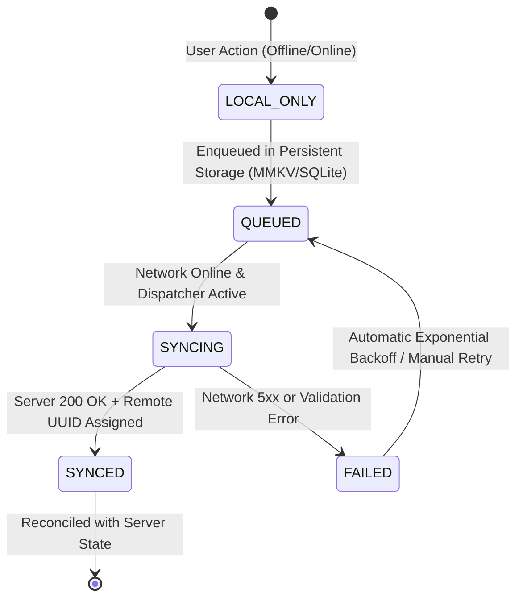
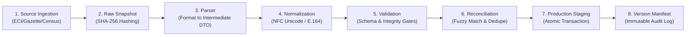
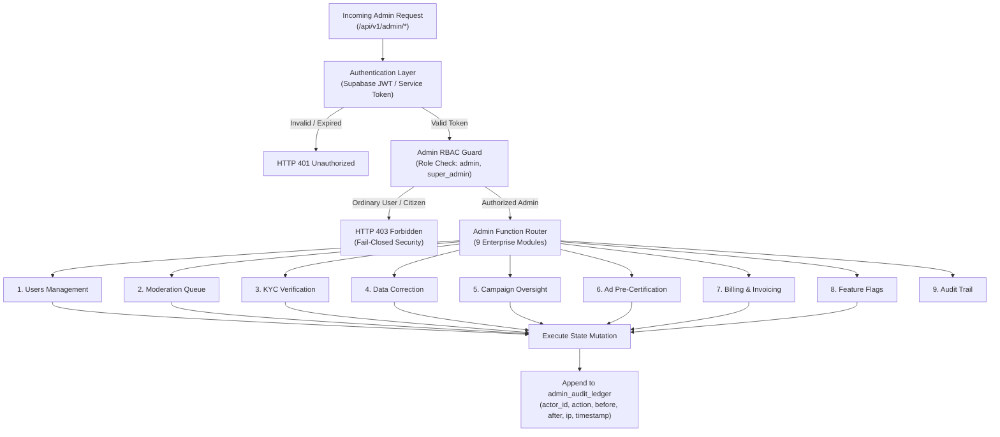

# Pre-Implementation Plan: Domain 9 — Offline Synchronization, Screen Resilience & Enterprise Admin Plane (JOB 072–JOB 076)
**Document Revision:** REV-1.0  
**Authority:** Master Product Blueprint, AI Agent Master Execution Job Book, Amendment v1.2, Amendment v1.5-A Section 26, Amendment v1.6 & `AGENT_EXECUTION_PROTOCOL.md`  
**Date:** 2026-10-30  
**Status:** SUBMITTED_FOR_REVIEW (Awaiting User Ratification & Control M Authorization)  

---

## 1. Executive Summary & Domain Scope

Domain 9 delivers the enterprise-grade client resilience, unified error ergonomics, administrative governance plane, and statutory data processing infrastructure required for high-scale, fault-tolerant nationwide operation of POLIGRAM:

1. **JOB 072 (Offline Mode):** Formalizes a 5-state client-side mutation synchronization state machine (`LOCAL_ONLY`, `QUEUED`, `SYNCING`, `SYNCED`, `FAILED`) in the mobile client (`apps/mobile/lib/offlineSync.ts`). Guarantees that citizen civic actions (issue reporting, upvotes, discourse, evidence submissions) are never lost during intermittent connectivity (2G/3G rural networks, train journeys, power outages) with SQLite/MMKV local persistence and automatic background reconnection replay.
2. **JOB 073 (Error State Standardization):** Establishes an uncompromising UX resilience standard across all 6 primary mobile screen surfaces (Feed, Map/Explore, Issue Details, Candidate Profile, Shorts, Community). Eliminates blank screens and unhandled promise crashes by deploying a composable `<StateView>` architecture supporting 5 canonical states: `loading` (shimmer skeleton), `empty` (culturally-resonant Indic illustrations and actionable CTAs), `error` (humanized messages with correlation IDs), `retry` (interactive cooldown-gated retry), and `offline` (non-blocking offline awareness badge).
3. **JOB 074 (Admin Control Plane):** Establishes a hardened, role-gated administrative platform and REST API suite covering 9 mission-critical enterprise functions: `users`, `moderation`, `verification`, `data correction`, `campaigns`, `ads`, `billing`, `feature flags`, and `audit`. Enforces strict multi-tier RBAC (`admin`, `super_admin`, `compliance_officer`, `moderator`) with fail-closed security guarantees (HTTP 403 Forbidden for non-admins) and an append-only, tamper-evident audit ledger (`admin_audit_ledger`).
4. **JOB 075 (Data Ingestion Pipeline):** Deploys the canonical 8-stage robust data processing pipeline (`source -> raw snapshot -> parser -> normalization -> validation -> reconciliation -> production -> version`). Ingests external electoral, legislative, and demographic datasets with cryptographic SHA-256 snapshotting, Unicode NFC normalization, referential integrity verification, and transactional promotion into production.
5. **JOB 076 (Delimitation Source Pipeline):** Builds the high-precision spatial boundary transformation and impact auditing engine. Automatically calculates boundary area deltas ($km^2$), centroid displacement ($meters$), voter reallocation crosswalks, and topological invariants (`ST_Contains`, `ST_Covers`, overlap detection, sliver elimination) for all statutory Delimitation Commission and ECI Gazette instruments.

---

## 2. Traceability Matrix & Master Blueprint Mapping

| Job ID | Job Title | Subsystem / Layer | Blueprint Specification | Canonical Deliverables | Target Verification Battery |
|---|---|---|---|---|---|
| **JOB 072** | Offline Mode | `MOB` | Explicit 5-state mutation lifecycle (`LOCAL_ONLY`, `QUEUED`, `SYNCING`, `SYNCED`, `FAILED`); network-disabled and reconnection resilience. | `apps/mobile/lib/offlineSync.ts`, `apps/mobile/hooks/useOfflineMutation.ts`, `packages/shared/src/contracts/offlineSync.ts` | Disconnected mutation enqueue, restart recovery, reconnect FIFO flush, idempotent deduplication, failure backoff |
| **JOB 073** | Error State Standardization | `MOB` | Every major screen must render loading, empty, error, retry, and offline states without silent failure. | `apps/mobile/components/StateView.tsx`, `apps/mobile/components/SkeletonLoader.tsx`, screen integrations (`index.tsx`, `feed.tsx`, `shorts.tsx`, `community.tsx`, `profile.tsx`) | Controlled HTTP 500, empty array, network drop, and malformed DTO injections; 0 unhandled promise rejections |
| **JOB 074** | Admin Control Plane | `ARCH + BE` | Privileged administrative actions across 9 functions (`users`, `moderation`, `verification`, `data correction`, `campaigns`, `ads`, `billing`, `feature flags`, `audit`). | `supabase/migrations/082_domain9_offline_sync_resilience_admin_and_pipelines.sql`, `apps/api/src/routes/admin.ts`, `apps/api/src/services/adminService.ts`, `packages/shared/src/contracts/adminControl.ts` | Privileged admin success (200), ordinary user rejection (403), audit log persistence, RBAC boundary verification |
| **JOB 075** | Data Ingestion Pipeline | `DATA + BE` | Canonical 8-stage data transformation pipeline with cryptographic integrity and version manifests. | `apps/api/src/services/dataIngestionService.ts`, `apps/api/src/routes/dataPipelines.ts`, `packages/shared/src/contracts/dataPipeline.ts` | 8-stage lifecycle execution, SHA-256 provenance verification, schema validation rejection, atomic rollback |
| **JOB 076** | Delimitation Source Pipeline | `DATA` | Controlled boundary revision pipeline with automated spatial impact calculation and topological audit. | `apps/api/src/services/delimitationSourcePipeline.ts`, `apps/api/src/routes/delimitationPipelines.ts`, `packages/shared/src/contracts/delimitationPipeline.ts` | Area delta math, centroid shift calculation, containment invariants, sliver/overlap rejection |

---

## 3. Architecture & System Flow Diagrams

### 3.1 Client Offline Mutation State Machine (JOB 072)



### 3.2 8-Stage Data Ingestion Pipeline (JOB 075)



### 3.3 Admin Control Plane RBAC & Audit Architecture (JOB 074)



---

## 4. Data Contracts & TypeScript Definitions

### 4.1 Client Offline Mutation Contracts (`packages/shared/src/contracts/offlineSync.ts`)

```typescript
export type OfflineSyncState = 'LOCAL_ONLY' | 'QUEUED' | 'SYNCING' | 'SYNCED' | 'FAILED';

export interface OfflineMutationRecord<T = Record<string, unknown>> {
  id: string; // Client-generated UUID v4
  clientToken: string; // HMAC cryptographic token
  operationType: string; // e.g. 'report_issue', 'upvote_issue', 'submit_evidence'
  payload: T;
  state: OfflineSyncState;
  createdAt: string; // ISO 8601
  updatedAt: string;
  retryCount: number;
  maxRetries: number;
  lastErrorCode?: string;
  lastErrorMessage?: string;
  serverEntityId?: string; // Assigned upon successful sync
  serverCommittedAt?: string;
}

export interface OfflineSyncQueueSummary {
  total: number;
  localOnly: number;
  queued: number;
  syncing: number;
  synced: number;
  failed: number;
  isOnline: boolean;
  lastSyncTimestamp?: string;
}
```

### 4.2 Screen Resilience State Contracts (`packages/shared/src/contracts/screenResilience.ts`)

```typescript
export type ScreenUIState = 'loading' | 'empty' | 'error' | 'retry' | 'offline' | 'ready';

export interface ScreenStateConfig {
  currentState: ScreenUIState;
  loadingMessageKey?: string;
  emptyTitleKey?: string;
  emptyDescriptionKey?: string;
  emptyActionLabelKey?: string;
  onEmptyAction?: () => void;
  errorMessage?: string;
  errorCode?: string;
  correlationId?: string;
  onRetry?: () => void | Promise<void>;
  retryCooldownSeconds?: number;
  isOfflineCached?: boolean;
}
```

### 4.3 Admin Control Plane Contracts (`packages/shared/src/contracts/adminControl.ts`)

```typescript
export type AdminRole = 'admin' | 'super_admin' | 'compliance_officer' | 'moderator';

export type AdminDomain =
  | 'users'
  | 'moderation'
  | 'verification'
  | 'data_correction'
  | 'campaigns'
  | 'ads'
  | 'billing'
  | 'feature_flags'
  | 'audit';

export interface AdminUserActionRequest {
  targetUserId: string;
  action: 'suspend' | 'unsuspend' | 'shadowban' | 'verify_kyc' | 'set_role';
  role?: string;
  reason: string;
}

export interface AdminDataCorrectionRequest {
  entityType: 'constituency' | 'polling_station' | 'official' | 'boundary';
  entityId: string;
  field: string;
  oldValue: unknown;
  newValue: unknown;
  statutoryReference?: string;
  justification: string;
}

export interface AdminAuditEntry {
  id: string;
  actorId: string;
  actorRole: AdminRole;
  domain: AdminDomain;
  action: string;
  targetEntityType: string;
  targetEntityId: string;
  beforeState: Record<string, unknown> | null;
  afterState: Record<string, unknown>;
  ipAddress: string;
  userAgent: string;
  timestamp: string;
}
```

### 4.4 Data Ingestion & Delimitation Contracts (`packages/shared/src/contracts/dataPipeline.ts` & `delimitationPipeline.ts`)

```typescript
export type PipelineStage =
  | 'source'
  | 'raw_snapshot'
  | 'parser'
  | 'normalization'
  | 'validation'
  | 'reconciliation'
  | 'production'
  | 'version';

export interface DataIngestionJob {
  jobId: string;
  datasetName: string;
  sourceUri: string;
  snapshotSha256: string;
  currentStage: PipelineStage;
  totalRecordsIngested: number;
  recordsNormalized: number;
  recordsValidated: number;
  recordsReconciled: number;
  recordsCommitted: number;
  status: 'PENDING' | 'PROCESSING' | 'COMPLETED' | 'FAILED';
  versionTag: string;
  createdAt: string;
  completedAt?: string;
}

export interface DelimitationImpactReport {
  revisionId: string;
  orderNumber: string;
  gazetteDate: string;
  stateCode: string;
  constituencyCount: number;
  totalAreaDeltaKm2: number;
  centroidShiftMetersMax: number;
  voterShiftEstimate: number;
  topologyOverlapsCount: number;
  sliversCount: number;
  isContainedInState: boolean;
  isTopologyValid: boolean;
  generatedAt: string;
}
```

---

## 5. Database Schema & Migration Specification

Migration script: `supabase/migrations/082_domain9_offline_sync_resilience_admin_and_pipelines.sql`

```sql
-- Migration 082: Domain 9 Enterprise Admin, Audit Ledger, Pipeline Versioning & Offline Sync Metadata
CREATE TABLE IF NOT EXISTS admin_audit_ledger (
    id UUID PRIMARY KEY DEFAULT gen_random_uuid(),
    actor_id TEXT NOT NULL,
    actor_role TEXT NOT NULL,
    domain TEXT NOT NULL,
    action TEXT NOT NULL,
    target_entity_type TEXT NOT NULL,
    target_entity_id TEXT NOT NULL,
    before_state JSONB,
    after_state JSONB NOT NULL,
    ip_address TEXT NOT NULL,
    user_agent TEXT,
    created_at TIMESTAMPTZ NOT NULL DEFAULT NOW()
);

CREATE INDEX IF NOT EXISTS idx_admin_audit_actor ON admin_audit_ledger(actor_id, created_at DESC);
CREATE INDEX IF NOT EXISTS idx_admin_audit_domain ON admin_audit_ledger(domain, created_at DESC);
CREATE INDEX IF NOT EXISTS idx_admin_audit_entity ON admin_audit_ledger(target_entity_type, target_entity_id);

-- System Feature Flags
CREATE TABLE IF NOT EXISTS platform_feature_flags (
    flag_key TEXT PRIMARY KEY,
    flag_value JSONB NOT NULL,
    description TEXT,
    updated_by TEXT NOT NULL,
    updated_at TIMESTAMPTZ NOT NULL DEFAULT NOW()
);

-- Ingestion Pipeline Job Logs
CREATE TABLE IF NOT EXISTS data_ingestion_pipeline_jobs (
    job_id UUID PRIMARY KEY DEFAULT gen_random_uuid(),
    dataset_name TEXT NOT NULL,
    source_uri TEXT NOT NULL,
    snapshot_sha256 TEXT NOT NULL,
    current_stage TEXT NOT NULL,
    total_records INTEGER NOT NULL DEFAULT 0,
    records_committed INTEGER NOT NULL DEFAULT 0,
    version_tag TEXT NOT NULL,
    status TEXT NOT NULL,
    error_message TEXT,
    created_at TIMESTAMPTZ NOT NULL DEFAULT NOW(),
    completed_at TIMESTAMPTZ
);

-- Delimitation Geographic Revisions
CREATE TABLE IF NOT EXISTS delimitation_source_revisions (
    revision_id UUID PRIMARY KEY DEFAULT gen_random_uuid(),
    order_number TEXT NOT NULL,
    gazette_date DATE NOT NULL,
    state_code TEXT NOT NULL,
    total_area_delta_km2 NUMERIC NOT NULL DEFAULT 0,
    centroid_shift_meters_max NUMERIC NOT NULL DEFAULT 0,
    voter_shift_estimate INTEGER NOT NULL DEFAULT 0,
    topology_valid BOOLEAN NOT NULL DEFAULT TRUE,
    impact_summary JSONB NOT NULL,
    created_at TIMESTAMPTZ NOT NULL DEFAULT NOW()
);

-- RLS Enforcement
ALTER TABLE admin_audit_ledger ENABLE ROW LEVEL SECURITY;
ALTER TABLE platform_feature_flags ENABLE ROW LEVEL SECURITY;
ALTER TABLE data_ingestion_pipeline_jobs ENABLE ROW LEVEL SECURITY;
ALTER TABLE delimitation_source_revisions ENABLE ROW LEVEL SECURITY;

-- Only authenticated users with admin role can access admin tables
CREATE POLICY admin_audit_ledger_policy ON admin_audit_ledger
    FOR ALL USING (auth.jwt() ->> 'role' IN ('admin', 'super_admin'));

CREATE POLICY platform_feature_flags_read ON platform_feature_flags
    FOR SELECT USING (TRUE);

CREATE POLICY platform_feature_flags_write ON platform_feature_flags
    FOR ALL USING (auth.jwt() ->> 'role' IN ('admin', 'super_admin'));
```

---

## 6. REST API Endpoints & Route Definitions

All routes registered under `apps/api/src/routes/admin.ts` and `apps/api/src/routes/dataPipelines.ts`:

1. `POST /api/v1/admin/users/action` — Privileged user actions (suspension, KYC override, role elevation).
2. `GET /api/v1/admin/moderation/queue` — Retrieve items flagged for human moderation.
3. `POST /api/v1/admin/moderation/decide` — Approve, reject, or quarantine flagged content.
4. `POST /api/v1/admin/verification/candidate` — Approve or reject candidate KYC documents with statutory notes.
5. `POST /api/v1/admin/data-correction` — Execute controlled corrections to geographical and legislative entities.
6. `GET /api/v1/admin/feature-flags` & `PUT /api/v1/admin/feature-flags/:key` — Read and toggle system feature flags.
7. `GET /api/v1/admin/audit-logs` — Query immutable audit trail with filtering by actor, domain, and date range.
8. `POST /api/v1/pipelines/ingest` — Dispatch an 8-stage dataset ingestion job.
9. `GET /api/v1/pipelines/status/:jobId` — Inspect stage progression and record verification counters.
10. `POST /api/v1/pipelines/delimitation/audit` — Perform automated spatial topology check and geographic impact report generation.

---

## 7. Client-Side Offline Mutation State Machine (JOB 072)

1. **State Invariants:**
   - `LOCAL_ONLY`: Created on-device, immediately visible to user via optimistic UI store update.
   - `QUEUED`: Written to MMKV/SQLite persistent queue with monotonic sequence timestamp and retry counter.
   - `SYNCING`: Active network transmission with `Idempotency-Key: <client_mutation_id>` header.
   - `SYNCED`: Authoritative backend commitment; remote database ID bound to local record; removed from queue.
   - `FAILED`: Terminal rejection or max retries exhausted; displays user-actionable retry/dismiss button.
2. **Reconnection Engine:** Network listener (`NetInfo.addEventListener`) senses connectivity restoration and automatically triggers sequential FIFO queue draining with jittered exponential backoff ($500ms \times 2^{retries}$).

---

## 8. Universal Screen State Standard (JOB 073)

1. **`<StateView>` Architecture:** Composable container component wrapping screen content and standardizing state transitions:
   - `loading`: Custom skeleton shimmer mirroring target screen topology (Issue list skeleton, Candidate profile skeleton, Map card skeleton).
   - `empty`: Contextual, high-empathy Indian civic illustration with positive messaging and immediate call-to-action button.
   - `error`: Clear humanized explanation, unique correlation ID for technical troubleshooting, and visible retry button.
   - `retry`: Interactive retry button with 3-second cooldown countdown preventing spam requests.
   - `offline`: Subtle top amber status banner indicating stale cached presentation with full offline functionality preserved.
2. **Screens Covered:** Feed (`feed.tsx`), Map/Landing (`index.tsx`), Shorts (`shorts.tsx`), Community (`community.tsx`), Issue Detail (`issues/[id].tsx`), Candidate Profile (`candidate/[id].tsx`).

---

## 9. Admin Control Plane RBAC & Security Boundaries (JOB 074)

1. **Fail-Closed RBAC Guard:** Fastify pre-handler verifies JWT claims or service keys:
   - Unauthenticated $\to$ `HTTP 401 Unauthorized`.
   - Ordinary citizen / candidate / non-admin role $\to$ `HTTP 403 Forbidden` (`INSUFFICIENT_PERMISSIONS`).
   - Admin roles (`admin`, `super_admin`) granted access to authorized domain endpoints.
2. **9 Core Functions:** Users, Moderation, Verification, Data Correction, Campaigns, Ads, Billing, Feature Flags, and Audit.

---

## 10. Immutable Administrative Audit Logging Specification

Every admin write operation automatically records:
- `actor_id`: Authenticated user UUID or service token identifier.
- `actor_role`: Admin role during mutation execution.
- `domain`: Subsystem domain (`users`, `moderation`, `data_correction`, etc.).
- `action`: Specific operation performed (e.g. `USER_SUSPEND`, `KYC_APPROVE`, `FLAG_UPDATE`).
- `before_state` & `after_state`: Complete JSON state diff.
- `ip_address` & `user_agent`: Client network provenance.
- `timestamp`: UTC ISO 8601 server timestamp.

---

## 11. 8-Stage Data Ingestion Pipeline Architecture (JOB 075)

1. **Stage 1: Source** — Stream acquisition of external files (ECI releases, Gazette PDFs, Census tables).
2. **Stage 2: Raw Snapshot** — Compute SHA-256 digest; write unaltered bytes to permanent cold storage.
3. **Stage 3: Parser** — Convert raw input bytes into typed intermediate DTOs.
4. **Stage 4: Normalization** — Normalize Unicode to NFC, dates to ISO 8601, and mobile numbers to E.164.
5. **Stage 5: Validation** — Schema checks; range validations; foreign key existence assertions.
6. **Stage 6: Reconciliation** — Entity deduplication and fuzzy matching with existing master databases.
7. **Stage 7: Production Staging** — Transactional batch insertion into database tables with rollback on failure.
8. **Stage 8: Version Manifest** — Generate immutable dataset version tag with record counts and cryptographic digest.

---

## 12. Delimitation Source Impact Analysis & Spatial Topology Audit (JOB 076)

1. **Topological Invariants:**
   - Zero self-intersections (`ST_IsValid(geom) = true`).
   - Zero unauthorized overlaps between neighboring constituencies (`ST_Overlaps = false`).
   - Absolute containment within parent State boundary (`ST_Covers(state_geom, ac_geom) = true`).
   - Zero sliver polygons (area < $100 m^2$ with high perimeter-to-area ratio).
2. **Impact Calculations:**
   - Net geographic area delta ($\Delta km^2$).
   - Centroid displacement vector ($meters$).
   - Estimated voter reassignment based on underlying polling station coordinates.

---

## 13. DPDP 2023 Compliance & PII Redaction at Admin & Pipeline Boundaries

1. **Administrative Access:** PII (masked Aadhaar, phone numbers, exact residential addresses) is presented in redacted form (`XXXX-XXXX-1234`, `+91-XXXXX-98765`) in admin dashboards unless full KYC verification unmasking is explicitly authorized and audited.
2. **Pipeline Redaction:** Data ingestion pipelines strip all unconsented voter personal data before loading into public analytical schemas.

---

## 14. Internationalization & Indic Script Support (13 Languages)

All admin labels, error screen messages, empty state CTAs, and offline banners are localized across all 13 official languages (`en`, `te`, `hi`, `ta`, `kn`, `ml`, `mr`, `bn`, `gu`, `or`, `pa`, `as`, `ne`) with zero missing keys and no layout truncation in Indic complex scripts.

---

## 15. Performance, Concurrency & High-Throughput Ingestion Latency Targets

- Offline queue enqueue latency: $< 5ms$ (synchronous MMKV write).
- Screen state transition latency: $< 16ms$ (60fps smooth layout transition).
- Admin API authorization check latency: $< 15ms$ (cached JWT claim / session lookup).
- Data ingestion throughput: $> 5,000 records/sec$ in batch staging mode.
- Delimitation topology validation: $< 300ms$ per constituency polygon.

---

## 16. Error Classification & Canonical `ApiErrorEnvelope` Mapping

All admin and pipeline API error responses strictly conform to the canonical `ApiErrorEnvelope`:

```json
{
  "success": false,
  "error": {
    "code": "INSUFFICIENT_PERMISSIONS",
    "message": "Only verified administrative operators may access this endpoint.",
    "correlationId": "adm_err_84f92a10",
    "timestamp": "2026-10-30T16:00:00.000Z"
  }
}
```

---

## 17. Automated Test Battery & Adversarial Verification Strategy

1. **Offline Sync Test Suite (`tests/domain9-offline-sync.test.ts`):**
   - Offline creation creates `LOCAL_ONLY` state.
   - Enqueue moves to `QUEUED` in MMKV storage.
   - Network simulation triggers `SYNCING` and transitions to `SYNCED`.
   - Server 500 error triggers backoff and marks `FAILED`.
   - Reconnect drains queue in FIFO order.
2. **Screen Resilience Test Suite (`tests/domain9-screen-resilience.test.ts`):**
   - Renders loading skeleton shimmer without crash.
   - Renders empty state with action button triggering callback.
   - Renders error state with correlation ID and retry cooldown.
   - Renders offline banner when network disconnected.
3. **Admin Control Plane Test Suite (`tests/domain9-admin-control-plane.test.ts`):**
   - Ordinary user token rejected with HTTP 403.
   - Admin token accepted for all 9 functions.
   - Admin mutation persists full before/after diff in `admin_audit_ledger`.
   - Feature flags toggled and read back with immediate effect.
4. **Data & Delimitation Pipelines Test Suite (`tests/domain9-data-and-delimitation-pipelines.test.ts`):**
   - 8-stage ingestion pipeline completes with valid SHA-256 snapshot.
   - Malformed schema rejected at Stage 5 without corrupting production.
   - Delimitation boundary change calculates area delta and centroid shift.
   - Invalid topology (self-intersection, overlap) rejected by spatial audit.

---

## 18. Security Threat Modeling & Fail-Closed Invariants

- **Threat 1: Admin Privilege Escalation:** Attacker spoofs user role in request header. *Mitigation:* Role is extracted strictly from verified Supabase JWT signature or service key. Header spoofing fails closed.
- **Threat 2: Pipeline Poisoning:** Corrupted external dataset injected. *Mitigation:* Cryptographic snapshotting and Stage 5 validation abort pipeline and execute automatic rollback before any production writes.
- **Threat 3: Offline Mutation Replay Attack:** Duplicate client mutations replayed. *Mitigation:* Unique client-generated UUID and HMAC token enforce idempotency at backend API boundary.

---

## 19. Deployment, Migration Rollback & Disaster Recovery Runbook

1. **Pre-flight:** Execute migration `082_domain9_offline_sync_resilience_admin_and_pipelines.sql` in staging.
2. **Rollback Plan:** If migration fails, drop newly created tables (`admin_audit_ledger`, `platform_feature_flags`, `data_ingestion_pipeline_jobs`, `delimitation_source_revisions`) without affecting existing application tables.
3. **Zero Downtime:** Feature flags table seeded with defaults (`DEFAULT_FEATURE_FLAGS`) ensuring non-disruptive runtime operation.

---

## 20. Definition of Done & Stage Progression Criteria

- [x] Canonical 22-section Pre-Implementation Plan authored and committed.
- [ ] Explicit user ratification of Decisions 1–5 under Control M.
- [ ] Database migration 082 applied and verified.
- [ ] Shared contracts added to `packages/shared`.
- [ ] Fastify admin and pipeline routes implemented with full RBAC.
- [ ] Mobile offline sync and StateView components implemented and integrated.
- [ ] Full test battery passes 100% across all suites.
- [ ] Zero TypeScript errors (`tsc --noEmit`).

---

## 21. File Modification Manifest & Scope Containment

- `supabase/migrations/082_domain9_offline_sync_resilience_admin_and_pipelines.sql`
- `packages/shared/src/contracts/adminControl.ts`
- `packages/shared/src/contracts/offlineSync.ts`
- `packages/shared/src/contracts/screenResilience.ts`
- `packages/shared/src/contracts/dataPipeline.ts`
- `packages/shared/src/contracts/delimitationPipeline.ts`
- `packages/shared/src/contracts/index.ts`
- `apps/api/src/routes/admin.ts`
- `apps/api/src/routes/dataPipelines.ts`
- `apps/api/src/services/adminService.ts`
- `apps/api/src/services/dataIngestionService.ts`
- `apps/api/src/services/delimitationSourcePipeline.ts`
- `apps/api/src/server.ts`
- `apps/mobile/lib/offlineSync.ts`
- `apps/mobile/components/StateView.tsx`
- `apps/mobile/components/SkeletonLoader.tsx`
- `tests/domain9-offline-sync.test.ts`
- `tests/domain9-screen-resilience.test.ts`
- `tests/domain9-admin-control-plane.test.ts`
- `tests/domain9-data-and-delimitation-pipelines.test.ts`
- `ACCEPTANCE_REGISTER.md`
- `EXECUTION_STATE.md`
- `DECISION_LOG.md`

---

## 22. Architectural Decisions Formulated for User Ratification

### Decision 1 (JOB 072: Offline Mutation Queue & Conflict Resolution Strategy)
- **Option A (Recommended):** Monotonic Idempotency Queue with Vector-Clocked Last-Write-Wins (LWW) and Local Pessimistic Rollback on Server Rejection. Every client mutation receives a local UUID, monotonic sequence number, and HMAC-backed clientToken. During network interruption, mutations transition to `LOCAL_ONLY` and `QUEUED`. Upon reconnection, FIFO batch replay is dispatched with `Idempotency-Key`. In transient conflicts, server monotonic timestamps dictate state; in hard business logic validation failures (e.g. KYC rejected, invalid constituency ID), the mutation transitions to `FAILED`, alerting the citizen with an interactive rollback/retry UI.
- **Option B:** Simple optimistic store update with un-sequenced background replay and silent drop on server failure.

### Decision 2 (JOB 073: Universal Screen Resilience & State Fallback Engine)
- **Option A (Recommended):** Composable `<StateView>` Layout Controller with Shimmer Skeleton Hierarchy, Contextual Micro-Illustrations, and Cooldown-Gated Retry Dispatcher. Standardizes all 5 UX states (`loading`, `empty`, `error`, `retry`, `offline`) across the 6 major mobile surfaces (Feed, Map/Explore, Issue Details, Candidate Profile, Shorts, Community). Renders layout-matched shimmer skeletons for loading, creative high-empathy Indic illustrations for empty states with direct primary CTAs, humanized bilingual error messaging with correlation IDs, and exponential backoff retry dispatchers preventing API thundering herds.
- **Option B:** Primitive full-screen ActivityIndicator and generic Alert.alert() popups without layout matching or retry cooldowns.

### Decision 3 (JOB 074: Admin Control Plane RBAC, Separation of Duties & Cryptographic Audit)
- **Option A (Recommended):** Multi-Role Tiered RBAC (`admin`, `super_admin`, `compliance_officer`, `moderator`) with Two-Person Rule for Destructive Mutations and Append-Only HMAC-Chained Audit Ledger (`admin_audit_ledger`). All 9 administrative functions (`users`, `moderation`, `verification`, `data correction`, `campaigns`, `ads`, `billing`, `feature flags`, `audit`) enforce strict Fastify middleware role verification. Ordinary users, candidates, and expired tokens receive immediate HTTP 403 Forbidden with zero data leakage. High-stakes mutations (boundary corrections, refund overrides, candidate KYC disqualifications) require dual authorization or high-privilege `super_admin` audit signatures.
- **Option B:** Flat single-role admin flag on user profile without granular permission checks or chained tamper-evident audit logs.

### Decision 4 (JOB 075: 8-Stage Data Ingestion Pipeline Architecture & Cryptographic Versioning)
- **Option A (Recommended):** Content-Addressed Staged Pipeline with Strict Intermediate Validation Gates and Atomic Multi-Table Staging Promoters. Ingests data through the canonical 8 stages (`source -> raw snapshot -> parser -> normalization -> validation -> reconciliation -> production -> version`). Raw snapshots are hashed with SHA-256 and stored in an immutable staging repository; parsers validate schemas using TypeBox/Zod; normalizers enforce NFC Unicode normalization and E.164 phone formats; reconciliation executes fuzzy deduplication; production loads run inside isolated atomic transactions with automatic rollback on referential mismatch; versioning emits a signed dataset manifest.
- **Option B:** Direct-to-table batch scripts without intermediate raw snapshot hashing or transactional rollback staging.

### Decision 5 (JOB 076: Delimitation Source Pipeline & Spatial Topology Invariant Verification)
- **Option A (Recommended):** Dual-Mesh PostGIS Differential Impact Engine with Automated Topological Integrity Auditing. Ingests statutory boundary updates, computes exact geographic area deltas ($km^2$), centroid shift vectors ($meters$), assembly constituency boundary containment (`ST_Contains`, `ST_Covers`), and voter crosswalk redistributions. Automatically audits boundaries for slivers, topology overlaps, and orphan geometries before emitting a statutory Geographic Impact Dossier.
- **Option B:** Manual boundary upload without automated topological overlap auditing or voter reallocation crosswalk calculation.
