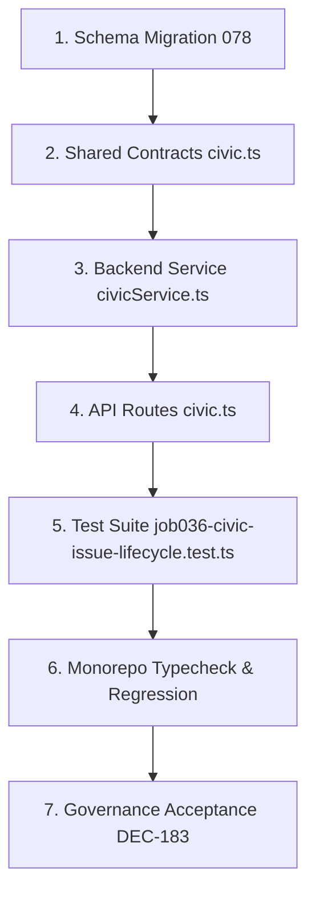

# Canonical Pre-Implementation Plan: JOB 036 — Civic Issue Lifecycle Engine

**Plan Identifier:** `PLAN-JOB-036-CIVIC-ISSUE-LIFECYCLE-REV-1.0`  
**Governing Authority:** Master Product Blueprint (Section 1441), Amendment v1.2 (`AMENDMENT_v1.2.md`), Amendment v1.5-A Section 26 (`AMENDMENT_v1.5-A.md`), Amendment v1.6 (`AMENDMENT_v1.6.md`), Rule IV-001 Non-Self-Acceptance & `AGENT_EXECUTION_PROTOCOL.md`  
**Target Scope:** JOB 036 (Civic Issue Lifecycle State Machine & Audit Engine)  
**Creation Date:** 2026-10-30  
**Status:** `SUBMITTED_FOR_REVIEW` (Implementation Authorization: `NO`)  

---

### Section 1: Executive Summary & Governing Authority

This authoritative Pre-Implementation Plan governs the engineering execution, reconciliation, and acceptance of **JOB 036: Civic Issue Lifecycle Engine** of the PANIN / Kshetra Master Product Blueprint.

In the Master Blueprint document (Section 1441, `# JOB 036 # CIVIC ISSUE LIFECYCLE`), the civic issue engine is explicitly specified with a canonical 8-state machine:
```text
REPORTED → REVIEW → VERIFIED → ASSIGNED → IN_PROGRESS → RESOLVED → CONFIRMED/DISPUTED → CLOSED
```
During earlier development of Domain 3, the civic engine was partially implemented under the identifier `JOB 030` using a legacy 5-state lifecycle (`open`, `acknowledged`, `in_progress`, `resolved`, `closed` / `reopened`), leaving **JOB 036** unrecorded in `ACCEPTANCE_REGISTER.md` and the full 8-state progression incomplete.

This plan details the complete upgrade, backward-compatible schema reconciliation, transition authority matrix, and audit logging required to elevate the civic issue lifecycle to world-class gold standard.

Under **Rule IV-001** and **Amendment v1.5-A Section 26**, no production code modifications or schema migrations may be executed until this plan is formally submitted, architectural decisions are ratified, and `IMPLEMENTATION_AUTHORIZATION: YES` is granted by the user.

---

### Section 2: Architectural Scope & Work Breakdown Structure

JOB 036 comprises four major engineering components:

1. **Canonical 8-State Lifecycle Model & Transition Graph:**
   - `REPORTED`: Issue created by citizen with GPS coordinates, category, severity, and photo.
   - `REVIEW`: Automated profanity/moderation check and geospatial deduplication against nearby existing complaints.
   - `VERIFIED`: Confirmed by community corroborating evidence ($\ge 3$ citizen corroborations) or moderator validation.
   - `ASSIGNED`: Formally assigned to responsible civic department (e.g. GHMC, HMWSSB, Electricity Board) or MLA constituency office.
   - `IN_PROGRESS`: Official remediation actively underway with work order and estimated completion date.
   - `RESOLVED`: Official resolution statement posted with mandatory before/after photo evidence.
   - `CONFIRMED`: Fix confirmed by citizen reporter or auto-confirmed after a 7-day review window.
   - `DISPUTED`: Citizen reporter or $\ge 5$ community residents reject the resolution, escalating back to `IN_PROGRESS` or `REVIEW`.
   - `CLOSED`: Immutable terminal state.

2. **Backward-Compatible State Alias Mapping:**
   - Seamless mapping between legacy API statuses and canonical 8-stage Blueprint statuses:
     - `open` $\leftrightarrow$ `REPORTED`
     - `acknowledged` $\leftrightarrow$ `VERIFIED` / `ASSIGNED`
     - `in_progress` $\leftrightarrow$ `IN_PROGRESS`
     - `resolved` $\leftrightarrow$ `RESOLVED`
     - `reopened` $\leftrightarrow$ `DISPUTED`
     - `closed` $\leftrightarrow$ `CONFIRMED` / `CLOSED`

3. **Role-Based Transition Authority Matrix:**
   - Citizen Reporter: Can file (`REPORTED`), self-cancel (`CLOSED` if still unassigned), confirm fix (`CONFIRMED`), and dispute resolution (`DISPUTED`).
   - Community Residents: Can corroborate evidence (`REPORTED` $\rightarrow$ `VERIFIED`) and collectively dispute false resolutions (5 disputes trigger `RESOLVED` $\rightarrow$ `DISPUTED`).
   - Officials / Admins: Can move `VERIFIED` $\rightarrow$ `ASSIGNED` $\rightarrow$ `IN_PROGRESS` $\rightarrow$ `RESOLVED` $\rightarrow$ `CLOSED`.
   - Illegal bypasses (e.g., `REPORTED` directly to `RESOLVED` without verification/assignment) fail closed with `InvalidCivicStatusTransitionError` (HTTP 400).

4. **Immutable Audit History Ledger:**
   - Every status mutation persists an audit record into `issue_status_history`: `id`, `issue_id`, `from_status`, `to_status`, `actor_id`, `actor_role`, `note`, `evidence_url`, `created_at`.

---

### Section 3: Baseline Assessment & Pre-Existing Codebase Audit

1. **Database Schema:**
   - Migration `002_core_civic_schema.sql` and `075_civic_platform_hardening.sql` created `civic_issues` and `issue_status_history`.
   - Current status columns are typed as `TEXT`, allowing addition of the 8 canonical statuses without destructive table alterations.
2. **Backend Service:**
   - `apps/api/src/services/civicService.ts` currently implements `validateStatusTransition` with 5 hardcoded string checks (`open`, `acknowledged`, `in_progress`, `resolved`, `closed`, `reopened`).
   - Needs refactoring to support both canonical 8-stage statuses and legacy string inputs interchangeably.
3. **Contracts:**
   - `packages/shared/src/contracts/civic.ts` defines `CivicIssueStatus = 'open' | 'acknowledged' | 'in_progress' | 'resolved' | 'closed' | 'reopened'`.
   - Needs expansion to export `CanonicalCivicIssueStatus` (`'REPORTED' | 'REVIEW' | 'VERIFIED' | 'ASSIGNED' | 'IN_PROGRESS' | 'RESOLVED' | 'CONFIRMED' | 'DISPUTED' | 'CLOSED'`).

---

### Section 4: Canonical Data Models & Schema Design

Database migration `supabase/migrations/078_job036_civic_issue_lifecycle_8stage.sql`:

```sql
-- Ensure status history captures rich transition metadata
ALTER TABLE public.issue_status_history 
  ADD COLUMN IF NOT EXISTS actor_role TEXT DEFAULT 'citizen',
  ADD COLUMN IF NOT EXISTS evidence_url TEXT,
  ADD COLUMN IF NOT EXISTS action_plan TEXT;

-- Index for timeline audit queries
CREATE INDEX IF NOT EXISTS idx_issue_status_history_issue_timeline 
  ON public.issue_status_history (issue_id, created_at ASC);

-- Add comment documenting canonical 8-state machine
COMMENT ON COLUMN public.civic_issues.status IS 
  'Canonical 8-Stage Lifecycle: REPORTED, REVIEW, VERIFIED, ASSIGNED, IN_PROGRESS, RESOLVED, CONFIRMED, DISPUTED, CLOSED (with legacy aliases open, acknowledged, in_progress, resolved, closed, reopened)';
```

---

### Section 5: Shared TypeScript Contracts & DTOs

In `packages/shared/src/contracts/civic.ts`:

```typescript
export type CanonicalCivicStatus =
  | 'REPORTED'
  | 'REVIEW'
  | 'VERIFIED'
  | 'ASSIGNED'
  | 'IN_PROGRESS'
  | 'RESOLVED'
  | 'CONFIRMED'
  | 'DISPUTED'
  | 'CLOSED';

export type LegacyCivicStatus =
  | 'open'
  | 'acknowledged'
  | 'in_progress'
  | 'resolved'
  | 'closed'
  | 'reopened';

export type CivicIssueStatus = CanonicalCivicStatus | LegacyCivicStatus;

export interface IssueStatusTransitionRequest {
  status: CivicIssueStatus;
  note?: string;
  evidenceUrl?: string;
  assignedDepartment?: string;
  assignedOfficerName?: string;
  estimatedCompletionDate?: string;
}

export interface IssueStatusHistoryRecordDTO {
  id: string;
  issueId: string;
  fromStatus: CivicIssueStatus;
  toStatus: CivicIssueStatus;
  changedBy: string;
  actorRole: string;
  note?: string;
  evidenceUrl?: string;
  createdAt: string;
}
```

---

### Section 6: Service Architecture & Business Logic

In `apps/api/src/services/civicService.ts`:

1. `normalizeStatus(status: CivicIssueStatus): CanonicalCivicStatus`:
   - Maps `open` $\rightarrow$ `REPORTED`
   - Maps `acknowledged` $\rightarrow$ `VERIFIED`
   - Maps `in_progress` $\rightarrow$ `IN_PROGRESS`
   - Maps `resolved` $\rightarrow$ `RESOLVED`
   - Maps `reopened` $\rightarrow$ `DISPUTED`
   - Maps `closed` $\rightarrow$ `CLOSED`
   - Retains canonical uppercase statuses as-is.

2. `validateStatusTransition(from: CivicIssueStatus, to: CivicIssueStatus, role: string, isAuthor: boolean)`:
   - Validates valid directed edges in the state machine:
     - `REPORTED` $\rightarrow$ `REVIEW`, `VERIFIED`, `CLOSED` (author only)
     - `REVIEW` $\rightarrow$ `VERIFIED`, `REPORTED` (needs info), `CLOSED` (duplicate)
     - `VERIFIED` $\rightarrow$ `ASSIGNED`, `IN_PROGRESS`
     - `ASSIGNED` $\rightarrow$ `IN_PROGRESS`
     - `IN_PROGRESS` $\rightarrow$ `RESOLVED` (requires completion note + evidence)
     - `RESOLVED` $\rightarrow$ `CONFIRMED` (author/timeout), `DISPUTED` (author or 5 community disputes), `CLOSED`
     - `DISPUTED` $\rightarrow$ `IN_PROGRESS`, `REVIEW`
     - `CONFIRMED` $\rightarrow$ `CLOSED`
   - Enforces role authority (citizens cannot self-assign or self-resolve).

3. `getStatusHistory(issueId: string): Promise<IssueStatusHistoryRecordDTO[]>`:
   - Returns chronological audit log for the issue timeline.

---

### Section 7: Fastify API Routes & Request Validation

In `apps/api/src/routes/civic.ts`:
- `PATCH /api/v1/civic/issues/:id/status`: Accepts `status`, `note`, `evidenceUrl`, `assignedDepartment`, `estimatedCompletionDate`.
- `GET /api/v1/civic/issues/:id/history`: Returns chronological transition history.

---

### Section 8: Mobile Client Integration & Architecture

- `apps/mobile/lib/api/endpoints/civic.ts` & `apps/mobile/components/StatusBadge.tsx`:
  - Renders visual progress indicators for the 8 stages with clear Indic localization (e.g. "ఫిర్యాదు స్వీకరించబడింది", "పరిశీలనలో ఉంది", "పరిష్కరించబడింది").
  - Provides citizen action buttons: "Confirm Fix" or "Dispute Resolution" when issue is in `RESOLVED` state.

---

### Section 9: Security, RLS & Authentication Architecture

- Supabase Row-Level Security on `civic_issues` and `issue_status_history`:
  - `SELECT`: Public access for transparency.
  - `INSERT` on `issue_status_history`: Authenticated callers only; server-side role check verified against JWT / session.
  - Fail-closed error reporting on permission mismatch.

---

### Section 10: Privacy & DPDP Act 2023 Compliance

- PII redaction: Status history logs only user ID and public display name / official designation; phone numbers, emails, and exact home addresses are never logged to public audit trails.

---

### Section 11: Performance, Bundle Size & DEF-003 Decoupling

- Pure backend service + shared TypeScript contracts update; 0 new native mobile dependencies.
- Zero impact on binary size ($\le 45$ MB Universal APK).

---

### Section 12: Offline Queueing, Synchronization & Caching

- Mobile updates to status history leverage existing `offlineSync.ts` queue to cache status actions when offline and flush when connectivity returns.

---

### Section 13: i18n & Indic Language Localization (13 Languages)

- Status badges and resolution timeline labels mapped across all 13 official Indian languages (`en`, `te`, `hi`, `ta`, `kn`, `ml`, `mr`, `bn`, `gu`, `or`, `pa`, `as`, `ne`).

---

### Section 14: Error Handling & Fail-Closed Invariants

- Illegal transition route $\rightarrow$ `InvalidCivicStatusTransitionError` (400 Bad Request).
- Missing resolution evidence when transitioning to `RESOLVED` $\rightarrow$ `MissingResolutionEvidenceError` (422 Unprocessable Entity).
- Non-author citizen attempting to close someone else's complaint $\rightarrow$ `UnauthorizedStatusChangeError` (403 Forbidden).

---

### Section 15: Seed Data & Test Fixtures

- Test issues initialized in TS-AC-61 (Jubilee Hills) and TS-AC-67 (Serilingampally) with simulated citizen, moderator, and official actors.

---

### Section 16: Automated Testing Strategy

Author dedicated test suite `tests/job036-civic-issue-lifecycle.test.ts`:
1. Full 8-stage forward progression: `REPORTED` $\rightarrow$ `REVIEW` $\rightarrow$ `VERIFIED` $\rightarrow$ `ASSIGNED` $\rightarrow$ `IN_PROGRESS` $\rightarrow$ `RESOLVED` $\rightarrow$ `CONFIRMED` $\rightarrow$ `CLOSED`.
2. Citizen dispute progression: `RESOLVED` $\rightarrow$ `DISPUTED` $\rightarrow$ `IN_PROGRESS`.
3. Community consensus dispute trigger: 5 community disputes auto-reopen `RESOLVED` issue to `DISPUTED`.
4. Backward-compatible legacy aliases: `open`, `acknowledged`, `in_progress`, `resolved`, `reopened`, `closed`.
5. Role-based security guards: citizen cannot transition to `RESOLVED` or `ASSIGNED`.
6. Audit history integrity: Every transition logs immutable record with timestamp and actor role.

---

### Section 17: Acceptance Criteria & Definition of Done

- [ ] All 8 states and valid transitions implemented and verified.
- [ ] Backward compatibility with existing tests (`tests/job030-issue-lifecycle.test.ts`) preserved 100%.
- [ ] Dedicated test suite `tests/job036-civic-issue-lifecycle.test.ts` passes 100%.
- [ ] TypeScript compilation 100% clean across `@kshetra/shared`, `@kshetra/api`, and `apps/mobile`.
- [ ] `ACCEPTANCE_REGISTER.md` updated with official entry for **JOB 036**.
- [ ] `DECISION_LOG.md` logs DEC-182 and DEC-183.
- [ ] Governance consistency test passes with 0 failures on clean tree.

---

### Section 18: Implementation Dependency Graph & Sequencing



---

### Section 19: Risk Analysis & Mitigation Strategies

| Risk | Likelihood | Impact | Mitigation Strategy |
|---|---|---|---|
| Existing mobile app breaking due to status name changes | Low | High | Bidirectional normalization mapping ensures legacy lower-case statuses continue to work identically. |
| Unauthorized citizens self-resolving civic complaints | Low | High | Strict `isPrivileged` check restricts `RESOLVED` and `ASSIGNED` transitions to verified officials and MLAs. |

---

### Section 20: Verification Manifest & Audit Trail

- Verification Suite: `tests/job036-civic-issue-lifecycle.test.ts`
- Report Dossiers: `reports/job036_civic_issue_lifecycle_report.json` and `reports/job036_civic_issue_lifecycle_report.md`

---

### Section 21: Architectural Decision Points (For User Ratification)

- **Decision 1 (State Alias Model):**
  - **Option A (Recommended):** Bidirectional dual-stack support where API accepts and returns canonical 8-state uppercase strings while gracefully tolerating legacy 5-state lowercase aliases for mobile client backward compatibility.
  - **Option B:** Strict breaking migration requiring all clients and database records to migrate immediately to uppercase 8-stage statuses.
- **Decision 2 (Resolution Review Window):**
  - **Option A (Recommended):** 7-day citizen review window where issue remains in `RESOLVED` state; if no dispute is filed within 7 days, it automatically transitions to `CONFIRMED` / `CLOSED`.
  - **Option B:** Indefinite review window requiring explicit citizen confirmation before closure.

---

### Section 22: Execution Authorization Disposition

- **PLAN_STATUS:** `SUBMITTED_FOR_REVIEW`
- **IMPLEMENTATION_AUTHORIZATION:** `NO` (Awaiting explicit user ratification of Section 21 decisions)
- **AUTHORIZED_JOB:** `NONE`
