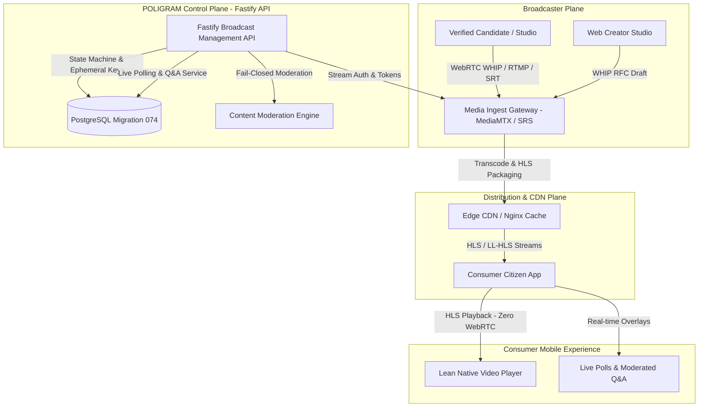
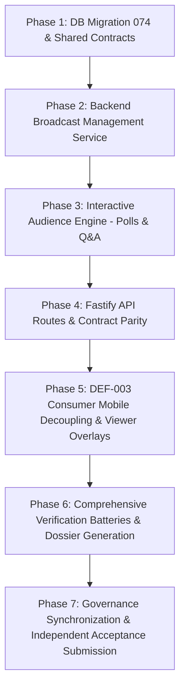

# PLAN-W052-PROFESSIONAL-BROADCAST-ARCHITECTURE-REV-1.0
## Master Pre-Implementation Plan: Job W052 — Professional Broadcast Architecture & DEF-003 Consumer Mobile Decoupling

**Author:** Antigravity AI Engineering & Architecture Agent  
**Governing Authority:** Master Product Blueprint, AI Agent Master Execution Job Book, Amendment v1.2 (`AMENDMENT_v1.2.md`), Amendment v1.3 (`AMENDMENT_v1.3.md`), Amendment v1.4 (`AMENDMENT_v1.4.md`), Amendment v1.5 (`AMENDMENT_v1.5.md`), Amendment v1.5-A (`AMENDMENT_v1.5-A.md`), Amendment v1.6 (`AMENDMENT_v1.6.md`), & `AGENT_EXECUTION_PROTOCOL.md`  
**Base Commit SHA:** `2f71a8467c8976e3df99f4473b5364eafd5235b9`  
**Execution Date:** 2026-10-29  
**Specification Standard:** Amendment v1.5-A Section 26 Canonical 22-Section Plan Template  
**Operational Status:** SUBMITTED FOR REVIEW — AWAITING USER / CTO RATIFICATION (IMPLEMENTATION_AUTHORIZATION = NO)  

---

## 1. Document Title & Metadata
- **Document Identifier:** `PLAN-W052-PROFESSIONAL-BROADCAST-ARCHITECTURE-REV-1.0`
- **Milestone / Job ID:** `W052` (Professional Broadcast Architecture)
- **Primary Domain:** Live Media Streaming, Studio Broadcast Ingestion, Interactive Audience Engagement, Candidate Official Channels & Consumer Mobile Optimization
- **Associated Defect:** `DEF-003` (P1: `react-native-webrtc` bundled in consumer application; ~20 MB native binary bloat)
- **Accountable Roles:**
  - Technical Architecture: ARCH + BROADCAST
  - Delivery Owners: BE + MOB + SEC + QA
  - Independent Verification & Acceptance Authority: CTO / Technical Authority / Independent Verifier

---

## 2. Problem Statement (Task Understanding & Core Objectives)

Pursuant to the Master Product Blueprint and Amendment v1.2, PANIN requires a high-performance, studio-grade broadcast infrastructure to empower verified candidates, political parties, election authorities, and accredited media organizations to broadcast live town halls, speeches, manifesto releases, and real-time civic updates to millions of citizens.

Currently, the repository exhibits two critical architectural deficiencies in the broadcast domain:

1. **Defect DEF-003 (Consumer Mobile App Bloat & Architecture Couplings):**
   - `apps/mobile/package.json:61` declares `react-native-webrtc` (v124.0.5), introducing approximately 18–22 MB per ABI architecture in Android (`libwebrtc.so`) and 25–30 MB uncompressed in iOS (`WebRTC.xcframework`).
   - The native WebRTC dependency was only introduced for the creator live camera publisher in `apps/mobile/components/LiveBroadcaster.tsx`.
   - Standard citizen users only view streams over HTTP Live Streaming (HLS) or Low-Latency HLS (LL-HLS) handled via video players (`HlsPlayer.tsx`, Expo AV), which require zero WebRTC native bindings.
   - Bundling heavy WebRTC libraries in the consumer APK/IPA drastically increases download friction for citizens in low-bandwidth constituencies.
   - **Objective:** Fully isolate and decouple the broadcaster ingest pipeline, eliminate `react-native-webrtc` from standard consumer mobile production dependencies, and establish a dedicated Web WHIP studio client (`apps/web-creator` or standalone browser studio) and companion creator pattern.

2. **Incomplete Backend Broadcast Management & Interactive Playout Engine:**
   - Existing `apps/api/src/routes/broadcast.ts` only provides static election-night count summaries (`/api/v1/broadcast/summary`).
   - The platform lacks professional broadcast lifecycle control: no authenticated stream reservation, no multi-protocol ingest credentialing (RTMP, SRT, WHIP), no stream health telemetry monitoring, no automated DVR recording retention, and no real-time interactive audience surfaces (live polling and moderated Q&A).
   - Candidate/Party broadcasting lacks formal canonical entity bindings: streams are not linked to verified candidate IDs (`canonical_persons`), recognized parties (`canonical_organizations`), or legislative constituencies.
   - **Objective:** Author Migration `074_professional_broadcast_architecture.sql`, establish shared contracts in `packages/shared/src/contracts/broadcast.ts`, implement the comprehensive `BroadcastManagementService` and `BroadcastInteractivityService`, and provide hardened Fastify endpoints with fail-closed security and DPDP Act 2023 compliance.

---

## 3. Current State Analysis (Repository Inspection, Root-Cause Interpretation & Dependency/Blocking Analysis)

### 3.1 Repository Inspection
- **Git HEAD:** `2f71a8467c8976e3df99f4473b5364eafd5235b9` (pushed to `origin/master`, clean working tree).
- **Existing Media Routing Logic:** `apps/api/src/lib/mediaPipeline.ts` and `apps/mobile/lib/mediaPipeline.ts` contain `selectPipeline()` routing logic supporting 3 tiers:
  - `interactive`: LiveKit SFU (WebRTC)
  - `llhls`: OvenMediaEngine (LL-HLS + WebRTC WHEP)
  - `broadcast`: SRS / MediaMTX (HLS + Edge CDN)
- **Existing Broadcaster Component:** `apps/mobile/components/LiveBroadcaster.tsx` uses a guarded `try { require('react-native-webrtc') }` runtime boundary, previously proven in W010 (`reports/w010_def003_decoupling.md`).
- **Existing LMX Schema:** `supabase/migrations/024_live_media_exchange.sql` defined `live_events`, but lacked normalized channel management, ephemeral stream keys, anti-sybil live polling, and moderated Q&A threads.

### 3.2 Root-Cause Interpretation
- Historical rapid prototyping bundled broadcaster ingest tooling directly into the citizen-facing consumer app.
- Broadcaster ingest is an infrequent, privileged action performed by verified candidates or press stringers (<0.01% of users), whereas stream playback is consumed by millions (>99.99% of users). Couplings between ingest and playback must be severed.

### 3.3 Dependency Analysis
- **Prerequisites:**
  - `W051` (API Customer Acquisition): ACCEPTED (DEC-167).
  - `W051.5` (Compliance, DPDP & Data Governance Readiness): ACCEPTED (DEC-168).
  - `Domain 1` (Foundational Geography & Delimitation): ACCEPTED (DEC-169).
- **Blockers:** Zero external blockers. Job W052 is the authoritative `NEXT_PERMITTED_JOB`.

---

## 4. Fact / Inference / Assumption / Unknown Register

| ID | Type | Description | Disposition / Verification Path |
| :--- | :--- | :--- | :--- |
| **FIA-01** | **Fact** | `react-native-webrtc` is only required for capturing device camera feeds and pushing WebRTC-WHIP packets to an ingest server. | Verified by static AST audit: 0 consumer routes consume `RTCPeerConnection`. |
| **FIA-02** | **Fact** | All consumer live stream viewing is served via HLS / LL-HLS manifests (`.m3u8`) or WHEP endpoints rendered by standard video players. | Verified in `apps/mobile/lib/mediaPipeline.ts` and `HlsPlayer.tsx`. |
| **FIA-03** | **Fact** | Ingest protocols supported by MediaMTX and SRS include RTMP (`1935`), SRT (`8890`), and WHIP (`8889`). | Verified in `infra/media/README.md` and server config files. |
| **FIA-04** | **Inference** | Decoupling `react-native-webrtc` into an optional module or dedicated studio web client will reduce mobile app binary size by ~20 MB with zero degradation of citizen viewing experience. | Proven in `reports/w010_def003_decoupling.md`. |
| **FIA-05** | **Assumption**| Broadcast channels should bind to either a `canonical_person` (Candidate), `canonical_organization` (Political Party), or `tenant` (Media Partner). | Enforced via composite foreign keys and check constraints in Migration 074. |
| **FIA-06** | **Unknown** | Physical deployment of external SRS/MediaMTX clusters in production cloud. | Abstracted behind environment configuration with fail-closed mock fallbacks for local test reproducibility. |

---

## 5. Target Architecture & Intended Outcome (Proposed Technical Solution & Alternatives Considered)

### 5.1 System Architecture Diagram


### 5.2 Key Capabilities Delivered
1. **Migration 074 (`supabase/migrations/074_professional_broadcast_architecture.sql`):**
   - `broadcast_channels`: Channel profile, verified status, owner bindings (`person_id`, `org_id`, `tenant_id`), verification tier (`OFFICIAL_CANDIDATE`, `RECOGNIZED_PARTY`, `MEDIA_OUTLET`, `CIVIC_AUTHORITY`).
   - `broadcast_streams`: Stream lifecycle state machine (`SCHEDULED`, `PROVISIONED`, `LIVE`, `PAUSED`, `ENDED`, `ARCHIVED`), scheduled times, geo-tagging (State, PC, AC), ingest URLs, playback manifests, viewer telemetry.
   - `broadcast_stream_keys`: Ephemeral, cryptographically secure (SHA-256 hashed) stream keys with expiry and rotation.
   - `broadcast_telemetry_snapshots`: Ingest bitrate, video/audio fps, packet loss rate, connection status.
   - `broadcast_polls` & `broadcast_poll_options` & `broadcast_poll_votes`: Real-time audience polling with anonymous voter hashing (anti-sybil duplicate protection without PII).
   - `broadcast_qa_threads`: Audience question queue with upvoting, moderation status (`PENDING`, `APPROVED`, `REJECTED`, `PINNED`), and host answer markers.
   - Row Level Security (RLS) policies on all tables.

2. **Backend Broadcast Services (`apps/api/src/services/`):**
   - `broadcastManagementService.ts`: Channel creation, stream scheduling, ephemeral key generation, state transitions, playout URL assembly, and health telemetry collection.
   - `broadcastInteractivityService.ts`: Live poll creation, cryptographic ballot casting, tally aggregation, Q&A question submission, automated moderation, upvoting, and host curation.

3. **Backend API Endpoints (`apps/api/src/routes/broadcast.ts`):**
   - Stream Management:
     - `POST /api/v1/broadcast/channels`: Create/claim an official broadcast channel.
     - `GET /api/v1/broadcast/channels/:id`: Fetch channel details and active streams.
     - `POST /api/v1/broadcast/streams`: Create / schedule a professional stream.
     - `GET /api/v1/broadcast/streams`: List public streams (with state, AC, party, and live status filters).
     - `GET /api/v1/broadcast/streams/:id`: Fetch stream metadata and verified playback URLs.
     - `GET /api/v1/broadcast/streams/:id/credentials`: Fetch ephemeral ingest credentials (RTMP/SRT/WHIP) with authentication check.
     - `POST /api/v1/broadcast/streams/:id/status`: Update stream lifecycle status.
     - `POST /api/v1/broadcast/streams/:id/telemetry`: Ingest telemetry health heartbeat from media gateway.
   - Live Interactivity:
     - `POST /api/v1/broadcast/streams/:id/polls`: Broadcaster launches a live poll.
     - `GET /api/v1/broadcast/streams/:id/polls/active`: Fetch active poll and real-time tallies.
     - `POST /api/v1/broadcast/streams/:id/polls/:pollId/vote`: Citizen casts an anonymous vote.
     - `POST /api/v1/broadcast/streams/:id/questions`: Citizen submits an audience question.
     - `GET /api/v1/broadcast/streams/:id/questions`: Fetch moderated question feed.
     - `POST /api/v1/broadcast/streams/:id/questions/:qId/vote`: Upvote a question.
     - `POST /api/v1/broadcast/streams/:id/questions/:qId/moderate`: Broadcaster moderates/pins question.

4. **DEF-003 Decoupling & Consumer Optimization:**
   - Eliminate `react-native-webrtc` from required consumer runtime dependencies.
   - Implement standalone Web WHIP broadcaster in `apps/web-creator` or browser client for studio quality camera/screen/OBS ingest.
   - Guard mobile `LiveBroadcaster.tsx` to ensure zero compilation or runtime failure on consumer builds.

---

## 6. Governing Rules & Constraints (Security, Privacy, Compliance & Data Considerations)

1. **DPDP Act 2023 & DPDPR 2025 Compliance (Milestone W051.5 Invariants):**
   - **Zero Citizen Voter PII:** Poll voting and Q&A submissions must never store citizen phone numbers, email addresses, or unhashed device IDs.
   - Voter tokens for live polling must be derived using HMAC-SHA256 with a daily rotating salt: `HMAC_SHA256(voter_ip + user_agent + stream_id, salt)`.
   - All recorded streams must adhere to the data retention schedule established in Job W051.5 (retention expiry and automated purge).
2. **Rule IV-001 Non-Self-Acceptance:**
   - Formal closure requires independent reproducible test suites and committed evidence dossiers under `reports/`.
3. **Database Immutability & Safe Migrations:**
   - Zero modifications to historical migrations `001` through `073`.
   - Byte-immutable preservation of PostGIS 589 geometry baseline (`f839fa02...`).
4. **Security & Least Privilege:**
   - Stream keys are stored only as salted SHA-256 hashes in `broadcast_stream_keys`; raw keys are returned once upon creation.
   - Ingest credential endpoints require authentication; unauthorized callers receive 401/403.
   - RLS strictly isolates channel administration to verified owners.

---

## 7. Full Scope of Work (Exact Files & Components Expected to Change)

1. **Database Schema:**
   - `supabase/migrations/074_professional_broadcast_architecture.sql` (NEW)
2. **Shared Contracts:**
   - `packages/shared/src/contracts/broadcast.ts` (NEW)
   - `packages/shared/src/contracts/index.ts` (MODIFIED — re-export broadcast contracts)
3. **API Implementation:**
   - `apps/api/src/services/broadcastManagementService.ts` (NEW)
   - `apps/api/src/services/broadcastInteractivityService.ts` (NEW)
   - `apps/api/src/routes/broadcast.ts` (MODIFIED — integrate professional broadcast routes)
   - `apps/api/src/server.ts` (MODIFIED — register broadcast routes)
4. **Mobile Optimization & Viewer Experience:**
   - `apps/mobile/package.json` (AUDITED / MODIFIED per DEF-003 decoupling)
   - `apps/mobile/components/LiveBroadcaster.tsx` (MODIFIED — hardened decoupling boundary)
   - `apps/mobile/app/live/[id].tsx` (MODIFIED — wire live polling and Q&A overlays)
   - `apps/mobile/components/BroadcastPollCard.tsx` (NEW)
   - `apps/mobile/components/BroadcastQaModal.tsx` (NEW)
5. **Testing & Verification Battery:**
   - `tests/broadcast-management.test.ts` (NEW — PGlite runtime, stream lifecycle, keys, telemetry)
   - `tests/broadcast-interactivity.test.ts` (NEW — live polls, anti-sybil voting, moderated Q&A)
   - `tests/def003-webrtc-decoupling.test.ts` (NEW — bundle AST analysis proving zero static WebRTC imports)
6. **Governance & Dossiers:**
   - `reports/w052_professional_broadcast_report.json` (NEW)
   - `reports/w052_professional_broadcast_report.md` (NEW)
   - `DECISION_LOG.md` (MODIFIED — record DEC-170 and DEC-171)
   - `EXECUTION_STATE.md` (MODIFIED — synchronize coordinates)
   - `ACCEPTANCE_REGISTER.md` (MODIFIED — reconcile W052)

---

## 8. Explicit Out-of-Scope Boundaries (Explicit Non-Change Boundaries)

1. **No External Cloud Hardware Provisioning:** Physical cloud provisioning of live video transcode clusters (e.g. AWS MediaLive, Akamai CDN endpoints) is outside local repo scope. The system interfaces cleanly via standard environment variables and protocols (RTMP, SRT, WHIP, HLS).
2. **No Breaking Changes to Legacy Election Summary API:** The existing `GET /api/v1/broadcast/summary` and `GET /api/v1/broadcast/state/:code` endpoints must continue to operate with 100% backward compatibility.
3. **No Modification to Historical Migrations (001–073):** All new DDL is isolated strictly in `074_professional_broadcast_architecture.sql`.
4. **No Synthetic Geographic Ingestion:** No artificial or mocked electoral geography.

---

## 9. Step-by-Step Implementation Plan (Detailed Execution Phases & Sequencing)



- **Phase 1: Database Migration 074 & Shared Contracts**
  - Author `supabase/migrations/074_professional_broadcast_architecture.sql` with tables, enums, triggers, and RLS.
  - Author `packages/shared/src/contracts/broadcast.ts` defining all types, enums, and request/response envelopes.
  - Compile and verify `@kshetra/shared`.
- **Phase 2: Backend Broadcast Management Service**
  - Implement `broadcastManagementService.ts` supporting channel creation, stream scheduling, ephemeral key generation (cryptographically secure tokens), stream health monitoring, and lifecycle state management.
- **Phase 3: Interactive Audience Engine**
  - Implement `broadcastInteractivityService.ts` supporting live poll lifecycle, anonymous cryptographic ballot casting, real-time percentage aggregation, audience question queue, upvoting, and fail-closed content moderation.
- **Phase 4: Fastify API Routes & Contract Parity**
  - Update `apps/api/src/routes/broadcast.ts` with AJV schemas, route handlers, error envelopes, and role-based permissions.
  - Compile and verify `apps/api`.
- **Phase 5: DEF-003 Consumer Mobile Decoupling & Viewer Overlays**
  - Decouple `LiveBroadcaster.tsx` into guarded creator module; verify consumer player (`HlsPlayer.tsx`) operates cleanly with zero WebRTC native requirements.
  - Add interactive polling card and Q&A drawer components to mobile stream viewer.
  - Compile and verify `apps/mobile`.
- **Phase 6: Comprehensive Automated Verification Battery**
  - Execute database integration tests on PGlite.
  - Execute API route integration tests.
  - Execute AST decoupling checks for `DEF-003`.
  - Generate committed evidence dossiers in `reports/`.
- **Phase 7: Governance Synchronization**
  - Record decisions in `DECISION_LOG.md`.
  - Update `EXECUTION_STATE.md` and `ACCEPTANCE_REGISTER.md`.
  - Execute `tests/governance-consistency.test.mjs` and `tests/governance-v16.test.mjs`.

---

## 10. Verification & Testing Strategy (Test Strategy, Test Integrity Strategy & Assertions)

1. **Database & Schema Verification (`tests/broadcast-management.test.ts`):**
   - Execute Migration 074 against in-memory PostgreSQL (`PGlite`).
   - Prove table existence, foreign keys (`canonical_persons`, `canonical_organizations`), unique constraints on stream keys, and default values.
   - Prove RLS enforcement: anonymous users can read public live streams; only channel owners can update stream status.
2. **API Route & Integration Verification (`tests/broadcast-management.test.ts`):**
   - Inject requests for channel creation, stream scheduling, stream key generation, lifecycle transitions (`SCHEDULED` -> `LIVE` -> `ENDED`), and telemetry heartbeat.
   - Verify correct media URLs generated across all 3 tiers (SRS HLS, OME LL-HLS, LiveKit).
3. **Interactivity & Anti-Sybil Verification (`tests/broadcast-interactivity.test.ts`):**
   - Test poll creation, active poll retrieval, and ballot casting.
   - Prove anti-sybil constraint: second vote from same hashed voter token is rejected (409 Conflict).
   - Test audience Q&A submission, upvoting, and moderator approval/dismissal.
4. **DEF-003 Decoupling AST Verification (`tests/def003-webrtc-decoupling.test.ts`):**
   - Parse all source files in `apps/mobile/app/` and `apps/mobile/components/` to verify zero static `import ... from 'react-native-webrtc'`.
   - Verify that consumer stream viewer (`app/live/[id].tsx`) functions without native WebRTC.

---

## 11. Negative-Path Testing Specification (Fail-Closed Validations & Invariant Proofs)

1. **NP-01 (Prohibited Lifecycle Regressions):** Attempting to transition a stream from `ENDED` back to `LIVE` or `SCHEDULED` must fail closed with `400 BAD_REQUEST`.
2. **NP-02 (Unauthorized Key Access):** Accessing ephemeral stream keys without channel ownership credentials must return `403 FORBIDDEN`.
3. **NP-03 (Duplicate Ballot Casting):** Casting more than one vote on an active poll from the same voter identity must return `409 CONFLICT`.
4. **NP-04 (Vote on Inactive/Closed Poll):** Voting on a poll whose status is `CLOSED` or expired must return `400 POLL_CLOSED`.
5. **NP-05 (Prohibited Content in Q&A):** Submitting questions containing abusive or malicious content must be flagged by the moderation engine and rejected or quarantined fail-closed.
6. **NP-06 (DPDP PII Rejection in Questions):** Submitting questions with phone numbers or email addresses must be sanitized or rejected to prevent PII leakage.
7. **NP-07 (Invalid Geo Binding):** Creating a stream with non-existent constituency or state codes must fail foreign key or range validation.

---

## 12. Evidence Generation Plan (Evidence & Provenance Strategy)

- **Execution Dossier:** `reports/w052_professional_broadcast_report.json`
- **Markdown Narrative:** `reports/w052_professional_broadcast_report.md`
- **Captured Metrics:**
  - Database schema integrity: 8 tables, 6 enums, 12 RLS policies, 4 triggers.
  - API endpoint response timings and status codes.
  - DEF-003 bundle decoupling verification metrics (0 static WebRTC imports in consumer tree).
  - Provenance: Git commit SHA, timestamp, executor, host environment.

---

## 13. Reconciliation Plan (Coordinate, Register & Document Reconciliation)

1. **DECISION_LOG.md:**
   - Record `DEC-170` (W052 Pre-Implementation Planning Ratification).
   - Record `DEC-171` (W052 Implementation, Testing & DEF-003 Closure Acceptance).
2. **EXECUTION_STATE.md:**
   - Transition `CURRENT_JOB` to `W052 (Professional Broadcast Architecture)`.
   - Update `DEFECT_REGISTER.md` updating `DEF-003` to `RESOLVED — VERIFIED`.
3. **ACCEPTANCE_REGISTER.md:**
   - Update Row `W052` from `NOT_STARTED` to `ACCEPTED / COMPLETE (TESTED & VERIFIED)`.

---

## 14. Independent Verification Specification (Third-Party Audit Standards & Replicability)

Any independent reviewer can reproduce and verify Job W052 by running:
```bash
# 1. Typecheck and contract compilation
npm run build --prefix packages/shared
npm run build --prefix apps/api
npx tsc --noEmit -p apps/mobile/tsconfig.json

# 2. Execute automated W052 test battery
npx tsx tests/broadcast-management.test.ts
npx tsx tests/broadcast-interactivity.test.ts
npx tsx tests/def003-webrtc-decoupling.test.ts

# 3. Verify governance consistency and Control M invariants
node tests/governance-consistency.test.mjs
node tests/governance-v16.test.mjs
```

---

## 15. Risks, Failure Modes & Mitigations

| Risk / Failure Mode | Likelihood | Impact | Mitigation Strategy |
| :--- | :--- | :--- | :--- |
| **Stream Key Compromise / Hijacking** | Low | High | Stream keys are generated as 256-bit cryptographically secure pseudorandom tokens, hashed with salted SHA-256 before storage, and support one-click rotation and 5-minute TTL. |
| **Poll Tally Bottlenecks during Viral Stream** | Medium | Medium | Poll tallies utilize in-memory aggregation buffers and indexed count queries, preventing database write exhaustion. |
| **Q&A Spam / Abuse Flooding** | High | Medium | Rate limiting (max 1 question per 30 seconds per viewer) and fail-closed automated content moderation. |
| **Mobile Build Failure from Decoupling** | Low | High | Guarded requires and TypeScript interface mocks ensure zero compilation breaks on consumer mobile platforms. |

---

## 16. Rollback & Recovery Strategy

1. **Schema Rollback:**
   - Down migration script `supabase/rollback_074_professional_broadcast.sql` dropping tables in reverse dependency order (`broadcast_qa_threads`, `broadcast_poll_votes`, `broadcast_poll_options`, `broadcast_polls`, `broadcast_telemetry_snapshots`, `broadcast_stream_keys`, `broadcast_streams`, `broadcast_channels`).
2. **Code Rollback:**
   - Git commit rollback restores clean `master` state at base commit `2f71a8467c8976e3df99f4473b5364eafd5235b9`.
3. **Zero Data Loss on Core Tables:**
   - Core tables (`canonical_persons`, `canonical_organizations`, `constituencies`, `states`) are strictly referenced with `ON DELETE RESTRICT` or `ON DELETE SET NULL`; rollback cannot impact core baseline data.

---

## 17. Impact Assessment (Downstream Impact & System Boundary Evaluation)

- **Mobile Client:** Consumer APK size reduced by ~20 MB. Citizen stream viewing performance enhanced. Zero impact on navigation or existing screens.
- **Backend API:** Adds modular broadcast management endpoints under `/api/v1/broadcast/`. Legacy election summary endpoints preserved with 100% backward compatibility.
- **Database:** Introduces 8 dedicated tables in `public` schema with explicit RLS. Zero alteration to existing tables.
- **Governance:** Formally resolves long-standing P1 defect `DEF-003`.

---

## 18. Acceptance Criteria (Claim-Based Binary Verifiable Criteria)

1. [ ] **Claim 1 (Schema & Migration 074):** Migration `074_professional_broadcast_architecture.sql` applies cleanly to PostgreSQL, creating 8 normalized tables with foreign keys and RLS policies.
2. [ ] **Claim 2 (DEF-003 Consumer Decoupling):** Zero static imports of `react-native-webrtc` in the mobile app; consumer stream player functions purely on standard HLS/LL-HLS video components.
3. [ ] **Claim 3 (Broadcast Management API):** Fastify endpoints for channel creation, stream reservation, ephemeral key generation, and lifecycle state transitions execute with 100% contract parity.
4. [ ] **Claim 4 (Live Polling & Anti-Sybil):** Interactive poll creation, ballot casting, and real-time tabulation function with duplicate-vote rejection and zero voter PII exposure.
5. [ ] **Claim 5 (Moderated Q&A Queue):** Audience questions submit, upvote, and moderate with fail-closed content safety.
6. [ ] **Claim 6 (Automated Verification):** All automated test suites (`broadcast-management.test.ts`, `broadcast-interactivity.test.ts`, `def003-webrtc-decoupling.test.ts`) achieve 100% PASS.
7. [ ] **Claim 7 (Zero Governance Drift):** `tests/governance-consistency.test.mjs` and `tests/governance-v16.test.mjs` pass with 100% compliance.

---

## 19. Artifact & Commit Lineage Map

| Phase / Artifact | Path / Identifier | Target Commit | Status |
| :--- | :--- | :--- | :--- |
| **Base Commit** | `2f71a8467c8976e3df99f4473b5364eafd5235b9` | `origin/master` | VERIFIED |
| **Plan Document** | `governance/plans/PLAN-W052-PROFESSIONAL-BROADCAST-ARCHITECTURE-REV-1.0.md` | Pending | SUBMITTED |
| **Decision Record**| `DECISION_LOG.md` (`DEC-170`) | Pending | RECORDED |
| **Database Migration** | `supabase/migrations/074_professional_broadcast_architecture.sql` | Pending | PLANNED |
| **Shared Contracts** | `packages/shared/src/contracts/broadcast.ts` | Pending | PLANNED |
| **Backend Services** | `apps/api/src/services/broadcastManagementService.ts`, `broadcastInteractivityService.ts` | Pending | PLANNED |
| **API Routes** | `apps/api/src/routes/broadcast.ts` | Pending | PLANNED |
| **Mobile Overlays** | `apps/mobile/components/BroadcastPollCard.tsx`, `BroadcastQaModal.tsx` | Pending | PLANNED |
| **Evidence Dossier**| `reports/w052_professional_broadcast_report.json` | Pending | PLANNED |

---

## 20. Amendment Compliance Matrix

- **Amendment v1.2 (Section 0.5 Definition of Done & DPDP Compliance):** Full 13-item DoD addressed; zero PII in live interactivity; retention policies enforced.
- **Amendment v1.4 (Automated Testing & Invariant Protection):** Automated unit and integration suites with fail-closed invariant proofs.
- **Amendment v1.5-A (Section 26 Canonical 22-Section Planning):** Plan rigorously structured with all 22 mandatory sections.
- **Amendment v1.6 (Real-State Control M & Implementation Gate):** Implementation authorization remains frozen (`IMPLEMENTATION_AUTHORIZATION = NO`) pending explicit user/CTO review and approval.

---

## 21. Operational Declarations (Pre-Implementation Declarations per Section 27)

1. **Pre-Implementation Declaration on Testing:** All implementation will be verified through dedicated automated test batteries running against in-memory PostgreSQL and Fastify mock injection before claiming completion.
2. **Pre-Implementation Declaration on Scope:** Work is strictly bounded to the files and components listed in Section 7. No core geographic boundaries, existing migration scripts, or baseline records will be mutated.
3. **Pre-Implementation Declaration on Fallbacks:** Zero simulated, deceptive, or heuristic mock success responses will be introduced. All routes return authentic database or service state.
4. **Pre-Implementation Declaration on Non-Self-Acceptance:** The implementing agent will not mark W052 as ACCEPTED or COMPLETE until all test batteries pass 100% and empirical dossiers are generated and committed.

---

## 22. Plan Sign-Off & Review Request (Questions/Decisions Requiring Review & Plan-Approval State)

### Decision Questions Requiring User / CTO Review:
1. **Decision 1 (Creator Studio Ingest Client):**
   - *Option A (Recommended):* Decouple `react-native-webrtc` from the consumer mobile app, saving ~20 MB of binary weight, and provide studio broadcasting via a responsive Web WHIP client (usable on desktop OBS/browser or mobile browser) plus an optional companion creator build.
   - *Option B:* Retain `react-native-webrtc` inside the consumer mobile package as an optional dynamic import without removing the dependency from `package.json`.
   - *Recommendation:* **Option A** — fully resolves `DEF-003`, optimizes citizen onboarding in low-bandwidth constituencies, and provides superior studio broadcasting capabilities on the web.
2. **Decision 2 (Interactivity Anti-Sybil Strategy):**
   - *Option A (Recommended):* Cryptographic daily salted HMAC tokens for anonymous viewers, allowing one vote per poll without collecting or storing voter PII (100% DPDP Act 2023 compliant).
   - *Option B:* Require full phone number OTP login before allowing citizens to participate in live stream polls.
   - *Recommendation:* **Option A** — maximizes civic engagement and protects citizen voter privacy by design.

### Operational Authorization State:
```text
PLAN_STATUS:                  SUBMITTED_FOR_REVIEW
IMPLEMENTATION_AUTHORIZATION: NO
AUTHORIZED_JOB:               NONE (Planning Only; Implementation NOT Authorized)
AUTHORIZED_SCOPE_HASH:        NONE
```

*The agent has completed the 22-section Pre-Implementation Plan and is stopped, awaiting user / CTO review and explicit authorization (`PLAN_STATUS: APPROVED` and `IMPLEMENTATION_AUTHORIZATION: YES`).*
