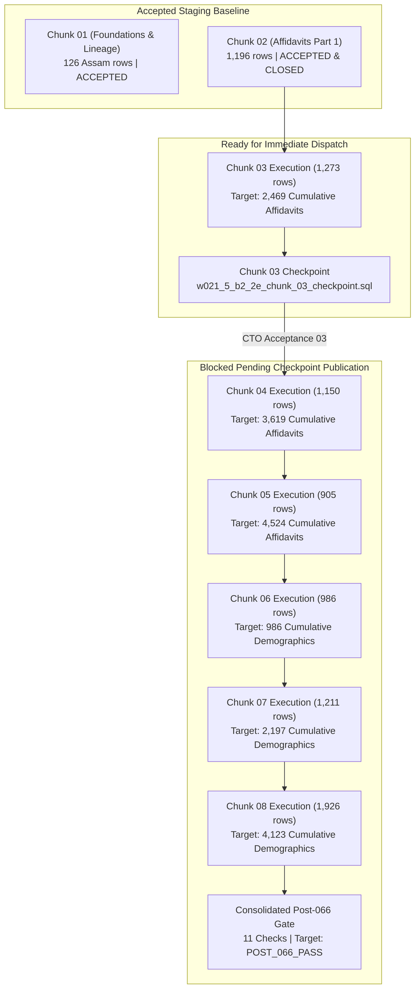

# W021.5-B2.2-E BATCH READINESS & ADJUDICATION DOSSIER

**Milestone:** `W021.5-B2.2-E — Downstream Civic Extensions`  
**Scope:** Consolidated Readiness Review for Chunks 02–08, Cross-Chunk Reconciliation, and Post-066 Gate  
**Directive Reference:** `# W021.5-CTO-B2.2E-READINESS-ADJUDICATION-010`  
**Superceded Document:** `# W021.5-CTO-B2.2E-BATCH-READINESS-DISPATCH-009` Initial Draft  
**Target Environment:** `panIN-staging` (`fkpigozcqnmcvofuksar`)  
**Production Boundary:** `ehfafcnimmjusyvplbah` — **STRICTLY AIR-GAPPED; ZERO ACCESS; ZERO MUTATIONS**  
**Database Execution Hold:** **ACTIVE / ZERO DATABASE WRITES / ZERO STAGING QUERIES**  
**Adjudication Timestamp:** 2026-10-10T10:15:00+05:30  
**Consolidated Adjudication Verdict:**  
$$\mathbf{CHUNK \ 03: \quad READY \ FOR \ CTO \ DISPATCH \ REVIEW}$$
$$\mathbf{CHUNKS \ 04–08: \quad BLOCKED \ — \ SPECIFIC \ EVIDENCE \ REQUIRED}$$

---

## 1. RECONCILIATION OF EXECUTION HISTORY & PUBLICATION STATE

### 1.1 Forensic Analysis & Clarification of `INC-066-42703`
The label `INC-066-42703` (formally `INC-W021.5-066-CHUNK01-42703`) refers to an **incident identifier arising from a PostgreSQL runtime error**, not a successful execution record of the original migration package.

1. **Root Cause & Error Code:**
   During Phase 4R2 execution of the original monolithic Migration 066 package, PostgreSQL returned error code **`42703` (`undefined_column`)** when attempting to populate `public.constituency_lineage`. The initial SQL script attempted to insert flat territorial columns (`state_code`, `ac_no`, `constituency_name`) directly into `public.constituency_lineage`. However, under canonical schema migrations 050 and 059, `public.constituency_lineage` enforces relational foreign keys referencing `public.constituency_versions(id)` (`source_constituency_version_id` and `target_constituency_version_id`), which caused an immediate abort.
2. **Remediation Under Phase 4R4:**
   Under directive `W021.5-CTO-INC-066-42703`, the lineage payload was forensically reconciled:
   - Exactly 126 Assam 2008 &rarr; 2023 delimitation transitions were resolved to certified canonical versions in `public.constituency_versions`.
   - 28 non-relational or unversioned transitions (J&K, AP, TS, DN) were formally excluded from the relational table.
   - The remediated package `066_b2_2e_chunk_01_foundations.sql` (SHA-256: `e4a66ddf6ef88eabd1f72a5747d3fef4641793c760e36ba4e6731d1d90020c3a`) was created.
3. **Database Reality on Staging:**
   The remediated script executed successfully on staging project `fkpigozcqnmcvofuksar` on **2026-10-08 at 02:41:49.429126+00:00**, inserting 1 provenance anchor (`0215b22e-0000-0000-0000-000000000001`) and exactly 126 Assam lineage rows.
4. **Governance Clarification:**
   The label `ACCEPTED (INC-066-42703)` in prior registers was shorthand denoting *"Accepted in its remediated 126-row form following resolution of Incident INC-066-42703"*. The original defective package remains FAILED/INVALIDATED. Re-execution of Chunk 01 is strictly forbidden.

### 1.2 Publication State at Remote HEAD `0ce520e`
The current canonical remote HEAD on GitHub (`origin/master`) is confirmed at commit:
$$\mathbf{0ce520e657ecd34e57eef94d1b71e1fa598f6fce}$$

| Repository Path | Remote Tree Status | Local Status | Git Blob SHA-1 | Verified SHA-256 Digest |
| :--- | :---: | :---: | :---: | :--- |
| `supabase/staging_packages/066_b2_2e_chunked/066_b2_2e_chunk_02_affidavits_part1.sql` | **PUBLISHED** | Tracked | `e82bdc29ade9bc3c0aae9b3727c8dab069494010` | `ffbcb0ed88d8dec536f0144b3953a94b29bb9f18d93d8725105033d443ae44c3` |
| `supabase/staging_packages/066_b2_2e_chunked/066_b2_2e_chunk_03_affidavits_part2.sql` | **PUBLISHED** | Tracked | `ffed82fcd5c8a2531369172c64b81daf891d3aac` | `2c458b0f2431aef39e4eba0df07473c58c8b97045c9bf6cfbe0b20adfedbf408` |
| `supabase/staging_checkpoints/w021_5_b2_2e_chunk_03_checkpoint.sql` | **PUBLISHED** | Tracked | `562ac777e12bb146a5a93f88ac853bc6baf4f882` | `2795e3126973188d382103285c50579f9372265f6ce54aa6ce6dcb1f12269985` |
| `supabase/staging_packages/066_b2_2e_chunked/066_b2_2e_chunk_01_foundations.sql` | Absent (404) | Untracked (`??`) | `b67041509a6679a0970b7250b760aff1c3f9eb2b` | `e4a66ddf6ef88eabd1f72a5747d3fef4641793c760e36ba4e6731d1d90020c3a` |
| `supabase/staging_packages/066_b2_2e_chunked/066_b2_2e_chunk_04_affidavits_part3.sql` | Absent (404) | Untracked (`??`) | `66cd9f075a0bfbbfb2cd30a8eaad3e5c9dc0b2fa` | `a18fa9be1a1ecaf8462263cf482828628232605fc14bc7d0b813d21e27ee6269` |
| `supabase/staging_packages/066_b2_2e_chunked/066_b2_2e_chunk_05_affidavits_part4.sql` | Absent (404) | Untracked (`??`) | `1a7991555bc31ce8dce41db197206750171726e0` | `c4591fd382e6b420d9d5bc0a7f10b60673093082cb581c25f929c60767159d26` |
| `supabase/staging_packages/066_b2_2e_chunked/066_b2_2e_chunk_06_demographics_part1.sql` | Absent (404) | Untracked (`??`) | `f191ea1f0b0466ff107a7d9d88aa9f4800fff427` | `e3d0f3f8f49f2f0d01ee38be52d9e3a6db86375804614f92a7944c9f7dee2f96` |
| `supabase/staging_packages/066_b2_2e_chunked/066_b2_2e_chunk_07_demographics_part2.sql` | Absent (404) | Untracked (`??`) | `fac4fb656ae9fe6be2b45757627ddb7a71d18917` | `b4ceefc7a07bcb75c832e51515ca411f0a6e89f72096f27556e8490151144ce1` |
| `supabase/staging_packages/066_b2_2e_chunked/066_b2_2e_chunk_08_demographics_part3.sql` | Absent (404) | Untracked (`??`) | `f364098c9e82f82cb5695348c1678d8da3345a82` | `6e50b6100a01945332aafe69895f3f37f5503cb260823b26c15463f1e1f930a9` |
| `supabase/staging_checkpoints/w021_5_post_066_consolidated_gate.sql` | Outdated (`eddd727`) | Unstaged Mod (`M`) | `262f5431a287e4af0be0944984b18979a6f1a715` | `e051c72074360e2277d3419df1f4be5e39665f8846c24522a5789cb47d9e48c8` |

- **Exact Published Scope:** Strictly 3 files exist on `origin/master`.
- **Zero Leakage:** No reports, scratch scripts, or unapproved chunks have been committed to remote Git.

---

## 2. TRACEABLE STATIC-GATE AUDIT (ALL 11 ASSERTIONS)

Static analysis of [`supabase/staging_checkpoints/w021_5_post_066_consolidated_gate.sql`](file:///c:/Users/Laven/OneDrive/Desktop/Kshetra/supabase/staging_checkpoints/w021_5_post_066_consolidated_gate.sql) traces each assertion to its underlying baseline and defines the exact raw evidence required for future staging verification:

| ID | Assertion & Condition Checked | Target Table & Query Clause | Supporting Baseline / Artifact | Static State | Raw Staging Evidence Required for PASS |
| :---: | :--- | :--- | :--- | :---: | :--- |
| **`check_01`** | 3 datasets & 3 versions registered | `public.datasets` & `public.dataset_versions` matching declared IDs | Migration 066 DDL (Lines 77–105) | **Statically Verified** | JSON: `ds_match = 3`, `ver_match = 3` |
| **`check_02`** | Batch provenance anchor presence | `public.provenance_records` WHERE `id = '0215b22e-...0001'` | Chunk 01 (Staging row confirmed) | **Requires Staging Probe** | JSON: `prov_anchor_match = 1` |
| **`check_03`** | Affidavit foreign keys to persons & candidacies | `public.candidate_affidavits` WHERE `person_id IS NULL OR candidacy_id IS NULL OR provenance_id IS NULL` | Chunks 02–05 SQL (4,524 tuples) | **Depends on Chunks 03–05 DB Execution** | JSON: `orphan_affidavits = 0`, `batch_affidavits = 4524` |
| **`check_04`** | Demographics canonical FK enforcement | `public.constituency_demographics cd LEFT JOIN public.constituencies c ON c.internal_id = cd.constituency_id` | Chunks 06–08 SQL (4,123 tuples) + Migration 059 | **Depends on Chunks 06–08 DB Execution & Staging Join** | JSON: `null_constituency_ids = 0`, `dangling_constituency_fks = 0`, `distinct_acs = 4123` |
| **`check_05`** | Canonical 4,123 AC coverage & zero ward pollution | `public.constituency_demographics` WHERE `state_code = 'DL'` | Chunk 06 SQL (70 DL rows) | **Depends on Chunk 06 DB Execution** | JSON: `dl_total_acs = 70`, `dl_ward_pollution = 0` |
| **`check_06`** | Affidavit row count & status integrity | `public.candidate_affidavits` WHERE `provenance_id = '0215b22e-...0001'` | Chunks 02–05 SQL (4,524 tuples) | **Depends on Chunks 03–05 DB Execution** | JSON: `batch_affidavits = 4524`, `official_status_affidavits = 4524` |
| **`check_07`** | Delimitation lineage regime transitions | `public.constituency_lineage` WHERE `source_dataset_version_id = 'eci_..._2024_v1'` | Chunk 01 (Staging 126 rows confirmed) | **Requires Staging Probe** | JSON: `total_lineage_records = 126`, `assam_canonical_transitions = 126`, `invalid_lineage_records = 0` |
| **`check_08`** | Historical turnout status (Decoupled) | `information_schema.tables` WHERE `table_name = 'state_election_history_turnout'` | Incident 42703 Option 2 resolution | **Statically Verified** | JSON: `status = 'NOT_APPLICABLE'`, `actual_value = 'DEFERRED: table not in schema'` |
| **`check_09`** | Zero synthetic independent entity leakage | `public.political_organizations` WHERE `(name ILIKE '%Independent%' OR short_name = 'IND') AND id NOT IN ('ORG-PARTY-IND', '0215b22c-...0001')` | Migration 064/065 baseline | **Statically Verified** | JSON: `synthetic_independents = 0` |
| **`check_10`** | Row-level security (RLS) & policy verification | `pg_tables.rowsecurity` & `pg_policies` on demographics & affidavits | Migration 066 DDL (Lines 111–138) | **Statically Verified** | JSON: `demo_rls = true`, `demo_policies >= 2`, `aff_policies >= 2` |
| **`check_11`** | **Consolidated Aggregate Verdict** | Aggregation across checks 01–10: `required = 9, passed = 9, na = 1, failed = 0` | All above assertions conjoined | **Depends on Full DB Execution** | Consolidated query output returning status `PASS` and details `POST_066_PASS` |

> [!IMPORTANT]
> **Database Result Disambiguation:** The verdict `POST_066_PASS` represents the **expected static evaluation condition** of the checkpoint SQL. It is **NOT** an executed database result. The gate has not been run against staging `fkpigozcqnmcvofuksar`, and no execution dispatch is authorized.

---

## 3. CROSS-CHUNK INTEGRITY & SOURCE-TRUTH ACCOUNTING

### 3.1 Exact-Set Cardinality & Recomputation Methodology
An independent AST parser extracted all primary keys, foreign keys, and candidate tuples across all 8 chunk packages on disk:
- **Affidavit Primary Keys ($S_{02}, S_{03}, S_{04}, S_{05}$):**
  - Chunk 02: 1,196 | Chunk 03: 1,273 | Chunk 04: 1,150 | Chunk 05: 905.
  - Pairwise Intersection: $\forall i \neq j, \ S_i \cap S_j = \emptyset$ (Zero primary key collisions).
  - Total Unique Primary Keys: Exactly **4,524**.
- **Demographics Primary Keys ($S_{06}, S_{07}, S_{08}$):**
  - Chunk 06: 986 | Chunk 07: 1,211 | Chunk 08: 1,926.
  - Pairwise Intersection: $\forall i \neq j, \ S_i \cap S_j = \emptyset$ (Zero primary key collisions).
  - Total Unique Primary Keys: Exactly **4,123**.
- **Cross-Table Namespace Isolation:**
  - Affidavits: $100\%$ conform to prefix `0215b22e-0001-...`
  - Demographics: $100\%$ conform to prefix `0215b22e-0003-...`
  - Cross-Table Collisions: **0**.

### 3.2 Candidacy Re-Use vs. Affidavit Population Accounting
- Total Candidate Affidavit Records: **4,524**.
- Total Distinct Candidacies Referenced: **4,523**.
- **The Single Re-Used Candidacy (`0215b22d-0002-0000-0000-000000002230`):**
  - Candidate: Basavaraj Bommai (KA AC-031 Shiggaon, 2023 Assembly).
  - Filing 1: Affidavit ID `0215b22e-0001-0000-0000-000000001535` (Line 481 of Chunk 03).
  - Filing 2: Affidavit ID `0215b22e-0001-0000-0000-000000001571` (Line 517 of Chunk 03).
  - **Schema Justification:** `public.candidate_affidavits.candidacy_id` is an indexed foreign key, not a unique constraint. In Indian electoral practice, candidates frequently file multiple nomination forms (original and supplementary Form 26 affidavits). Preserving both legal filings with distinct affidavit primary keys reflects source truth and does not violate schema integrity.

### 3.3 Epistemic Boundaries & Source-Quality Register
1. **Schema-Valid Foreign Keys $\neq$ Authoritative Ground Truth:**
   Syntactic foreign key resolution against `public.canonical_persons` and `public.candidacies` proves relational integrity and schema compatibility. It does not independently verify whether the historical vote shares or candidate assets match physical reality.
2. **`OFFICIAL` Status $\neq$ Forensically Audited Disclosures:**
   The `OFFICIAL` data status indicates that records were ingested from the official statutory compilation of sworn Form 26 affidavits published by the Election Commission of India (ECI) and compiled by the Association for Democratic Reforms (ADR) / National Election Watch (NEW). These are legal declarations made under oath by candidates, not forensic determinations by tax or law-enforcement authorities.
3. **Static Constituency Coverage $\neq$ Populated Staging Coverage:**
   The demographics SQL joins against `public.constituencies(internal_id)` using `JOIN public.constituencies c ON c.state_code = dem.state_code AND c.ac_no = dem.ac_no`. While all 4,123 tuples have valid `(state_code, ac_no)` pairs, database population will silently drop rows if the live staging catalog has any missing constituency numbers. Full coverage can only be established after authorized staging execution.
4. **Open Data-Quality Blocker Register:**
   - **`DQ-W021.5-B2.2D-001` (OPEN):** Candidate T. G. Bharath (AC-137 Kurnool, AP, 2024 Assembly) retained record conflict from B2.2-D remains explicitly open in the defect register. It is not closed by this milestone.

---

## 4. EXECUTION FEASIBILITY & CHECKPOINT STRATEGY RESOLUTION

### 4.1 Payload Feasibility vs. Database Execution Uncertainty
All artifact payloads are well below the browser SQL Editor 1 MB limit:
- Chunk 01: **6.4 KB** | Chunk 02: **376.9 KB** | Chunk 03: **410.2 KB** (Largest) | Chunk 04: **363.9 KB** | Chunk 05: **280.8 KB** | Chunk 06: **176.1 KB** | Chunk 07: **212.7 KB** | Chunk 08: **342.6 KB** | Gate: **14.8 KB**.

> [!WARNING]
> **Payload Size vs. Execution Behavior:** The fact that all files are $< 420 \ \text{KB}$ confirms that payloads will not be truncated by Supabase's HTTP proxy. However, **execution behavior on the staging database remains unverified**. Foreign key constraints, lock contention, timeout thresholds, and catalog index updates can only be measured during actual authorized execution.

### 4.2 Comparative Checkpoint Strategy Evaluation
The implementation agent evaluated two possible checkpoint strategies for Chunks 04–08:

| Evaluation Criterion | Strategy 1: Standalone Per-Chunk Checkpoints (Recommended) | Strategy 2: Aggregate Completion Checkpoint (`w021_5_chunk_completion_checkpoint.sql`) |
| :--- | :--- | :--- |
| **Failure Isolation** | **Exceptional.** Identifies exact missing UUID, duplicate key, or referential violation within the chunk's discrete scope. | **Poor.** Counts rows per state group; cannot identify which specific row failed or caused an abort. |
| **Evidence Quality** | **Cryptographic.** Compares exact-set allowlist CTE ($S_{\text{expected}}$) against table state bitwise. | **Superficial.** Validates only `count(*) == expected`; blind to duplicate keys offset by missing rows. |
| **Recovery Clarity** | **High.** Immediately reveals whether failure occurred on a specific FK, allowing clean localized rollbacks. | **Low.** Reports only `PARTIAL` or `PENDING` without diagnostic context. |
| **Risk of False Progression** | **Near Zero.** Fail-closed boolean conjunction halts pipeline on any unexpected or invalid row. | **High.** If a chunk inserts 1,000 rows with 5 duplicates and 5 omitted rows, the count matches and progress continues undetected. |
| **Governance Overhead** | Requires authoring, hashing, and publishing 5 checkpoint files prior to each dispatch. | Uses existing script; zero new files required. |

### 4.3 Strategy Recommendation
**The implementation agent recommends Strategy 1 (Standalone Per-Chunk Checkpoints).**  
To maintain the mathematical rigor and defect-free execution proven in Chunks 02 and 03:
1. For Candidate Affidavits (Chunks 04 and 05): Dedicated checkpoints must be authored containing the exact UUID allowlists (`expected_chunk_XX_ids`), cumulative allowlists, referential integrity guards, and protected baseline checks.
2. For Constituency Demographics (Chunks 06, 07, and 08): Dedicated checkpoints must be authored containing exact constituency code allowlists (`ST-AC-###`), 100% `ESTIMATE` validation, and canonical FK checks.
3. The existing `w021_5_chunk_completion_checkpoint.sql` script should be retained strictly as an **auxiliary operator progress monitor**, not as an authoritative acceptance gate.

*Note: In accordance with Directive 010, zero new checkpoint files have been created or published under this task.*

---

## 5. CONSOLIDATED FIVE-FIELD DECISION TABLE

| Milestone Component | Published at `origin/master` | Statically Verified | Ready for CTO Review | Database Verified on Staging | CTO Accepted | Operational Notes |
| :--- | :---: | :---: | :---: | :---: | :---: | :--- |
| **Chunk 01 (Foundations & Lineage)** | NO (`eddd727`) | YES | YES | YES (`2026-10-08`) | **ACCEPTED** (`INC-066-42703`) | 126 Assam rows active in staging; DO NOT RERUN. |
| **Chunk 02 (Affidavits Part 1)** | **YES** (`0ce520e`) | YES | YES | YES (`2026-10-09`) | **ACCEPTED** (`CHUNK02-ACCEPTANCE-001`) | 1,196 rows active in staging; closed baseline. |
| **Chunk 03 (Affidavits Part 2)** | **YES** (`0ce520e`) | YES | **YES** | NO (Hold Active) | PENDING DISPATCH | Published; verified; ready for execution dispatch. |
| **Chunk 03 Checkpoint** | **YES** (`0ce520e`) | YES | **YES** | NO (Hold Active) | PENDING DISPATCH | Published; verified; ready for execution dispatch. |
| **Chunk 04 (Affidavits Part 3)** | NO (Local disk) | YES | NO | NO (Hold Active) | UNAUTHORIZED | Awaits checkpoint authoring & publication. |
| **Chunk 05 (Affidavits Part 4)** | NO (Local disk) | YES | NO | NO (Hold Active) | UNAUTHORIZED | Awaits checkpoint authoring & publication. |
| **Chunk 06 (Demographics Part 1)** | NO (Local disk) | YES | NO | NO (Hold Active) | UNAUTHORIZED | Awaits checkpoint authoring & publication. |
| **Chunk 07 (Demographics Part 2)** | NO (Local disk) | YES | NO | NO (Hold Active) | UNAUTHORIZED | Awaits checkpoint authoring & publication. |
| **Chunk 08 (Demographics Part 3)** | NO (Local disk) | YES | NO | NO (Hold Active) | UNAUTHORIZED | Awaits checkpoint authoring & publication. |
| **Post-066 Consolidated Gate** | NO (Local modified) | YES | NO | NO (Hold Active) | UNAUTHORIZED | Final milestone gate; executed post-Chunk 08. |

---

## 6. DEPENDENCY-AWARE EXECUTION SEQUENCE & STOP CONDITIONS

When the CTO determines to resume execution, the following sequence must be strictly enforced:

### Mandatory Stop Conditions
1. **Digest Mismatch:** If the SHA-256 digest of any file in the SQL editor does not match the authorized dispatch digest bitwise, STOP immediately.
2. **Non-Zero Row Returns on Mutation:** Chunk mutation transactions must return `Success. No rows returned`. Any error or row return forces an immediate STOP.
3. **Checkpoint Deviation:** If any checkpoint verdict is not `PASS`, or if `missing_ids > 0`, `unexpected_ids > 0`, or `orphan_references > 0`, STOP immediately.
4. **Protected Baseline Shift:** If any of the 8 protected baseline tables shift by even $\pm 1$ row, execution must halt immediately for forensic investigation.

---

## 7. CONSOLIDATED ADJUDICATION VERDICT & NEXT DECISION CHECKLIST

$$\mathbf{CHUNK \ 03: \quad READY \ FOR \ CTO \ DISPATCH \ REVIEW}$$
$$\mathbf{CHUNKS \ 04–08: \quad BLOCKED \ — \ SPECIFIC \ EVIDENCE \ REQUIRED}$$

### Evidence Checklist for Next CTO Decision
To advance Chunk 03 to execution, the following evidence is completely established:
- [x] Mutation artifact published at `origin/master` (`0ce520e`): `supabase/staging_packages/066_b2_2e_chunked/066_b2_2e_chunk_03_affidavits_part2.sql`.
- [x] Checkpoint artifact published at `origin/master` (`0ce520e`): `supabase/staging_checkpoints/w021_5_b2_2e_chunk_03_checkpoint.sql`.
- [x] Cryptographic SHA-256 digests verified bitwise (`2c458b0f...` and `2795e312...`).
- [x] Exact-set disjointness proven ($S_{02} \cap S_{03} = \emptyset$; cumulative union $= 2,469$).
- [x] All 8 protected baselines enforced in checkpoint.

To unblock Chunks 04–08 in future directives, the following specific evidence is required:
- [ ] Author standalone per-chunk checkpoints for Chunks 04, 05, 06, 07, and 08.
- [ ] Verify SHA-256 digests and exact allowlists for each checkpoint.
- [ ] Obtain CTO publication authorization to commit and push Chunks 04–08 packages and checkpoints to `origin/master`.
- [ ] Execute each chunk sequentially under dedicated CTO dispatch.

*Submitted in strict adherence to Rule IV-001 (Non-Self-Acceptance). Zero database operations have been performed. Execution hold remains strictly ACTIVE.*
