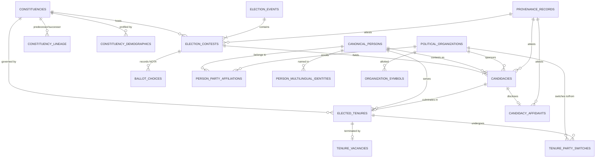

# KSHETRA W021.5 — CANONICAL ARCHITECTURE READINESS PACKAGE
## Canonical Entity Relationships, Forward-Only Migration Sequence & Consumer Decoupling Plan

**Milestone:** W021.5 — National Political Intelligence and Candidate Transparency  
**Directive:** CTO Directive 086 (Workstream D)  
**Date:** 2026-10-17  
**Governance Invariant:** Master Execution Framework Amendment v1.2 / Rule IV-001 (Non-Self-Acceptance)  
**Financial Defect Status:** `DQ-W021.5-B2.2E-001` — **STRICTLY OPEN**, pending separate CTO adjudication  
**Execution Boundary:** Repository design and architecture specifications only. Zero live database connections, mutations, or DDL applications.

---

## 1. Executive Mission & Strategic Framework

Under **CTO Directive 086**, this readiness package establishes the definitive, dependency-aware architectural blueprint for transitioning Kshetra from an offline seed/adapter hybrid into a fully normalized, canonical political-truth architecture.

Rather than proposing parallel registries or disruptive full-table rewrites, this design rigorously inspects the existing 68 SQL migrations, the W006 API strangler boundaries, the Fastify server layer, and the mobile application to answer the **10 mandatory architectural questions** specified in Directive 086 Section 5.

---

## 2. Exhaustive Analysis: The 10 Mandatory Architectural Questions

### Question 1: Which canonical tables and constraints already exist?

An exhaustive audit of the 68 migrations in `supabase/migrations/` confirms the existence of the following foundational tables:

1. **Constituency & Jurisdiction Layer:**
   - `states` (Migration 001, 003, 040): ISO state codes, names, statutory assembly and parliamentary seat counts, Union Territory flags.
   - `constituencies` (Migration 001, 003, 040, 059): Statutory assembly constituencies with unique primary key (`id = '{STATE}-AC-{acNo}'`), district associations, reservation status (`GEN`, `SC`, `ST`), and localized names.
   - `constituency_lineage` (Migration 060): Tracks historical predecessor and successor relationships across delimitation orders (e.g., 2008 Delimitation, 2023 Assam Delimitation).
   - `constituency_parliamentary_mappings` (Migration 060, 061): Normalized many-to-one mapping between Assembly Constituencies (AC) and Parliamentary Constituencies (PC).
   - `constituency_demographics` (Migration 066): ECI and Census 2011 demographic aggregates (electors, gender split, literacy, SC/ST percentage).

2. **Political Organization Layer:**
   - `public.political_organizations` (Migration 050, 064, 065): Canonical party registry (`id`, `canonical_name`, `abbreviation`, `recognition_status`, `founded_year`).
   - `public.organization_multilingual_names` (Migration 064): Localized party names across 13 scheduled Indian languages.
   - `public.organization_aliases` (Migration 064): Historical, regional, and colloquial party aliases.
   - `public.organization_symbols` (Migration 064): ECI-allotted electoral symbols, reservation status, and SVG/PNG asset references.
   - `public.organization_relationships` (Migration 050): Alliance and coalition structures (`alliance_with`, `parent_of`, `merged_into`).

3. **Canonical Person & Role Layer:**
   - `public.canonical_persons` (Migration 050, 063): Globally unique politician identity (`id UUID`, `canonical_name`, `gender`, `date_of_birth`, `birth_place`).
   - `public.person_multilingual_identities` (Migration 063): Transliterated names across languages.
   - `public.person_party_affiliations` (Migration 050): Historical party memberships (`valid_from`, `valid_to`, `affiliation_type`).
   - `public.person_roles` (Migration 050): Institutional roles held (`mla`, `mp`, `minister`, `party_official`).
   - `public.person_identity_linkages` (Migration 050): Cross-system deduplication linkages with source systems (`myneta`, `sansad`, `eci`).

4. **Electoral Contests & Tenures Layer:**
   - `public.election_events` (Migration 051): Discrete electoral events (`election_code`, `election_type`, `election_year`, `notification_date`, `polling_date`).
   - `public.election_contests` (Migration 051): Per-constituency electoral contests (`contest_code`, `constituency_id`, `reservation_status`, `is_uncontested`).
   - `public.candidacies` (Migration 050): Individual candidate contest entries (`person_id`, `party_id`, `result`, `votes_received`).
   - `public.elected_tenures` (Migration 050): Authoritative legislative tenures (`person_id`, `jurisdiction_id`, `term_start`, `term_end`, `is_current`).
   - `public.tenure_party_switches` (Migration 050): Mid-term defections and floor crossings (`from_party_id`, `to_party_id`, `effective_date`, `gazette_reference`).
   - `public.tenure_vacancies` (Migration 063): Premature tenure cessations (`vacancy_date`, `reason`, `gazette_reference`).
   - `public.provenance_records` (Migration 050): Cryptographic hashes, source URLs, collection timestamps, and verification audit trails.

---

### Question 2: Which required entities or relationships are absent, incomplete or duplicated?

1. **Foreign Key Gap: `candidacies` to `election_contests`:**
   - *Absence:* Migration 050 defined `public.candidacies` with `constituency_id TEXT` and `election_year INTEGER`, but omitted a direct foreign key to `public.election_contests(id)`. This prevents relational enforcement of candidate lists to official ECI contests.
2. **Defective Affidavit Linkage & Unsafe Defaults:**
   - *Incomplete & Defective:* Legacy `candidate_affidavits` (Migration 008) uses unindexed text fields (`constituency_id TEXT`, `candidate_name TEXT`) without linking to `canonical_persons(id)` or `candidacies(id)`.
   - *Financial Defect `DQ-W021.5-B2.2E-001`:* Migration 008 declared `movable_assets_inr BIGINT DEFAULT 0` and `immovable_assets_inr BIGINT DEFAULT 0`. This dangerous schema default converts missing or unfiled affidavits into false claims of ₹0 wealth.
3. **Duplication between Legacy `legislator_profiles` and Canonical Entities:**
   - *Duplication:* Migration 012 (`legislator_profiles`) combines politician identity, current office, committee memberships, and asset estimates into a single wide flat table. This duplicates the relational model in Migration 050 (`canonical_persons` + `elected_tenures` + `person_roles`).
4. **Candidate Ballot Result Modeling Gap:**
   - *Incomplete:* Migration 051 created `public.ballot_choices`, but constrained `choice_type` strictly to `CHECK (choice_type IN ('NOTA'))`. Official candidate votes were left solely in `candidacies.votes_received`, leaving runner-up votes, margins, and vote shares disconnected from contest ballot tables.
5. **Absence of Canonical Affidavit Schema:**
   - *Absent:* An authoritative, normalized table `candidacy_affidavit_disclosures` linking 1-to-1 with `candidacies(id)` where asset and liability fields are strictly nullable (`NULL` when unfiled, never `DEFAULT 0`).

---

### Question 3: Which existing migration or schema can be extended without introducing a parallel source of truth?

- **The Canonical Anchor:** Migrations 050 (`political_entity_model.sql`) and 051 (`election_data_normalization.sql`) must be treated as the sole canonical anchor.
- **Strict Prohibition:** Under no circumstances should parallel schemas (such as `canonical_candidates_v2` or `constituency_results_new`) be introduced.
- **Direct Safe Extensions:**
  - `public.candidacies`: Add column `contest_id UUID REFERENCES public.election_contests(id) ON DELETE RESTRICT`.
  - `public.candidacies`: Add column `margin INTEGER`, `margin_percent NUMERIC(5,2)`, `vote_share NUMERIC(5,2)`, `rank INTEGER`.
  - `public.elected_tenures`: Add column `candidacy_id UUID REFERENCES public.candidacies(id) ON DELETE RESTRICT` to create a verifiable link between the election victory and the legislative term.
  - Create table `public.candidacy_affidavits`: Normalized replacement for Migration 008 that references `candidacies(id)` and `canonical_persons(id)`, enforcing nullable financial fields.

---

### Question 4: How should constituency identity, election events, constituency-level results, candidates, canonical persons, parties, tenures, candidate affidavits and provenance relate?

The complete relational entity architecture is formalized below:



#### Relational Cardinality Invariants:
1. Every `ELECTION_CONTEST` belongs to exactly one `ELECTION_EVENT` and one `CONSTITUENCY`.
2. Every `CANDIDACY` binds exactly one `CANONICAL_PERSON` to one `ELECTION_CONTEST`.
3. An `ELECTED_TENURE` is created if and only if `candidacies.result = 'won'`.
4. `CANDIDACY_AFFIDAVITS` has a strict 1-to-0..1 relationship with `CANDIDACIES`. Financial metrics (`movable_assets`, `immovable_assets`, `liabilities`) are strictly `NULL` until certified ECI Form 26 data is ingested.

---

### Question 5: How will historical records, party changes, by-elections, vacancies and jurisdiction changes be represented temporally?

1. **Longitudinal Election History:**
   - Handled via `election_events` and `election_contests`.
   - Each general election (e.g. 2014, 2018, 2023) or by-election has a distinct `election_events` record with immutable `polling_date` and `counting_date`.
2. **Mid-Term Party Defections & Mergers:**
   - Modeled via `public.tenure_party_switches`.
   - Records `tenure_id`, `from_party_id`, `to_party_id`, `effective_date`, `switch_type` (`defection`, `merger`, `expulsion`, `resignation`), and `gazette_reference`.
   - Current representative party at any timestamp $t$ is resolved deterministically by evaluating switches where `effective_date <= t`.
3. **Premature Vacancies & By-Elections:**
   - Modeled via `public.tenure_vacancies`.
   - Sets `elected_tenures.is_current = false` with `vacancy_date`, `reason` (`death`, `resignation`, `disqualification`, `election_voided`).
   - The subsequent by-election is instantiated as `election_events.election_type = 'by_election'`.
4. **Delimitation & Boundary Reorganizations:**
   - Modeled via `public.constituency_lineage`.
   - Maps old constituency IDs to new constituency IDs with `lineage_type` (`redrawn`, `split`, `merged`, `renamed`) and `delimitation_year` (e.g., 2008 or 2023).

---

### Question 6: How will seed fixtures be separated from authoritative canonical records?

1. **Explicit Provenance Classification:**
   - Every row in the database must reference a `provenance_id` pointing to `public.provenance_records`.
   - `data_status_enum` values:
     - `OFFLINE_LOCAL_FIXTURE`: Data originating from repository static seed files (`data/seed/*.ts`).
     - `PROVISIONAL_INGESTED`: Scraped or bulk imported data pending independent cross-check.
     - `VERIFIED_OFFICIAL`: Bitwise-verified data matching ECI Form 20, Form 21E, or state CEO gazette notices.
2. **Perimeter Segregation in Fastify API:**
   - The Fastify API service layer must stamp each returned payload with its source provenance:
     - `provenance.source`: `'OFFICIAL_CANONICAL_DB'` vs `'OFFLINE_SEED_FIXTURE'`.
     - `provenance.verificationStatus`: `'VERIFIED'` vs `'UNVERIFIED_SEED'`.
3. **Prohibition of Blind Elevation:**
   - A seed fixture row can never be elevated to `VERIFIED_OFFICIAL` by automated script; elevation requires a verified ECI source citation and checksum match.

---

### Question 7: Which API contracts must change, and which consumers depend on their current shapes?

1. **`GET /states/:stateCode/constituencies/:id`:**
   - *Current Shape:* Returns `{ constituency, recentElection, elections[], election2023, mla }`.
   - *Consumers:* Mobile `app/constituency/[id].tsx`, `apps/mobile/lib/api/endpoints/constituencies.ts`.
   - *Contract Evolution:*
     - Preserve `recentElection` and `elections[]` as canonical.
     - Mark `election2023` as `@deprecated` (retained as an alias pointing to `recentElection` until Milestone W022).
     - Add section-level `provenance` metadata.
2. **`GET /states/:stateCode/mla/:acNo`:**
   - *Current Shape:* Returns flat MLA profile synthesized from seed data.
   - *Consumers:* Mobile `app/legislator/[id].tsx`, `apps/mobile/components/MLACard.tsx`.
   - *Contract Evolution:*
     - Add `canonicalPersonId: string | null`.
     - Support canonical routing `/legislator/person/:personId` alongside legacy `/states/:stateCode/mla/:acNo`.
3. **Impact on Mobile Consumers:**
   - Zero breaking changes to mobile route navigation.
   - The mobile client's `validateConstituencyDetail` validator has already been updated in Directive 086 to accept nullable election years and strict enum values for `electionType` (`'GENERAL' | 'BYPOLL' | null`).

---

### Question 8: Which W006 prerequisites or explicit CTO decisions block the next implementation stage?

1. **W006 Strangler Gate:**
   - *Prerequisite:* Phase 1–4 of the Fastify Strangler Migration must fully deprecate direct mobile client writes (`supabaseDataService.ts` Class B methods) before database triggers or constraints are tightened.
2. **CTO Decision Gate 1: Adjudication of Financial Defect `DQ-W021.5-B2.2E-001`:**
   - The CTO must formally adjudicate the replacement of Migration 008's `DEFAULT 0` financial columns with nullable fields and approve the schema migration script.
3. **CTO Decision Gate 2: Authorization of Staging Database Operations:**
   - No database connections, migrations, or DDL execution may occur without an explicit Staging Execution Directive.

---

### Question 9: What forward-only migration sequence, backfill, validation and rollback strategy would be safe?

#### Forward-Only Migration Plan (Migrations 067–070):

```text
Migration 067: 067_canonical_candidacies_contest_linkage.sql
- Purpose: Add foreign key constraint linking candidacies to election_contests.
- Operations:
    ALTER TABLE public.candidacies 
      ADD COLUMN contest_id UUID REFERENCES public.election_contests(id) ON DELETE RESTRICT,
      ADD COLUMN margin INTEGER,
      ADD COLUMN margin_percent NUMERIC(5,2) CHECK (margin_percent >= 0 AND margin_percent <= 100),
      ADD COLUMN vote_share NUMERIC(5,2) CHECK (vote_share >= 0 AND vote_share <= 100),
      ADD COLUMN rank INTEGER CHECK (rank >= 1);
    CREATE INDEX idx_candidacies_contest_id ON public.candidacies(contest_id);

Migration 068: 068_canonical_candidate_affidavits_remediation.sql
- Purpose: Remediate financial defect DQ-W021.5-B2.2E-001 with strict nullability.
- Operations:
    CREATE TABLE public.candidacy_affidavits (
      id UUID PRIMARY KEY DEFAULT gen_random_uuid(),
      candidacy_id UUID NOT NULL UNIQUE REFERENCES public.candidacies(id) ON DELETE CASCADE,
      person_id UUID NOT NULL REFERENCES public.canonical_persons(id) ON DELETE RESTRICT,
      affidavit_url TEXT,
      filing_date DATE,
      movable_assets_inr BIGINT CHECK (movable_assets_inr >= 0),
      immovable_assets_inr BIGINT CHECK (immovable_assets_inr >= 0),
      total_liabilities_inr BIGINT CHECK (total_liabilities_inr >= 0),
      has_criminal_cases BOOLEAN,
      criminal_cases_count INTEGER CHECK (criminal_cases_count >= 0),
      education_level TEXT,
      provenance_id UUID REFERENCES public.provenance_records(id) ON DELETE RESTRICT,
      created_at TIMESTAMPTZ NOT NULL DEFAULT now()
    );
    -- NOTE: Assets and liabilities default to NULL, NEVER 0.

Migration 069: 069_canonical_elected_tenure_candidacy_bridge.sql
- Purpose: Relate legislative office tenures to winning candidate records.
- Operations:
    ALTER TABLE public.elected_tenures
      ADD COLUMN candidacy_id UUID REFERENCES public.candidacies(id) ON DELETE RESTRICT;

Migration 070: 070_canonical_electoral_intelligence_views.sql
- Purpose: High-performance read views for Fastify API service.
- Operations:
    CREATE VIEW public.v_constituency_election_summary AS
      SELECT 
        ec.id AS contest_id,
        ec.constituency_id,
        ee.election_year,
        ee.election_type,
        w.person_id AS winner_person_id,
        w_cp.canonical_name AS winner_name,
        w_po.abbreviation AS winner_party,
        w.votes_received AS winner_votes,
        w.margin,
        w.margin_percent,
        r.person_id AS runner_up_person_id,
        r_cp.canonical_name AS runner_up_name,
        r_po.abbreviation AS runner_up_party,
        r.votes_received AS runner_up_votes
      FROM public.election_contests ec
      JOIN public.election_events ee ON ec.election_id = ee.id
      LEFT JOIN public.candidacies w ON w.contest_id = ec.id AND w.rank = 1
      LEFT JOIN public.canonical_persons w_cp ON w.person_id = w_cp.id
      LEFT JOIN public.political_organizations w_po ON w.party_id = w_po.id
      LEFT JOIN public.candidacies r ON r.contest_id = ec.id AND r.rank = 2
      LEFT JOIN public.canonical_persons r_cp ON r.person_id = r_cp.id
      LEFT JOIN public.political_organizations r_po ON r.party_id = r_po.id;
```

#### Backfill & Rollback Invariants:
1. **Backfill:** Idempotent `INSERT ... ON CONFLICT DO UPDATE` populated per-state, verifying record counts against ECI Form 20/21E benchmarks before committing transaction.
2. **Rollback Strategy:** All migrations are forward-only with corresponding `DOWN` rollback SQL scripts that drop added views and foreign key columns without destroying base records.

---

### Question 10: What acceptance evidence will demonstrate correctness without confusing repository tests with live database evidence?

Under Rule IV-001:
1. **Repository Test Evidence:**
   - Proves code syntax, TypeScript type checking, API schema contracts, mock responses, serialization, null preservation, and local offline fixture integrity.
   - Identified in reports as: `EVIDENCE_SOURCE: REPOSITORY_LOCAL_INSPECTION`.
2. **Live Database Evidence:**
   - Proves schema migrations, table constraints, row counts, query plans, and RLS policies against actual PostgreSQL catalogs (`pg_catalog.pg_tables`, `pg_catalog.pg_policies`).
   - Identified in reports as: `EVIDENCE_SOURCE: LIVE_CATALOG_QUERY`.
3. **Mandatory Standard:**
   - A passing Jest/Node test MUST NEVER be cited as proof that a database table exists in staging or production.

---

## 3. Table-by-Table Canonical Gap and Reuse Matrix

| Migration | Table Name | Status | Proposed Action | Rationalized Role in Canonical Model |
| :--- | :--- | :---: | :--- | :--- |
| **001** | `states` | **EXISTING** | **REUSE AS-IS** | Base statutory jurisdiction container. |
| **001 / 059** | `constituencies` | **EXISTING** | **REUSE AS-IS** | Statutory Assembly Constituencies (4,123 seats). |
| **008** | `candidate_affidavits` | **DEFECTIVE** | **DEPRECATE** | Has `DEFAULT 0` on assets (`DQ-W021.5-B2.2E-001`). Superseded by Migration 068. |
| **012** | `legislator_profiles` | **LEGACY** | **STRANGLE** | Wide legacy table. Replaced by `canonical_persons` + `elected_tenures`. |
| **050** | `canonical_persons` | **EXISTING** | **REUSE AS-IS** | Immutable global politician identity. |
| **050 / 065** | `political_organizations` | **EXISTING** | **REUSE AS-IS** | 1,207 ECI-recognized political parties and alliances. |
| **050** | `candidacies` | **INCOMPLETE** | **EXTEND (067)** | Add `contest_id` FK, margin, margin_percent, vote_share, rank. |
| **050** | `elected_tenures` | **INCOMPLETE** | **EXTEND (069)** | Add `candidacy_id` FK linking tenure to election win. |
| **050** | `tenure_party_switches` | **EXISTING** | **REUSE AS-IS** | Mid-term floor crossings and defections. |
| **051** | `election_events` | **EXISTING** | **REUSE AS-IS** | Discrete national and state election cycles. |
| **051** | `election_contests` | **EXISTING** | **REUSE AS-IS** | Per-constituency electoral contest containers. |
| **060** | `constituency_lineage` | **EXISTING** | **REUSE AS-IS** | Temporal boundary transitions across delimitations. |
| **063** | `tenure_vacancies` | **EXISTING** | **REUSE AS-IS** | Premature seat vacancies (death, resignation). |
| **064** | `organization_symbols` | **EXISTING** | **REUSE AS-IS** | Official party electoral symbols. |
| **066** | `constituency_demographics` | **EXISTING** | **REUSE AS-IS** | Census 2011 and ECI demographic profiles. |
| **068 (Prop)**| `candidacy_affidavits` | **NEW** | **AUTHOR (068)** | Normalized, null-safe candidate financial and legal disclosures. |
| **070 (Prop)**| `v_constituency_election_summary` | **NEW** | **AUTHOR (070)** | API read-optimized view over canonical contests and candidacies. |

---

## 4. Governance & Execution Sign-Off Boundaries

- **Rule IV-001 Notice:** This architecture package is submitted for independent CTO review. The author does not self-accept or self-ratify this design.
- **Defect Notice:** Financial defect `DQ-W021.5-B2.2E-001` remains **STRICTLY OPEN** pending separate CTO review.
- **Operational Boundary:** Zero database connections, staging migrations, or production operations were executed during this workstream.
