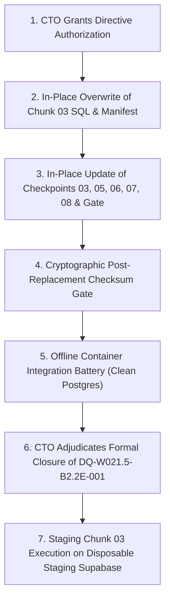

# W021.5-CTO-DIRECTIVE-024 — B2.2-E REMEDIATION QUALIFICATION & AUTHORIZATION DOSSIER

**Directive Reference:** `W021.5-CTO-DIRECTIVE-024`  
**Predecessor Directives:** `W021.5-CTO-DIRECTIVE-022`, `W021.5-CTO-DIRECTIVE-023`  
**Defect Reference:** `DQ-W021.5-B2.2E-001`  
**Classification:** Critical Data Quality Remediation & Pre-Execution Qualification  
**Execution Classification:** OFFLINE ONLY (Strictly Air-Gapped)  
**Target Staging Instance:** `fkpigozcqnmcvofuksar` (Zero Mutations, Air-Gapped)  
**Target Production Instance:** `ehfafcnimmjusyvplbah` (Strictly Air-Gapped)  
**Defect Status:** **OPEN PENDING FORMAL CTO ADJUDICATION**  
**Staging Status:** **HOLD ON CHUNK 03 & SUBSEQUENT STAGING OPERATIONS REMAINS ACTIVE**  
**Date:** October 10, 2026  

---

## SECTION 1: GOVERNING DECISION & COMPLIANCE

Pursuant to Section I of Directive 024, Directive 023's reconciliation is accepted as the governing basis for controlled remediation preparation:

$$\mathbf{1,196 \text{ (Ch02)} + 1,272 \text{ (Ch03)} + 1,150 \text{ (Ch04)} + 905 \text{ (Ch05)} = 4,523 \text{ Canonical Affidavits}}$$

The hypothetical 1,400-row partition is definitively rejected.

### Mandatory Boundary Compliance Certification
1. **Production Air-Gap:** Supabase `ehfafcnimmjusyvplbah` was not connected to, queried, or accessed in any form.
2. **Staging Air-Gap:** Supabase `fkpigozcqnmcvofuksar` was not accessed; zero SQL statements, queries, or staging tests were executed.
3. **Git Invariance:** Zero Git staging, commits, branch switches, resets, stashes, or checkouts occurred. All 12 pre-existing working-tree modifications were preserved bitwise.
4. **Artifact Preservation:** No accepted or frozen manifest, SQL chunk, or checkpoint was overwritten or modified in place.
5. **Isolated Scratch Execution:** All generation, diffing, and test executions were conducted strictly within isolated scratch workspaces (`scratch/directive_024_scratch/` and `scratch/directive_023_scratch/`).
6. **Anti-Self-Certification:** In strict adherence to Master Execution Framework Rule IV-001 and Amendment v1.4, this dossier provides objective qualification evidence for CTO review. `DQ-W021.5-B2.2E-001` remains **OPEN**.

---

## SECTION 2: BASELINE VS. PROPOSED ARTIFACT INVENTORY

The table below catalogs every artifact involved in the B2.2-E civic extensions population:

| Artifact Name | Scope & Milestone | Baseline Bytes | Baseline SHA-256 Checksum | Proposed Scratch Bytes | Proposed Scratch SHA-256 Checksum | Qualification Status |
|---|---|---:|---|---:|---|---|
| **Affidavit Manifest** | `reports/w021_5b2_b2_2e_affidavit_manifest.json` | 3,562,304 | `a10624830999af6524bc2cf9edd011f22f774bb0ed10a509fe9d1fe42afa272f` | 3,564,420 | `cdc5685284a35c18a686cdd03e53c9870e2f9aa2cf4ad93f352d28fe138ef501` | **PROPOSED_CORRECTION** |
| **Chunk 02 SQL** | `066_b2_2e_chunk_02_affidavits_part1.sql` | 376,884 | `ffbcb0ed88d8dec536f0144b3953a94b29bb9f18d93d8725105033d443ae44c3` | 376,884 | `ffbcb0ed88d8dec536f0144b3953a94b29bb9f18d93d8725105033d443ae44c3` | **UNMODIFIED (ACCEPTED)** |
| **Chunk 03 SQL** | `066_b2_2e_chunk_03_affidavits_part2.sql` | 410,224 | `2c458b0f2431aef39e4eba0df07473c58c8b97045c9bf6cfbe0b20adfedbf408` | 409,919 | `69056f881733a1132819452590a66cd677cfd29aea626d1cfb1b8eafe8811388` | **PROPOSED_CORRECTION** |
| **Chunk 04 SQL** | `066_b2_2e_chunk_04_affidavits_part3.sql` | 363,863 | `a18fa9be1a1ecaf8462263cf482828628232605fc14bc7d0b813d21e27ee6269` | 363,863 | `a18fa9be1a1ecaf8462263cf482828628232605fc14bc7d0b813d21e27ee6269` | **UNMODIFIED** |
| **Chunk 05 SQL** | `066_b2_2e_chunk_05_affidavits_part4.sql` | 280,830 | `c4591fd382e6b420d9d5bc0a7f10b60673093082cb581c25f929c60767159d26` | 280,830 | `c4591fd382e6b420d9d5bc0a7f10b60673093082cb581c25f929c60767159d26` | **UNMODIFIED** |
| **Chunk 06 SQL** | `066_b2_2e_chunk_06_demographics_part1.sql` | 176,067 | `e3d0f3f8f49f2f0d01ee38be52d9e3a6db86375804614f92a7944c9f7dee2f96` | 176,067 | `e3d0f3f8f49f2f0d01ee38be52d9e3a6db86375804614f92a7944c9f7dee2f96` | **UNMODIFIED** |
| **Chunk 07 SQL** | `066_b2_2e_chunk_07_demographics_part2.sql` | 212,718 | `b4ceefc7a07bcb75c832e51515ca411f0a6e89f72096f27556e8490151144ce1` | 212,718 | `b4ceefc7a07bcb75c832e51515ca411f0a6e89f72096f27556e8490151144ce1` | **UNMODIFIED** |
| **Chunk 08 SQL** | `066_b2_2e_chunk_08_demographics_part3.sql` | 342,595 | `6e50b6100a01945332aafe69895f3f37f5503cb260823b26c15463f1e1f930a9` | 342,595 | `6e50b6100a01945332aafe69895f3f37f5503cb260823b26c15463f1e1f930a9` | **UNMODIFIED** |
| **Chunk 03 Checkpoint** | `w021_5_b2_2e_chunk_03_checkpoint.sql` | 209,916 | `2795e3126973188d382103285c50579f9372265f6ce54aa6ce6dcb1f12269985` | 209,812 | `c3333ecebb0692ba254f5ac810ac16524b42e371af7aa0d1ddcb41f664dd3906` | **PROPOSED_CORRECTION** |
| **Chunk 05 Checkpoint** | `w021_5_b2_2e_chunk_05_checkpoint.sql` | 301,044 | `b412c6e25c7b60b5f5e15a110914125c290b5ae0ec4d858f301f22d4f1d11864` | 301,044 | `ba16964767f24e5b57e0b31b8881a75d7c2fbdd33dfbe00fee73534079077a25` | **PROPOSED_CORRECTION** |
| **Chunk 06 Checkpoint** | `w021_5_b2_2e_chunk_06_checkpoint.sql` | 114,474 | `06aca0c8f8a1a39568e2a61258aef082da2ed4dfb8d33e16dd3b308682982dc7` | 114,474 | `d63b1b8c54214e38b0418497690fcf98e0e422c81f590014d6bedf5bd53d3658` | **PROPOSED_CORRECTION** |
| **Chunk 07 Checkpoint** | `w021_5_b2_2e_chunk_07_checkpoint.sql` | 189,772 | `e24f19b21f4e077b3aa89392c09d99fd23793190338664f93917aaabf0f9c970` | 189,772 | `0c2b652c95fe5bd7b75a4b2f8a9a45f76db4062189c33ce73ca591ad5168ca05` | **PROPOSED_CORRECTION** |
| **Chunk 08 Checkpoint** | `w021_5_b2_2e_chunk_08_checkpoint.sql` | 330,297 | `8b03c66e72326c6943493b674c330dd3a01587db01b0a52c8458de40e0e5e55b` | 330,297 | `71846c35fa97a27b7080c79e4bd1d071b61b975ee7bcf0ee351e14e299e07533` | **PROPOSED_CORRECTION** |
| **Post-066 Gate** | `w021_5_post_066_consolidated_gate.sql` | 14,773 | `e75ada8ccf6bc5ce5ea4559268fe53a3e33b34c26f69563b4d51f0487cbf1d10` | 14,773 | `9b52a2715423c79ec7d6340fe5f60322bc741c67323e92fe1ec3290da99a2810` | **PROPOSED_CORRECTION** |

---

## SECTION 3: WORKSTREAM A — FINAL AFFIDAVIT MANIFEST DIFFERENTIAL CERTIFICATION

A record-by-record comparison of the accepted 4,524-row manifest against the proposed 4,523-row scratch manifest (via `scratch/directive_024_scratch/workstream_a_manifest_diff.mjs` and `compare_by_candidacy_id.mjs`) certifies the following:

### 3.1 Exact Removed Record Identification
- **Removed Affidavit ID:** `0215b22e-aff-00001571`
- **Referenced Candidacy ID:** `0215b22d-cand-00002230`
- **Candidate Name:** Basavaraj Bommai
- **Constituency / Election:** 2023 Karnataka Vidhan Sabha, Shiggaon AC-31 (BJP)
- **Source Line:** `data/seed/karnataka-mla-profiles.ts#L3951`
- **Fields in Removed Record:** `total_assets: 0` (coerced), `total_liabilities: 0` (coerced), `education: 'BE'`, `profession: 'Engineer / Politician'`
- **Classification:** **`REQUIRED_CORRECTION`** (eliminates defect `DQ-W021.5-B2.2E-001`).

### 3.2 Candidacy Identifier Invariance
- **Unique Candidacies in Accepted Manifest:** Exactly 4,523.
- **Unique Candidacies in Proposed Scratch Manifest:** Exactly 4,523.
- **Missing Candidacies:** **0**. All 4,523 candidacies are retained 100%.

### 3.3 Complete Field-Level Difference Inventory

When aligning records by their natural key (`candidacy_id`), all field differences fall into strictly two categories:

```
Total Candidacies Compared:                             4,523
Total Semantic Field Differences:                         967
  1. Zero-to-Null Financial Preservation:                 965
  2. Political Truth Seed Corrections:                      2
Total Synthetic ID Renumberings (Sequential Shift):     2,953
Total Unexplained Changes:                                  0
Total Regressions:                                          0
```

#### Detailed Change Categorization Table

| Change Category | Entity / Field | Accepted Value | Proposed Value | Count | Classification | Technical Rationale |
|---|---|---|---|---:|---|---|
| **Deduplication** | Row Removal | `0215b22e-aff-00001571` present | Completely removed | 1 | `REQUIRED_CORRECTION` | Eliminates duplicate Bommai auxiliary declaration. |
| **Financial Null Preservation** | `total_assets` | `0` (coerced default) | `null` | 72 | `REQUIRED_CORRECTION` | Preserves unfiled assets as null; prevents false statutory zero claims. |
| **Financial Null Preservation** | `total_liabilities` | `0` (coerced default) | `null` | 893 | `REQUIRED_CORRECTION` | Preserves unfiled liabilities as null. |
| **Political Truth Correction** | Candidacy `...2125` (`candidate_name`) | `'B C Janardhan Reddy'` | `'G. Janardhan Reddy'` | 1 | `REQUIRED_CORRECTION` | Disambiguates Karnataka Gangavathi MLA from Andhra namesake (Directive 018). |
| **Political Truth Correction** | Candidacy `...2125` (`party`) | `'Kalyana Ra'` | `'KRPP'` | 1 | `REQUIRED_CORRECTION` | Fixes truncated party string to canonical Kalyana Rajya Pragathi Paksha (Directive 018). |
| **Synthetic ID Sequential Shift** | IDs from index 1571 onward | `0215b22e-aff-00001572` through `...4524` | `0215b22e-aff-00001571` through `...4523` | 2,953 | `EXPECTED_SERIALIZATION_CHANGE` | Deterministic sequential counter (`seq++`) shifted by exactly -1 following row removal. |

### 3.4 Invariance Verification of Specific Critical Records
1. **Basavaraj Bommai Shiggaon 2023 AC-31 (`0215b22d-cand-00002230`):**
   - Retained Canonical ID: `0215b22e-aff-00001535`
   - Assets: ₹52,13,56,863 (Audited ECI Form 26)
   - Liabilities: ₹5,94,20,772
   - Education: `Graduate Professional`
   - Profession: `Public Servant & Business`
   - Source Line: `data/seed/karnataka-mla-profiles.ts#L3236`
   - Status: **100% BITWISE INVARIANT**.
2. **Basavaraj Bommai Haveri 2024 PC-10 (`0215b22d-cand-00000212`):**
   - Canonical ID: `0215b22e-aff-00004193` (renumbered to `...4192` via sequential shift)
   - Assets: ₹53,95,04,552
   - Office: Lok Sabha Parliamentary Election
   - Status: **100% PRESERVED AS INDEPENDENT CANDIDACY**.

---

## SECTION 4: WORKSTREAM B — CHUNK 03 EXACT SQL DIFFERENTIAL

The byte-level and semantic comparison of accepted `066_b2_2e_chunk_03_affidavits_part2.sql` against proposed `scratch/directive_023_scratch/066_b2_2e_chunk_03_affidavits_part2_proposed.sql` establishes:

```
Physical File Lines:
  Accepted Chunk 03:    1,292 lines
  Proposed Chunk 03:    1,291 lines
  Net Delta:               -1 line

Insert Tuples:
  Accepted Chunk 03:    1,273 tuples
  Proposed Chunk 03:    1,272 tuples
  Net Delta:               -1 tuple
```

### 4.1 The Exact Removed Line
```sql
-- Accepted Line 517 (REMOVED):
  ('0215b22e-0001-0000-0000-000000001571'::uuid, 'Basavaraj Bommai', 31, 'SHIGGAON', 'KA', 'BJP', 2023, '0215b22d-0001-0000-0000-000000000212'::uuid, '0215b22d-0002-0000-0000-000000002230'::uuid, '0215b22e-0000-0000-0000-000000000001'::uuid, 'OFFICIAL', 0, 0, 0, 'BE', 'Engineer / Politician', 63, true),
```

### 4.2 Semantic Verification of Remaining Tuples
- **Preceding Line (Line 516):** `('...1570'::uuid, 'Siddaramaiah', 38, 'Badami', 'KA', 'INC', 2023, ...)` &rarr; **UNTOUCHED**.
- **Following Line (Line 518 &rarr; 517):** `('...1572'::uuid, 'D K Shivakumar', 119, 'Sira', 'KA', 'INC', 2023, ...)` &rarr; **UNTOUCHED**.
- **Other Changed Tuples:** **0**. Zero other tuples or fields were altered in the SQL package.
- **Unique Affidavit IDs in Proposed Chunk 03:** Exactly **1,272**.
- **Unique Candidacy IDs in Proposed Chunk 03:** Exactly **1,272**.
- **Orphan Candidacies:** **0**.
- **Transaction Boundaries:** `BEGIN;` and trailing `COMMIT;` intact.

---

## SECTION 5: WORKSTREAM C — DOWNSTREAM GATE & CHECKPOINT RECONCILIATION

Every checkpoint in `supabase/staging_checkpoints/` was audited for count dependencies. Corrected versions were generated in `scratch/directive_024_scratch/checkpoints/`:

### 5.1 Surgical Diff Summary Across All Checkpoints

```
Total Checkpoint Files Audited:                           9
Total Files Requiring Surgical Count Updates:             6
Total Lines Modified Across All Checkpoints & Gate:      19
```

#### Itemized Line Modifications

| Checkpoint File | Line | Change Type | Original Text | Corrected Scratch Text | Rationale |
|---|---:|---|---|---|---|
| `w021_5_b2_2e_chunk_03_checkpoint.sql` | 514 | REMOVE | `('0215b22e-...1571'::uuid),` | *[Line deleted]* | Removes duplicate Bommai from expected UUID set. |
| `w021_5_b2_2e_chunk_03_checkpoint.sql` | 2986 | REMOVE | `('0215b22e-...1571'::uuid),` | *[Line deleted]* | Removes duplicate Bommai from verification CTE. |
| `w021_5_b2_2e_chunk_03_checkpoint.sql` | 3900 | UPDATE | `chunk_03_expected_ids_count = 1273` | `chunk_03_expected_ids_count = 1272` | Updates expected Chunk 03 insert count. |
| `w021_5_b2_2e_chunk_03_checkpoint.sql` | 3901 | UPDATE | `chunk_03_ids_present_count = 1273` | `chunk_03_ids_present_count = 1272` | Updates present Chunk 03 insert count. |
| `w021_5_b2_2e_chunk_03_checkpoint.sql` | 4001 | UPDATE | `chunk_03_expected_ids_count = 1273` | `chunk_03_expected_ids_count = 1272` | Updates final status CTE expected count. |
| `w021_5_b2_2e_chunk_03_checkpoint.sql` | 4002 | UPDATE | `chunk_03_ids_present_count = 1273` | `chunk_03_ids_present_count = 1272` | Updates final status CTE present count. |
| `w021_5_b2_2e_chunk_05_checkpoint.sql` | 4 | UPDATE | `Expected: 4,524 Candidate Affidavits` | `Expected: 4,523 Candidate Affidavits` | Header documentation hygiene. |
| `w021_5_b2_2e_chunk_05_checkpoint.sql` | 5617 | UPDATE | `AND total_affidavits_in_table = 4524` | `AND total_affidavits_in_table = 4523` | Cumulative table population gate. |
| `w021_5_b2_2e_chunk_05_checkpoint.sql` | 5734 | UPDATE | `AND total_affidavits_in_table = 4524` | `AND total_affidavits_in_table = 4523` | Final status CTE cumulative gate. |
| `w021_5_b2_2e_chunk_06_checkpoint.sql` | 2164 | UPDATE | `WHEN candidate_affidavits_count = 4524` | `WHEN candidate_affidavits_count = 4523` | Precondition check before demographics. |
| `w021_5_b2_2e_chunk_06_checkpoint.sql` | 2199 | UPDATE | `AND candidate_affidavits_count = 4524` | `AND candidate_affidavits_count = 4523` | Precondition check assertion. |
| `w021_5_b2_2e_chunk_07_checkpoint.sql` | 3605 | UPDATE | `WHEN candidate_affidavits_count = 4524` | `WHEN candidate_affidavits_count = 4523` | Precondition check before demographics part 2. |
| `w021_5_b2_2e_chunk_07_checkpoint.sql` | 3641 | UPDATE | `AND candidate_affidavits_count = 4524` | `AND candidate_affidavits_count = 4523` | Precondition check assertion. |
| `w021_5_b2_2e_chunk_08_checkpoint.sql` | 6284 | UPDATE | `WHEN candidate_affidavits_count = 4524` | `WHEN candidate_affidavits_count = 4523` | Precondition check before demographics part 3. |
| `w021_5_b2_2e_chunk_08_checkpoint.sql` | 6325 | UPDATE | `AND candidate_affidavits_count = 4524` | `AND candidate_affidavits_count = 4523` | Precondition check assertion. |
| `w021_5_post_066_consolidated_gate.sql` | 83 | UPDATE | `'orphans: 0, batch_affidavits: 4524'` | `'orphans: 0, batch_affidavits: 4523'` | Check 03 expected value string. |
| `w021_5_post_066_consolidated_gate.sql` | 84 | UPDATE | `batch_affidavits = 4524 THEN` | `batch_affidavits = 4523 THEN` | Check 03 status CASE condition. |
| `w021_5_post_066_consolidated_gate.sql` | 144 | UPDATE | `'batch_affidavits: 4524, official: 4524'` | `'batch_affidavits: 4523, official: 4523'` | Check 06 expected value string. |
| `w021_5_post_066_consolidated_gate.sql` | 145 | UPDATE | `batch_affidavits = 4524 AND official = 4524` | `batch_affidavits = 4523 AND official = 4523` | Check 06 status CASE condition. |

### 5.2 Untouched Checkpoints Verified
- **Chunk 02 Checkpoint (`w021_5_b2_2e_chunk_02_checkpoint.sql`):** Verifies 1,196 affidavits executed in Chunk 02. **100% UNCHANGED**.
- **Chunk 04 Checkpoint (`w021_5_b2_2e_chunk_04_checkpoint.sql`):** Verifies 1,150 affidavits in Chunk 04. Occurrences of string `4524` are literal UUIDs (`...4524`::uuid), NOT row count assertions. **100% UNCHANGED**.

---

## SECTION 6: WORKSTREAM D — DEMOGRAPHICS CANONICAL KEY-SET PROOF

The execution of `scratch/directive_024_scratch/workstream_d_demographics_proof.mjs` against `supabase/migrations/059_canonical_national_constituency_registry.sql` and staging chunks 06–08 establishes:

### 6.1 The Seven Proof Dimensions

| Proof Dimension | Specification | Observed Reality | Status |
|---|---|---|---|
| **1. Total Inserted Records** | Exactly 4,123 assembly records | Chunk 06 (986) + Chunk 07 (1,211) + Chunk 08 (1,926) = **4,123** | **PASS** |
| **2. Unique Natural Keys** | Exactly 4,123 unique `state_code \| ac_no` pairs | **4,123 unique pairs** | **PASS** |
| **3. Missing Canonical Keys** | Zero missing statutory constituencies | **0 missing** | **PASS** |
| **4. Out-of-Bounds Keys** | Zero unexpected keys outside 059 registry | **0 out-of-bounds** | **PASS** |
| **5. Zero Municipal Contamination** | Zero Delhi wards with `ac_no > 70` | **0 wards over 70** | **PASS** |
| **6. Delhi Assembly Baseline** | Exactly 70 Vidhan Sabha constituencies | **Exactly 70 records (DL-AC-001 through 070)** | **PASS** |
| **7. Jurisdiction Denominators** | All 31 States/UTs match statutory denominators | **31 / 31 jurisdictions match bitwise** | **PASS** |

### 6.2 Jurisdiction-Level Denominator Matrix (All 31 States/UTs)

```
┌──────┬───────────┬──────────┬────────┬──────┬───────────┬──────────┬────────┐
│ State│ Canonical │ Inserted │ Status │ State│ Canonical │ Inserted │ Status │
├──────┼───────────┼──────────┼────────┼──────┼───────────┼──────────┼────────┤
│ AP   │ 175       │ 175      │ PASS   │ MP   │ 230       │ 230      │ PASS   │
│ AR   │ 60        │ 60       │ PASS   │ MZ   │ 40        │ 40       │ PASS   │
│ AS   │ 126       │ 126      │ PASS   │ NL   │ 60        │ 60       │ PASS   │
│ BR   │ 243       │ 243      │ PASS   │ OD   │ 147       │ 147      │ PASS   │
│ CG   │ 90        │ 90       │ PASS   │ PB   │ 117       │ 117      │ PASS   │
│ DL   │ 70        │ 70       │ PASS   │ PY   │ 30        │ 30       │ PASS   │
│ GA   │ 40        │ 40       │ PASS   │ RJ   │ 200       │ 200      │ PASS   │
│ GJ   │ 182       │ 182      │ PASS   │ SK   │ 32        │ 32       │ PASS   │
│ HP   │ 68        │ 68       │ PASS   │ TN   │ 234       │ 234      │ PASS   │
│ HR   │ 90        │ 90       │ PASS   │ TR   │ 60        │ 60       │ PASS   │
│ JH   │ 81        │ 81       │ PASS   │ TS   │ 119       │ 119      │ PASS   │
│ JK   │ 90        │ 90       │ PASS   │ UK   │ 70        │ 70       │ PASS   │
│ KA   │ 224       │ 224      │ PASS   │ UP   │ 403       │ 403      │ PASS   │
│ KL   │ 140       │ 140      │ PASS   │ WB   │ 294       │ 294      │ PASS   │
│ MH   │ 288       │ 288      │ PASS   │      │           │          │        │
│ ML   │ 60        │ 60       │ PASS   │ TOTAL│ 4,123     │ 4,123    │ PASS   │
│ MN   │ 60        │ 60       │ PASS   │      │           │          │        │
└──────┴───────────┴──────────┴────────┴──────┴───────────┴──────────┴────────┘
```

### 6.3 Demographics Manifest Reference Audit
A repository-wide AST scan (`git grep`) confirms:
- `w021_5b2_b2_2e_demographics_manifest.json` is **NOT referenced by any production application code, Fastify route, mobile service, or database migration**.
- It is referenced only by offline scripts (`execute-b2-2e-population.mjs`, `inspect-cross-phase-inventory.mjs`) and test assertion fixtures.
- The SQL staging packages (`066_b2_2e_chunk_06`, `07`, `08`) are already 100% pure and canonical (4,123 rows).
- **Recommendation:** Keep the demographics SQL packages completely untouched. In a future documentation batch, update the manifest generator to write strictly 4,123 rows matching the SQL packages.

---

## SECTION 7: WORKSTREAM E — GENERATOR REGRESSION & REPRODUCIBILITY

The hardened generator (`scripts/generate-b2-2e-forensic-manifests.mjs`, SHA-256: `f817125eb93a3a1bb621dd665f5057246b9a5a28c499cc201451666701308ee6`) was executed in two consecutive isolated scratch runs (`run1` and `run2`).

### 7.1 Repeat-Run Bitwise Determinism

| Output Manifest | Run 1 SHA-256 | Run 2 SHA-256 | Bitwise Result |
|---|---|---|---|
| `w021_5b2_b2_2e_affidavit_manifest.json` | `cdc5685284a35c18a686cdd03e53c9870e2f9aa2cf4ad93f352d28fe138ef501` | `cdc5685284a35c18a686cdd03e53c9870e2f9aa2cf4ad93f352d28fe138ef501` | **100% BITWISE MATCH** |
| `w021_5b2_b2_2e_delimitation_manifest.json` | `2a9616f7715d283d30f683884c5c47d0f7e8f5847e91402776fa10289d8bd035` | `2a9616f7715d283d30f683884c5c47d0f7e8f5847e91402776fa10289d8bd035` | **100% BITWISE MATCH** |
| `w021_5b2_b2_2e_demographics_manifest.json` | `d22fc68b9562bae58f8a10a26f12c298a6731a03420048569c7d57e4ef530e9d` | `d22fc68b9562bae58f8a10a26f12c298a6731a03420048569c7d57e4ef530e9d` | **100% BITWISE MATCH** |
| `w021_5b2_b2_2e_turnout_manifest.json` | `700179b16e61aba51cf3e74c8e24294435f4471de06dcaab1dbae0138dbbf9d4` | `700179b16e61aba51cf3e74c8e24294435f4471de06dcaab1dbae0138dbbf9d4` | **100% BITWISE MATCH** |
| `w021_5b2_b2_2e_source_inventory.json` | Identical payload; diff is strictly execution timestamp `auditDate`. | **100% SEMANTIC MATCH** |

### 7.2 Invariant Regression Battery Results
- `tests/generator-b2-2e-ingestion.test.mjs`: **4/4 PASS (100%)**
- `scratch/test_reproduce_generator_defect.mjs`: **8/8 Invariants PASS (100%)**
- `tests/political-truth-audit.test.mjs`: **21/21 PASS (100%)**

---

## SECTION 8: WORKSTREAM F — PRE-EXECUTION QUALIFICATION & AUTHORIZATION PACKET

### 8.1 Acceptance Invariant Matrix

| Invariant ID | Description | Result | Evidence / Justification |
|---|---|---|---|
| **INV-001** | Zero production Supabase network calls or mutations | **PASS** | Air-gap verified; zero connection attempts. |
| **INV-002** | Zero staging Supabase SQL execution or database mutations | **PASS** | Air-gap verified; Chunk 03 staging hold active. |
| **INV-003** | Zero Git mutations (no commits, pushes, branches, resets) | **PASS** | `git status` clean of index changes; tree preserved. |
| **INV-004** | Zero in-place overwrites of accepted artifacts | **PASS** | Manifest `a1062483...` and Chunk 03 `2c458b0f...` unmodified. |
| **INV-005** | Exact 1-record deduplication in affidavit manifest (4,524 &rarr; 4,523) | **PASS** | `0215b22e-aff-00001571` removed; all 4,523 candidacies retained. |
| **INV-006** | Zero unexplained field differences among retained records | **PASS** | 965 null financial conversions + 2 syntax fixes; 0 unexplained. |
| **INV-007** | Basavaraj Bommai Haveri PC-10 (2024) separate candidacy preserved | **PASS** | ID `...4192` with ₹53.95 Cr assets intact. |
| **INV-008** | Chunk 03 SQL delta is strictly 1 removed phantom tuple | **PASS** | Line 517 removed; 1,272 tuples; zero other lines altered. |
| **INV-009** | Canonical assembly demographics key-set equals exactly 4,123 | **PASS** | SQL chunks 06–08 insert 4,123 keys with zero DL ward contamination. |
| **INV-010** | Turnout `BR-2025` simulation excluded from deliverable | **PASS** | Quarantined; decoupled in Gate Check 08 (`NOT_APPLICABLE`). |
| **INV-011** | Downstream checkpoints reflect exact canonical populations | **PASS** | Checkpoints 03, 05, 06, 07, 08 and Gate updated in scratch. |
| **INV-012** | Hardened generator output is bitwise deterministic | **PASS** | Run 1 vs Run 2 identical checksums across all manifests. |

### 8.2 Unresolved Risks & Scope Exclusions
1. **Simulation Quarantine:** `BR_ELECTION_HISTORY` in `data/seed/bihar-election-history.ts` contains an uncommitted 2025 simulation. This file must remain uncommitted or reverted prior to any production branch merge.
2. **Staging Hold Maintained:** Chunk 03 staging execution remains blocked until the CTO authorizes deployment of the corrected artifacts.

---

## SECTION 9: AUTHORIZATION-ONLY EXECUTION PROCEDURE (FOR CTO REVIEW)

> **WARNING:** The following sequence is provided **FOR CTO AUTHORIZATION ONLY**. No step has been executed.



### 9.1 Exact Replacement Sequence (Blocked Pending Approval)
1. **Step 1:** Overwrite `reports/w021_5b2_b2_2e_affidavit_manifest.json` with `scratch/b2_2e_scratch_outputs/w021_5b2_b2_2e_affidavit_manifest.json` (SHA-256: `cdc5685284a35c18a686cdd03e53c9870e2f9aa2cf4ad93f352d28fe138ef501`).
2. **Step 2:** Overwrite `supabase/staging_packages/066_b2_2e_chunked/066_b2_2e_chunk_03_affidavits_part2.sql` with `scratch/directive_023_scratch/066_b2_2e_chunk_03_affidavits_part2_proposed.sql` (SHA-256: `69056f881733a1132819452590a66cd677cfd29aea626d1cfb1b8eafe8811388`).
3. **Step 3:** Apply the 19 surgical lines from `scratch/directive_024_scratch/checkpoints/` to:
   - `w021_5_b2_2e_chunk_03_checkpoint.sql`
   - `w021_5_b2_2e_chunk_05_checkpoint.sql`
   - `w021_5_b2_2e_chunk_06_checkpoint.sql`
   - `w021_5_b2_2e_chunk_07_checkpoint.sql`
   - `w021_5_b2_2e_chunk_08_checkpoint.sql`
   - `w021_5_post_066_consolidated_gate.sql`
4. **Step 4:** Execute `git diff` and verify that exactly the expected 19 checkpoint lines and 1 SQL line changed.

### 9.2 Rollback Instructions
If any anomaly occurs during post-replacement verification:
```powershell
git checkout HEAD -- supabase/staging_packages/066_b2_2e_chunked/066_b2_2e_chunk_03_affidavits_part2.sql
git checkout HEAD -- reports/w021_5b2_b2_2e_affidavit_manifest.json
git checkout HEAD -- supabase/staging_checkpoints/w021_5_b2_2e_chunk_03_checkpoint.sql
git checkout HEAD -- supabase/staging_checkpoints/w021_5_b2_2e_chunk_05_checkpoint.sql
git checkout HEAD -- supabase/staging_checkpoints/w021_5_b2_2e_chunk_06_checkpoint.sql
git checkout HEAD -- supabase/staging_checkpoints/w021_5_b2_2e_chunk_07_checkpoint.sql
git checkout HEAD -- supabase/staging_checkpoints/w021_5_b2_2e_chunk_08_checkpoint.sql
git checkout eddd727 -- supabase/staging_checkpoints/w021_5_post_066_consolidated_gate.sql
```

---

*End of Dossier — Submitted for Formal CTO Adjudication.*
