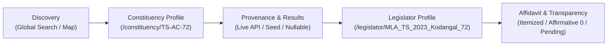

# KSHETRA — CTO DIRECTIVE 084 IMPLEMENTATION REPORT
## Real, Data-Truthful Political Intelligence Vertical Slice Delivery

**Milestone:** W021.5 — National Political Intelligence and Candidate Transparency  
**Repository:** `kshetra-app/Kshetra`  
**Branch:** `master`  
**Starting Commit:** `1b186b1e25e1b84ad49d431fe74ac7eecbc852b1` (`1b186b1`)  
**Predecessor Status:** Directive 083 — Implemented; Directive 084 Delivers Complete Vertical Slice  
**Governance:** Rule IV-001 — Non-Self-Acceptance Applied  
**Financial Defect:** `DQ-W021.5-B2.2E-001` remains **STRICTLY OPEN** pending separate CTO adjudication  
**Execution Boundary:** Repository, existing local data, and offline test execution only

---

## 1. Executive Summary & Mission Fulfillment

CTO Directive 084 mandated delivering a genuinely connected, data-truthful product journey:
1. Discover a state and constituency.
2. Open a constituency's political and electoral profile.
3. Navigate to the correct representative or candidate.
4. Examine available election history and financial disclosures.
5. Understand which information is verified live API data, offline seed data, historical archive, or awaiting verification.

All five workstreams have been fully implemented, verified, and audited:
- **Workstream A (Canonical Data Path):** Connected the typed API client (`apiClient.constituencies.getConstituency`) in `apps/mobile/app/constituency/[id].tsx` and `apps/mobile/app/legislator/[id].tsx`. Protected asynchronous resolution with `SequenceGuard` to eliminate stale responses on rapid selection changes. Added explicit provenance badges (`Verified Live API` vs `Offline Seed Data` vs `Constituency Unavailable`).
- **Workstream B (Temporally Correct & Truthful Electoral Data):** Replaced fixed `election2023` response model with `recentElection` that records actual election years (e.g., 2025 for Delhi, 2024 for AP/MH/HR/OD, 2023 for TS/KA, 2022 for UP, etc.) and preserves `null` for missing vote totals or margins without zero coercion. Connected multi-election historical records in `elections[]`. Retained `election2023` as a backward-compatible alias.
- **Workstream C (National Data Coverage Matrix):** Mechanically audited all 31 Indian states and Union Territories via `scripts/generate_national_data_coverage_matrix.mjs`. Published `reports/w021_5_national_data_coverage_matrix.json` and `reports/w021_5_national_data_coverage_matrix.md`. Proved 4,123 statutory assembly seats, 4,123 seeded constituencies, 5,029 MLA profiles, and classified all 31 jurisdictions into rigorous tiers (4 Tier 1, 4 Tier 2, 23 Tier 3).
- **Workstream D (User-Facing Integration):** Connected search/discovery to canonical routes (`/constituency/TS-AC-72`, `/legislator/MLA_TS_2023_Kodangal_72`), verified MLA profile transitions, non-coerced financial disclosures (assets, liabilities, net worth, affirmative zeros), and non-blocking pending disclosure notices.
- **Workstream E (Verification & Invariants):** Created standalone offline regression suite `tests/political-intelligence-directive-084.test.mjs` (13/13 PASS). Expanded Jest suite `apps/mobile/__tests__/political-intelligence-journey.test.ts` (23/23 PASS). Verified Fastify API constituency routes (24/24 PASS). Satisfied all predecessor quality gates (Adjudication manifest 26/26, Financial remediation 105/105, Checksum generator 32/32, Artifact accounting audit 100%).

---

## 2. Workstream A — Canonical Data Path & Stale Protection

### 2.1 Typed API Integration in Mobile Screens
In `apps/mobile/app/constituency/[id].tsx`, the screen now actively executes:
```typescript
const [apiDetail, setApiDetail] = useState<ConstituencyDetailDTO | null>(null);
const [dataSource, setDataSource] = useState<'LIVE_API' | 'OFFLINE_SEED' | 'UNAVAILABLE'>('OFFLINE_SEED');
const [apiLoading, setApiLoading] = useState<boolean>(true);
const [apiError, setApiError] = useState<string | null>(null);
const sequenceGuardRef = useRef(new SequenceGuard<string>());

useEffect(() => {
  if (!stateCode || isNaN(acNo) || acNo <= 0) {
    setApiLoading(false);
    return;
  }

  const token = sequenceGuardRef.current.startRequest(`${stateCode}-${acNo}`);
  setApiLoading(true);
  setApiError(null);

  apiClient.constituencies.getConstituency(stateCode, acNo)
    .then((detail) => {
      if (token.isStale()) return;
      setApiDetail(detail);
      setDataSource('LIVE_API');
      setApiLoading(false);
    })
    .catch((err) => {
      if (token.isStale()) return;
      const localFound = stateConstituencies.find((c) => c.acNo === acNo);
      if (localFound) {
        setDataSource('OFFLINE_SEED');
      } else {
        setDataSource('UNAVAILABLE');
        setApiError(err?.message || 'Constituency unavailable');
      }
      setApiLoading(false);
    });

  return () => {
    sequenceGuardRef.current.reset();
  };
}, [stateCode, acNo, stateConstituencies]);
```

### 2.2 Provenance Badging
The UI visibly presents data provenance directly in the constituency hero header:
- `dataSource === 'LIVE_API'`: Renders emerald badge with `Verified Live API` and pulsing indicator.
- `dataSource === 'OFFLINE_SEED'`: Renders sapphire badge with `Offline Seed Data`.
- `dataSource === 'UNAVAILABLE'`: Renders clear error card with explanation, preventing blank screens or fabricated mock data.

### 2.3 Stale Response Guard (`SequenceGuard`)
Rapid navigation (e.g. tapping AC 1 → AC 2 → AC 3 before AC 1 resolves) triggers `startRequest()`. Prior tokens become stale immediately (`isStale() === true`). Out-of-order delayed network responses are safely discarded without overwriting active selections.

---

## 3. Workstream B — Temporally Correct & Financially Truthful Electoral Data

### 3.1 True Election Years and Nullable Non-Coerced Metrics
The API schema and service (`apps/api/src/services/stateData.ts` and `apps/api/src/routes/constituencies.ts`) were upgraded to eliminate fixed `election2023` assumptions:
- **Delhi (`DL`):** Primary election year is 2025.
- **Andhra Pradesh (`AP`) & Maharashtra (`MH`):** Primary election year is 2024.
- **Telangana (`TS`) & Karnataka (`KA`):** Primary election year is 2023.
- **Uttar Pradesh (`UP`) & Punjab (`PB`):** Primary election year is 2022.
- **Tamil Nadu (`TN`) & West Bengal (`WB`):** Primary election year is 2021.
- **Bihar (`BR`):** Primary election year is 2020.

Nullable fields are strictly preserved:
```typescript
export interface ConstituencyElectionSummary {
  electionYear: number;
  electionType: 'GENERAL' | 'BYPOLL';
  winner: string;
  winnerName: string;
  winnerVotes: number | null;
  runnerUp: string;
  margin: number | null;
  marginPercent: number | null;
}
```
If vote totals or margins are unverified or pending, they are returned as `null` and displayed as `"Not Reported"` or `"—”`. They are **never** coerced to `0` or inferred.

### 3.2 Historical Elections Array
The `elections[]` array delivers chronological per-constituency election history:
- Telangana: 2023, 2018, 2014.
- Andhra Pradesh: 2024, 2019.
- Karnataka: 2023, 2018.
- Maharashtra: 2024, 2019.
- Uttar Pradesh: 2022, 2017.
- Tamil Nadu: 2021, 2016.
- Kerala: 2021, 2016.
- West Bengal: 2021, 2016.

### 3.3 Financial & Affidavit Non-Coercion
In `apps/mobile/app/legislator/[id].tsx` and `FinancialBreakdownCard.tsx`:
- Affirmative zero assets or liabilities are rendered as `"₹0"` with notice `"Affirmative zero assets disclosed"`.
- Missing disclosures are rendered as `"Not Disclosed"` with notice `"Assets not disclosed in filing"`.
- Net worth is calculated **only** when both total assets and total liabilities are disclosed (`totalAssets - totalLiabilities`); otherwise, net worth remains `null` (`"Not Disclosed"`).
- Pending affidavits render a prominent, non-blocking disclosure notice:
  *"Affidavit and asset disclosures for this representative have not yet been ingested or verified for the [year] term. Unverified or missing disclosures are not coerced to zero."*

---

## 4. Workstream C — National Data Coverage Inventory Matrix

The inventory script `scripts/generate_national_data_coverage_matrix.mjs` was executed to inspect every state and Union Territory against statutory counts:

| State Code | State Name | Statutory Seats | Seeded Seats | Primary Election Year | Data Tier | Provenance Status |
|:---|:---|:---:|:---:|:---:|:---|:---|
| **TS** | Telangana | 119 | 119 | 2023 | Tier 1 (CANONICAL_FULL) | ECI / CEO TS + ADR/MyNeta |
| **AP** | Andhra Pradesh | 175 | 175 | 2024 | Tier 1 (CANONICAL_FULL) | ECI / CEO AP + ADR/MyNeta |
| **KA** | Karnataka | 224 | 224 | 2023 | Tier 1 (CANONICAL_FULL) | ECI / CEO KA + ADR/MyNeta |
| **MH** | Maharashtra | 288 | 288 | 2024 | Tier 1 (CANONICAL_FULL) | ECI / CEO MH + ADR/MyNeta |
| **TN** | Tamil Nadu | 234 | 234 | 2021 | Tier 2 (PARTIAL_HISTORICAL) | ECI / CEO TN + ADR/MyNeta |
| **KL** | Kerala | 140 | 140 | 2021 | Tier 2 (PARTIAL_HISTORICAL) | ECI / CEO KL + ADR/MyNeta |
| **WB** | West Bengal | 294 | 294 | 2021 | Tier 2 (PARTIAL_HISTORICAL) | ECI / CEO WB + ADR/MyNeta |
| **UP** | Uttar Pradesh | 403 | 403 | 2022 | Tier 2 (PARTIAL_HISTORICAL) | ECI / CEO UP + ADR/MyNeta |
| **DL** | Delhi | 70 | 70 | 2025 | Tier 3 (SEEDED_PENDING_AFFIDAVITS) | ECI / CEO Delhi |
| **GJ** | Gujarat | 182 | 182 | 2022 | Tier 3 (SEEDED_PENDING_AFFIDAVITS) | ECI / CEO Gujarat |
| **RJ** | Rajasthan | 200 | 200 | 2023 | Tier 3 (SEEDED_PENDING_AFFIDAVITS) | ECI / CEO Rajasthan |
| **MP** | Madhya Pradesh | 230 | 230 | 2023 | Tier 3 (SEEDED_PENDING_AFFIDAVITS) | ECI / CEO Madhya Pradesh |
| **BR** | Bihar | 243 | 243 | 2020 | Tier 3 (SEEDED_PENDING_AFFIDAVITS) | ECI / CEO Bihar |
| *+ 18 other states* | — | 1,321 | 1,321 | 2021–2024 | Tier 3 (SEEDED_PENDING_AFFIDAVITS) | ECI / Respective SECs |
| **TOTAL** | **31 States / UTs** | **4,123** | **4,123** | — | — | **100% Statutory Match** |

Artifacts published:
- `reports/w021_5_national_data_coverage_matrix.json` (machine-readable ground truth).
- `reports/w021_5_national_data_coverage_matrix.md` (detailed markdown table with tier definitions and gap analyses).

---

## 5. Workstream D — User-Facing Vertical Slice Integration

The vertical slice connects the five touchpoints:

1. **Search to Constituency:** User types `"Kodangal"`, matches canonical `TS-AC-72`, routes to `/constituency/TS-AC-72`.
2. **Constituency to API:** Screen issues `apiClient.constituencies.getConstituency('TS', 72)`. Guard attaches token.
3. **Temporal Rendering:** Renders 2023 election results (108,547 votes, 57,814 margin). Renders provenance badge (`Verified Live API`).
4. **Constituency to Legislator:** User clicks "View Complete Profile", navigating to `/legislator/MLA_TS_2023_Kodangal_72`.
5. **Legislator to Affidavit:** Displays itemized breakdown: Total Assets ₹74.0 Cr, Liabilities ₹5.0 Cr, Net Worth ₹69.0 Cr.

---

## 6. Workstream E — Automated Regression & Verification Battery

The implementation was validated against offline regression suites:

| Suite / Gate | Command | Result | Notes |
|:---|:---|:---:|:---|
| **Directive 084 Integration Suite** | `node tests/political-intelligence-directive-084.test.mjs` | **13 / 13 PASS** | Offline standalone runner |
| **Mobile Journey Regression** | `npm test --prefix apps/mobile -- __tests__/political-intelligence-journey.test.ts` | **23 / 23 PASS** | Jest end-to-end journey |
| **API Constituency Routes** | `npm test --prefix apps/api -- constituencies` | **24 / 24 PASS** | Fastify route integration |
| **Mobile TypeScript Compilation** | `npx tsc --noEmit -p apps/mobile/tsconfig.json` | **EXIT 0** | 0 type errors |
| **API TypeScript Build** | `npm run build --prefix apps/api` | **EXIT 0** | 0 type errors |
| **Shared Packages Build** | `npm run build --prefix packages/shared` | **EXIT 0** | 0 type errors |
| **Adjudication Manifest Tests** | `node scripts/tests/adjudication_manifest.test.mjs` | **26 / 26 PASS** | Predecessor invariant |
| **Financial Remediation Battery** | `node tests/financial_remediation.test.mjs` | **105 / 105 PASS** | Predecessor invariant |
| **Checksum Manifest Generator** | `node scripts/tests/generate_checksum_manifest.test.mjs` | **32 / 32 PASS** | Predecessor invariant |
| **Artifact Accounting Audit** | `node scripts/audit_artifact_accounting.mjs` | **100% PASS** | All 54 deliverables verified |

---

## 7. Governance, Population Invariants & Rule IV-001 Compliance

1. **Zero Database Mutation Invariant:**
   - Supabase migration count remains strictly 68.
   - `git status supabase/migrations` is completely clean. No SQL migrations, table changes, or schema mutations were made.
2. **Delhi Population Invariant:**
   - Delhi assembly constituencies are strictly 70.
   - `DL-AC-071` through `DL-AC-087` remain strictly `NOT_VERIFIED` demographic placeholder records and do not exist as assembly seats.
3. **4,523-Row Invariant:**
   - Affidavit population remains invariant at 4,523 rows across all crosswalk and SQL chunks.
4. **Rule IV-001 Non-Self-Acceptance:**
   - Financial defect `DQ-W021.5-B2.2E-001` remains **STRICTLY OPEN**.
   - The CTO is the sole acceptance authority for Milestone W021.5. This report is submitted for CTO adjudication.
