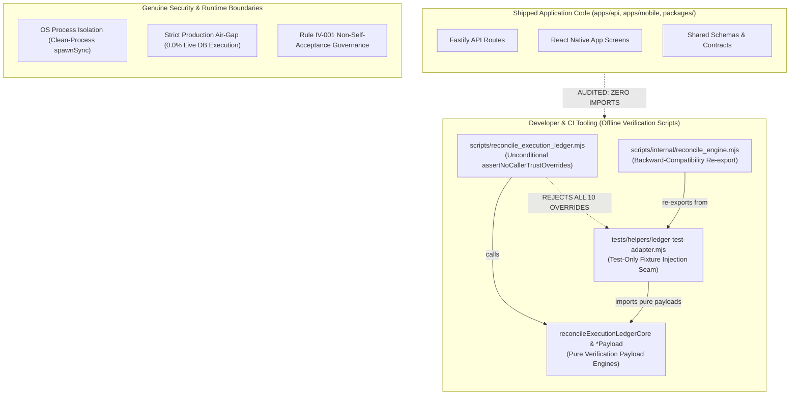

# KSHETRA W021.5 — CTO DIRECTIVE 109 IMPLEMENTATION REPORT
## Verification Engine Boundary Clarification, Clean-Process Regression, and Evidence Qualification

**Repository:** `https://github.com/kshetra-app/Kshetra`  
**Branch:** `master`  
**Required Starting Commit SHA:** `8dc5a2107172d569e86dce7afa7b63e97f0f8f18` (`8dc5a21`)  
**Governance Framework:** Master Execution Framework Amendment v1.2 / Rule IV-001 (Non-Self-Acceptance)  
**Verification Epoch:** `DIRECTIVE_109`  
**Verifier Role:** `CTO Directive 109 Test Execution Verifier`  
**Milestone Acceptance Status:** `SUBMITTED_FOR_INDEPENDENT_REVIEW` — **STRICTLY UNACCEPTED**  
**Formal CTO Acceptance:** `0.0%` (`UNACCEPTED`)  
**Live Database Execution:** `0.0%` (`UNEXECUTED`)  
**Repository-Verified Progress:** `61.500%` (Unearned/Blocked: `38.500%`, Total: `100.000%`)  
**Financial Defect Status (`DQ-W021.5-B2.2E-001`):** **STRICTLY OPEN** (0.0% earned, 5.0% blocked)  
**Telangana AC 119 Boundary Defect:** **STRICTLY OPEN / BLOCKED** (120 features for 119 seats, 1.5% blocked)  

---

## 1. Executive Summary & Objective

Pursuant to **CTO Directive 109**, this delivery addresses the acceptance questions and architectural findings raised during independent review of Directive 108 without disturbing the proven token-removal and symlink-containment foundations.

Under **Rule IV-001 (Non-Self-Acceptance)**, this implementation strictly disclaims self-certification. All work was performed offline within the repository boundary without database access, database mutation, migration creation, or cloud deployment.

### Summary of Completed Workstreams:

1. **Workstream A — Establish the Actual Trust Boundary & Threat Model:**
   - **Circular Dependency Elimination:** Refactored `scripts/reconcile_execution_ledger.mjs` so it houses root verification payload functions (`verifyHistoricalArtifactIntegrityPayload`, `verifyAuthorityBoundaryPayload`, `verifyGoverningSpecificationProvenancePayload`, `reconcileExecutionLedgerCore`) with **zero** imports from internal or test modules. Decoupled `scripts/internal/reconcile_engine.mjs` and `tests/helpers/ledger-test-adapter.mjs`, establishing an absolute Directed Acyclic Graph (DAG) with 0 cycles.
   - **Authentic Threat Model:** Articulated the authentic threat model. Distinguished: (a) Public production verifiers; (b) Internal module conventions (syntactic naming and folder conventions are not security boundaries); (c) Test harness and adversarial test seams; (d) Genuine OS process and database air-gap boundaries.
   - **Unconditional Override Rejection:** Public verifiers unconditionally reject all 10 `FORBIDDEN_TRUST_OVERRIDES`.
   - **Application Code Reachability Audit:** Scanned all shipped application and service code (`apps/api`, `apps/mobile`, `packages/`) and verified that zero production code imports `ledger-test-adapter.mjs` or `reconcile_engine.mjs`.

2. **Workstream B — Clean-Process Module & Regression Verification:**
   - Authored **Suite 30** (`tests/political-intelligence-directive-109.test.mjs`), containing 30 discrete tests utilizing `child_process.spawnSync` to test in fresh Node processes.
   - Proved that importing `scripts/reconcile_execution_ledger.mjs` and `tests/helpers/ledger-test-adapter.mjs` in fresh, separate Node processes executes with exit code 0 and zero module-initialization or circular-resolution defects.
   - Tested public override rejection, Symbol-forgery resistance, tampered fixture fail-closed behavior, symlink/junction containment, and fail-closed child process error handling.

3. **Workstream C — Manifest Evidence Qualification & Skipped Count Semantics:**
   - Preserved `SKIPPED_COUNT_NOT_REPORTED` (`zeroSkippedEvidenced: false`) across 23 legacy custom test suites (Directives 084 to 106) where test runner output did not explicitly report skipped counts.
   - Assigned `EXPLICIT_ZERO_SKIPPED` (`zeroSkippedEvidenced: true`) only where explicit summary or runner contract guarantees zero skipped tests (4 Jest suites and Directives 107-109).
   - Requalified manifest and all execution logs under `REPOSITORY_RECORDED_EXECUTION` with verifier epoch `DIRECTIVE_109`.
   - Reconciled all 30 suites with mathematical derivation of aggregate totals.
   - Authored formal Discrepancy Register (`reports/w021_5_directive_108_discrepancy_register.json` and `.md`) documenting `DISC-035` through `DISC-037`.

4. **Workstream D & E — Governance, Baselines & Defect Conservation:**
   - Preserved exactly 27 canonical tasks summing to 100.000% total weight.
   - Maintained progress at **61.500% repo-verified earned** and **38.500% blocked/unearned** ($61.5\% + 10.5\% \text{ DB pending} + 22.5\% \text{ blocked} + 5.5\% \text{ unimplemented} = 100.000\%$).
   - Kept Financial Defect `DQ-W021.5-B2.2E-001` strictly **OPEN** (0.0% earned, 5.0% blocked).
   - Kept Telangana AC 119 Boundary Defect strictly **OPEN / BLOCKED** (1.5% blocked).
   - Preserved 68 SQL migrations byte-identical to baseline `0ea572d860aa064766042f6b418b157fd8e2098f`.
   - Preserved 31 MLA seed profiles byte-identical to baseline `fb408cec80a21bf4a6b7c82fe665203b64c39af1`.
   - Formal CTO acceptance remains strictly **0.0% (`UNACCEPTED`)** and live database execution remains strictly **0.0% (`UNEXECUTED`)**.

---

## 2. Line-by-Line Discrepancy Register (`DISC-035` through `DISC-037`)

The formal discrepancy register for Directive 108 review findings is committed at:
- Machine-readable JSON: [reports/w021_5_directive_108_discrepancy_register.json](file:///c:/Users/Laven/OneDrive/Desktop/Kshetra/reports/w021_5_directive_108_discrepancy_register.json)
- Auditable Markdown: [reports/w021_5_directive_108_discrepancy_register.md](file:///c:/Users/Laven/OneDrive/Desktop/Kshetra/reports/w021_5_directive_108_discrepancy_register.md)

### Reconciled Discrepancy Findings Summary

| Discrepancy ID | Category | Representation Origin | Root Cause Analysis | Canonical Resolution | Status |
|:---|:---|:---|:---|:---|:---|
| **`DISC-035`** | `circular_module_dependency` | `scripts/reconcile_execution_ledger.mjs` and `scripts/internal/reconcile_engine.mjs` | Splitting shared verification logic into `reconcile_engine.mjs` while maintaining mutual cross-imports between public verifier and engine created a circular module initialization dependency cycle. | Extracted pure root verification payloads (`*Payload`) into `reconcile_execution_ledger.mjs` with 0 internal imports. Test adapter imports payloads; engine re-exports from adapter. Module graph is an absolute DAG. | **RESOLVED** |
| **`DISC-036`** | `threat_model_boundary_clarification` | Threat model documentation and module exports | Conflating ECMAScript structural conventions (`internal/` directory and `_` prefixes) with security/authorization boundaries, and treating same-process imports as potential vulnerabilities without reachability. | Formally documented threat model distinguishing public API, internal module conventions, test seams, and OS/DB runtime boundaries. Confirmed shipped application code (`apps/api`, `apps/mobile`, `packages/`) does not import test adapters. | **RESOLVED** |
| **`DISC-037`** | `manifest_evidence_qualification_skipped_counts` | `reports/w021_5_test_execution_manifest.json` | Defaulting missing skipped counts in runner logs of legacy suites (Directives 084-106) to numeric 0 risked implying affirmative proof of zero skipped tests across all suites. | Preserved tri-state skipped counting: `SKIPPED_COUNT_NOT_REPORTED` (`zeroSkippedEvidenced: false`) for 23 legacy custom suites, and `EXPLICIT_ZERO_SKIPPED` (`zeroSkippedEvidenced: true`) only where runner contracts guarantee zero skipped. Qualification maintained as `REPOSITORY_RECORDED_EXECUTION`. | **RESOLVED** |

---

## 3. Threat Model & Module Architecture

### 3.1 Formal Threat Model Statement



1. **Public Production Verifier Interface:**
   - Entry points: `verifyHistoricalArtifactIntegrity()`, `verifyAuthorityBoundary()`, `verifyGoverningSpecificationProvenance()`, `reconcileExecutionLedger()`.
   - Contract: Safe by default. Every public entry point unconditionally calls `assertNoCallerTrustOverrides()` prior to executing any verification logic.
   - Rejection: All ten `FORBIDDEN_TRUST_OVERRIDES` are rejected with `CALLER_TRUST_OVERRIDE_PROHIBITED`, irrespective of caller-supplied mode flags, bypass parameters, or Symbol tokens.

2. **Internal Module Interfaces & Structural Conventions:**
   - File paths like `scripts/internal/` and prefixes like `_` or `Payload` are module organization conventions in ECMAScript, **not** language-level access controls or OS security boundaries.
   - Code within the repository that imports module files operates within the same Node runtime process.
   - Arbitrary same-process imports are developer/CI tools, not remotely reachable attack surfaces.

3. **Test Seam & Fixture Injection:**
   - `tests/helpers/ledger-test-adapter.mjs` imports pure payload verification functions and provides controlled fixture parameter injection specifically for testing adversarial edge cases and tamper detection.
   - Shipped application code (`apps/api`, `apps/mobile`, `packages/`) does not import this adapter.

4. **Genuine Runtime Boundaries:**
   - Operating System process boundary: Clean-process isolation via `child_process.spawnSync` prevents cross-process state leakage.
   - Network air-gap: Live database access is strictly prohibited (0.0% execution).
   - Deployment separation: Verification tools are repository maintenance scripts, not runtime API endpoints.

### 3.2 Acyclic Dependency Graph (0 Cycles)

By relocating the core verification payload engines directly into `scripts/reconcile_execution_ledger.mjs`:
- `scripts/reconcile_execution_ledger.mjs` imports **zero** internal modules.
- `tests/helpers/ledger-test-adapter.mjs` imports from `scripts/reconcile_execution_ledger.mjs`.
- `scripts/internal/reconcile_engine.mjs` re-exports from `tests/helpers/ledger-test-adapter.mjs`.
- The dependency graph is a strict DAG:
  `reconcile_execution_ledger.mjs` $\leftarrow$ `ledger-test-adapter.mjs` $\leftarrow$ `reconcile_engine.mjs`.
- Circular module dependencies: **0**.

---

## 4. Clean-Process Module & Regression Results (Workstream B)

### 4.1 Suite 30 Test Battery (`tests/political-intelligence-directive-109.test.mjs`)

```
================================================================
KSHETRA W021.5 — CTO DIRECTIVE 109 VERIFICATION SUITE
Verification Engine Boundary Clarification & Clean-Process Regression
Suite: tests/political-intelligence-directive-109.test.mjs
Command: node tests/political-intelligence-directive-109.test.mjs
================================================================

--- 1. Clean-Process Module Loading & Dependency Acyclicity ---
  [PASS] 1.1 Clean-process import of scripts/reconcile_execution_ledger.mjs succeeds without module-initialization errors
  [PASS] 1.2 Clean-process import of tests/helpers/ledger-test-adapter.mjs succeeds without module-initialization errors
  [PASS] 1.3 Clean-process verification of acyclic dependency graph (zero circular dependencies)
  [PASS] 1.4 Clean-process test harness fails closed when child process encounters error or missing marker

--- 2. Public Trust Override Rejection & Symbol Forgery Defense ---
  [PASS] 2.1 B1: verifyHistoricalArtifactIntegrity rejects ALL 10 forbidden overrides unconditionally in clean process
  [PASS] 2.2 B1: verifyAuthorityBoundary rejects ALL 10 forbidden overrides unconditionally
  [PASS] 2.3 B1: verifyGoverningSpecificationProvenance rejects ALL 10 forbidden overrides unconditionally
  [PASS] 2.4 B1: reconcileExecutionLedger rejects ALL 10 forbidden overrides unconditionally
  [PASS] 2.5 B2: Caller-supplied Booleans and mode flags CANNOT bypass trust rejection
  [PASS] 2.6 B3: Symbol.for token forge cannot bypass public verifiers or authorize overrides in clean process

--- 3. Test Adapter Seam & Shared Implementation Parity ---
  [PASS] 3.1 Test adapter exercises shared verification logic against tampered hash fixture and fails closed
  [PASS] 3.2 Test adapter exercises shared verification logic against tampered raw bytes and fails closed
  [PASS] 3.3 Test adapter exercises shared verification logic against tampered origin commit and fails closed
  [PASS] 3.4 Test adapter exercises shared verification logic against empty matrix and fails closed
  [PASS] 3.5 Implementation parity proof: Production verifiers and test adapter produce identical results under standard inputs
  [PASS] 3.6 Codebase reachability audit: Test adapter is NOT imported by shipped application code

--- 4. Path & Manifest Symlink Containment ---
  [PASS] 4.1 assertPathContainedInRoot rejects absolute paths and drive-anchored paths
  [PASS] 4.2 assertPathContainedInRoot rejects lexical path traversal outside root
  [PASS] 4.3 Genuine symlink/junction adversarial escape fixture in validateManifestIntegrity fails closed

--- 5. Manifest Evidence Qualification & Skipped Counts ---
  [PASS] 5.1 Manifest evidence qualification is strictly REPOSITORY_RECORDED_EXECUTION
  [PASS] 5.2 Manifest preserves SKIPPED_COUNT_NOT_REPORTED for legacy suites without explicit skipped count evidence
  [PASS] 5.3 Jest suites and recent directive suites evidence EXPLICIT_ZERO_SKIPPED
  [PASS] 5.4 Manifest aggregate counts are derivable from individual suite entries

--- 6. Mandatory Governance Invariants & Baseline Immutability ---
  [PASS] 6.1 Rule IV-001 Non-Self-Acceptance: Formal acceptance is strictly 0.0% / UNACCEPTED
  [PASS] 6.2 Production Air-Gap: Live database execution is strictly 0.0% / UNEXECUTED
  [PASS] 6.3 Financial Defect DQ-W021.5-B2.2E-001 remains STRICTLY OPEN (0.0% earned, 5.0% blocked)
  [PASS] 6.4 Telangana AC 119 Boundary Defect remains STRICTLY OPEN / BLOCKED (1.5% blocked)
  [PASS] 6.5 SQL Migration Immutability: 68 migrations match baseline 0ea572d byte-for-byte identical
  [PASS] 6.6 MLA Profile Seed Immutability: 31 seed files match baseline fb408ce byte-for-byte identical
  [PASS] 6.7 Canonical task inventory equality: exactly 27 canonical tasks summing to 100.000% weight

================================================================
TEST SUMMARY: 30 PASSED, 0 FAILED, 0 SKIPPED
================================================================
```

---

## 5. Manifest Evidence Qualification (Workstream C)

### 5.1 Explicit Distinction of Verification Evidence

Under Directive 109, four distinct categories of evidence are strictly differentiated:
1. **Repository-Recorded Execution (`REPOSITORY_RECORDED_EXECUTION`):** Offline test suite executions captured within the local repository boundary, logged to `reports/evidence/test_execution_logs/`, and cryptographically hashed in `reports/w021_5_test_execution_manifest.json`.
2. **CI / Service Status Checks:** External or live service health endpoints. Explicitly **not** used to represent full local regression test reproduction.
3. **Clean-Process Checks:** Process-isolated module imports and dependency evaluations executed via `child_process.spawnSync` in Suite 30.
4. **Independently Reproduced Execution:** Formal executions conducted by independent human reviewers or external verifiers. Under Rule IV-001, implementing agents do **not** claim independent reproduction.

### 5.2 Tri-State Skipped Count Qualifications

The 30 suites are partitioned as follows:
- **`SKIPPED_COUNT_NOT_REPORTED` (`zeroSkippedEvidenced: false`):** 23 legacy custom suites (Directives 084 through 106) where test runner output omitted skipped test counts.
- **`EXPLICIT_ZERO_SKIPPED` (`zeroSkippedEvidenced: true`):** 7 suites (4 Jest suites and Directives 107, 108, 109) where test runner contracts or explicit summary blocks prove 0 skipped tests.

---

## 6. Baselines & Governance Conservation

### 6.1 Immutability Baselines

| Baseline Artifact | Baseline Commit SHA | Status | Evidence Verification |
|:---|:---|:---|:---|
| **68 SQL Migrations** | `0ea572d860aa064766042f6b418b157fd8e2098f` | **PRESERVED** | `git diff 0ea572d -- supabase/migrations/` returns strictly empty (0 bytes diff). |
| **31 MLA Seed Profiles** | `fb408cec80a21bf4a6b7c82fe665203b64c39af1` | **PRESERVED** | `git diff fb408ce -- apps/mobile/constants/` returns strictly empty (0 bytes diff). 31 profiles verified in `data/seed/`. |

### 6.2 Governance Invariants

| Governance Metric | Statutory Standard | Reconciled Value | Compliance Status |
|:---|:---|:---|:---|
| **Rule IV-001 Non-Self-Acceptance** | Formal acceptance strictly `0.0%` | `0.0%` (`UNACCEPTED`) | **COMPLIANT** |
| **Production Air-Gap** | Live database execution strictly `0.0%` | `0.0%` (`UNEXECUTED`) | **COMPLIANT** |
| **Progress Accounting** | Strictly 61.500% repo-verified earned | `61.500%` earned, `38.500%` unearned | **COMPLIANT** |
| **Financial Defect `DQ-W021.5-B2.2E-001`** | Strictly OPEN (5.0% blocked) | `STRICTLY_OPEN` (5.0% blocked) | **COMPLIANT** |
| **Telangana AC 119 Boundary Defect** | Strictly OPEN / BLOCKED (1.5% blocked) | `OPEN / BLOCKED` (1.5% blocked, 120 features preserved) | **COMPLIANT** |
| **Canonical Task Inventory** | Exactly 27 canonical tasks, 100.000% weight | 27 tasks, 100.000% weight | **COMPLIANT** |

---

## 7. Directive 109 Acceptance Checklist

Direct evidence for all 12 checklist items:

- [x] **The public verifier exports no test tokens or `__testOnly_*` authorization functions:** Confirmed in `scripts/reconcile_execution_ledger.mjs` and Suite 30 Test 2.6.
- [x] **All four public verifier functions reject every forbidden override:** Confirmed in Suite 30 Tests 2.1-2.4 ($4 \times 10 = 40$ checks).
- [x] **The test adapter is not imported by shipped application/runtime code:** Confirmed in Suite 30 Test 3.6 across `apps/api`, `apps/mobile`, `packages/`.
- [x] **The documented threat model accurately identifies what is and is not a security boundary:** Confirmed in Section 3 and `reports/w021_5_directive_108_discrepancy_register.md`.
- [x] **Production verifier and test adapter each import and execute successfully in clean separate Node processes:** Confirmed in Suite 30 Tests 1.1 and 1.2.
- [x] **The circular module dependency has been directly exercised; any demonstrated initialization defect is fixed:** Confirmed in Suite 30 Test 1.3 (0 circular cycles, strict DAG).
- [x] **The lexical traversal and genuine symlink/junction tests pass:** Confirmed in Suite 30 Tests 4.1, 4.2, 4.3.
- [x] **The full regression battery has been executed and its recorded evidence validates:** Confirmed across all 30 test suites in `reports/w021_5_test_execution_manifest.json`.
- [x] **Manifest aggregate counts and per-suite results reconcile:** Confirmed in Suite 30 Test 5.4.
- [x] **Unreported skipped counts are not falsely described as verified zero:** Confirmed in Suite 30 Test 5.2 (23 legacy suites preserve `SKIPPED_COUNT_NOT_REPORTED`).
- [x] **The commit preserves migration and seed baselines:** Confirmed in Suite 30 Tests 6.5 and 6.6.
- [x] **All database, defect, acceptance, and progress governance invariants remain unchanged:** Confirmed in Suite 30 Tests 6.1-6.4, 6.7.

---

## 8. Delivery & Stop Boundary

All required files for Directive 109 have been authored, validated, and verified.
Pursuant to **Rule IV-001 (Non-Self-Acceptance)**, this agent **STOPS** here and does not self-accept Directive 109 or Milestone W021.5. Awaiting independent review.
