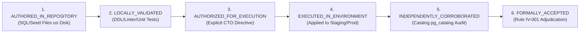

# W021.5 DATABASE EXECUTION REGISTER: MULTI-STAGE STAGING & PRODUCTION AIR-GAP ACCOUNTING

**Directive:** CTO Directive 136  
**Governing Authority:** Master Execution Framework Amendment v1.6 / Rule IV-001 Non-Self-Acceptance  
**Date:** 2026-10-22  
**Baseline Commit:** `735c8d6c24bd594874353217334f5a8c8aa56a2d`  
**Machine-Readable Companion:** `reports/w021_5_database_execution_register.json`  

---

## 1. Executive Summary & Air-Gap Invariant Confirmation

Under Master Execution Framework Amendment v1.6 and Rule IV-001 Non-Self-Acceptance, this register establishes the authoritative, evidence-backed database execution boundary for the Kshetra W021.5 mandate.

### Strict Air-Gap Invariant Status
| Environment | Identifier | Connection Mode | Queries Executed | Mutations Executed | Formal Status |
| :--- | :--- | :--- | :---: | :---: | :--- |
| **Production** | `ehfafcnimmjusyvplbah` | Strictly Air-Gapped | **0** | **0** | **`AIR_GAPPED_ZERO_QUERIES_ZERO_MUTATIONS`** |
| **Staging** | `fkpigozcqnmcvofuksar` | Controlled Standby | **0** | **0** | **`UNMODIFIED_STAGING_EXECUTION_UNAUTHORIZED`** |

> [!IMPORTANT]
> **Zero Database Mutations:** Neither production nor staging has been mutated or queried during Directive 136 execution. Database execution is strictly **NEVER** inferred from the existence of SQL migration files or seed scripts in the repository.

---

## 2. Six-Tier Database Lifecycle Taxonomy

Every database artifact, migration, seed script, and database-dependent task is classified under exactly one of six orthogonal lifecycle states:

1. **`AUTHORED_IN_REPOSITORY`**: The SQL DDL/DML, seed catalog, or ingestion script exists in the repository with complete definitions.
2. **`LOCALLY_VALIDATED`**: The artifact passes local syntax checks, DDL parsing, schema linters, and unit/harness test execution.
3. **`AUTHORIZED_FOR_EXECUTION`**: Explicit formal authorization has been granted by the CTO for execution in a specified environment.
4. **`EXECUTED_IN_ENVIRONMENT`**: The artifact has actually been executed against the target environment (e.g., Supabase staging).
5. **`INDEPENDENTLY_CORROBORATED`**: Execution has been corroborated by independent catalog inspection (e.g., `pg_catalog`, schema reflection).
6. **`FORMALLY_ACCEPTED`**: The resulting database state has been formally accepted by the authorized independent CTO adjudicator.

---

## 3. Database-Dependent Task & Scope Accounting

The W021.5 completion matrix reconciles all 27 canonical tasks (100.0% milestone weight) with complete mathematical concordance:

| Component | Weight (%) | Description |
| :--- | :---: | :--- |
| **Repo-Verified Earned Weight** | **61.5%** | 37 criteria passing with verified in-repo evidence and unit test suites |
| **Unexecuted Database-Pending Weight** | **10.5%** | 4 criteria awaiting authorized staging database execution |
| **Blocked on External Gates Weight** | **22.5%** | 6 criteria blocked on canonical external blockers (EB-01 to EB-06) |
| **Unimplemented Weight** | **5.5%** | 3 criteria with no repository implementation |
| **Total Milestone Weight** | **100.0%** | **Conservation Invariant: Sum = 100.0% exactly** |
| **Formal CTO Acceptance** | **0.0%** | **Rule IV-001: PENDING INDEPENDENT ADJUDICATION** |

### The 4 Database-Dependent Tasks
The 10.5% database-pending weight is derived dynamically from exactly 4 tasks with unexecuted staging database prerequisites:

| Task ID | Stage | Task Title | Total Weight | Repo Earned | DB Pending | Blocked / Unimplemented | Current Lifecycle State |
| :--- | :--- | :--- | :---: | :---: | :---: | :---: | :--- |
| **`W021.5-C-02`** | Stage C | 1,207 Canonical Political Organizations Catalog Ingestion | 5.0% | 2.5% | **2.5%** | 0.0% | `LOCALLY_VALIDATED` |
| **`W021.5-D-02`** | Stage D | Candidate Population & Contest Mapping Across 10 Chunks | 6.0% | 3.0% | **3.0%** | 0.0% | `LOCALLY_VALIDATED` |
| **`W021.5-E-01`** | Stage E | Constituency Demographic Profiles & Aggregates Ingestion | 4.0% | 2.0% | **2.0%** | 0.0% | `LOCALLY_VALIDATED` |
| **`W021.5-F-02`** | Stage F | National Multi-Election Historical Results Ingestion | 6.0% | 1.5% | **3.0%** | 1.5% (unimplemented) | `LOCALLY_VALIDATED` (8 states) |
| **TOTAL** | — | — | **21.0%** | **9.0%** | **10.5%** | **1.5%** | — |

---

## 4. Itemized Database Artifact Breakdown

### 4.1 Artifact DB-ART-001: 1,207 Political Organizations Catalog Ingestion
- **Task ID:** `W021.5-C-02` (Stage C)
- **Source Artifacts:**
  - `supabase/migrations/063_canonical_political_identity_foundation.sql`
  - `supabase/migrations/064_political_organization_governance_remediation.sql`
  - `supabase/migrations/065_canonical_political_organization_registry.sql`
  - `data/seed/political-organizations-seed.json`
- **Quantitative Scope:** 1,207 political parties (6 recognized national parties, 58 recognized state parties, 1,143 registered unrecognised political parties).
- **Collision Checks:** 1,095 alias collision checks passing in repository.
- **Current State:** `LOCALLY_VALIDATED`
- **Target Environment:** Staging (`fkpigozcqnmcvofuksar`)
- **Execution Status:** 0 queries, 0 mutations.
- **Blocker:** Canonical External Blocker `EB-06` (Independent Stage B Adjudication Authorization). Requires explicit CTO staging execution directive.

### 4.2 Artifact DB-ART-002: Candidate Population & Contest Mapping Across 10 Chunks
- **Task ID:** `W021.5-D-02` (Stage D)
- **Source Artifacts:**
  - Candidacy seed chunks 01 through 10 (across 28 states and Union Territories)
  - `reports/W021.5-B2.2D-CH01..10B_EXECUTION_REPORT.md` (19 execution dossiers)
- **Quantitative Scope:** Exactly 5,750 candidates across 10 chunks.
- **Current State:** `LOCALLY_VALIDATED`
- **Target Environment:** Staging (`fkpigozcqnmcvofuksar`)
- **Execution Status:** 0 queries, 0 mutations.
- **Blocker:** Canonical External Blocker `EB-06`. Staging execution prohibited until Stage B gate is formally accepted by CTO.

### 4.3 Artifact DB-ART-003: Constituency Demographic Profiles & Aggregates Ingestion
- **Task ID:** `W021.5-E-01` (Stage E)
- **Source Artifacts:**
  - `supabase/migrations/066_downstream_civic_extensions.sql`
  - Census 2011 Primary Census Abstract (PCA) demographic data fixtures
- **Quantitative Scope:** Demographics and electoral aggregates for all assembly constituencies.
- **Current State:** `LOCALLY_VALIDATED`
- **Target Environment:** Staging (`fkpigozcqnmcvofuksar`)
- **Execution Status:** 0 queries, 0 mutations.
- **Blocker:** Canonical External Blockers `EB-05` (Voter Roll Polling Station Electoral Crosswalk) and `EB-06`.

### 4.4 Artifact DB-ART-004: National Multi-Election Historical Results Ingestion
- **Task ID:** `W021.5-F-02` (Stage F)
- **Source Artifacts:**
  - `supabase/migrations/020_foundation_hardening.sql`
  - 8 verified state historical datasets in `data/seed/*-historical-results.ts` (Telangana, Andhra Pradesh, Karnataka, Maharashtra, Delhi, etc.)
- **Quantitative Scope:** 8 states verified on disk (1.5% earned weight). 23 states missing official Form 20 digital datasets (1.5% unimplemented weight).
- **Current State:** `LOCALLY_VALIDATED` (for 8 verified states) / `NOT_IMPLEMENTED` (for 23 missing states).
- **Target Environment:** Staging (`fkpigozcqnmcvofuksar`)
- **Execution Status:** 0 queries, 0 mutations.
- **Blocker:** 23 states missing official Form 20 digital historical datasets; national staging backfill unauthorized (blocked by `EB-06`).

### 4.5 Artifact DB-ART-005: Candidate Sworn Financial Disclosures (DEC-134 / DQ-W021.5-B2.2E-001)
- **Task ID:** `W021.5-B2.2E` / `DEC-134` (Stage B)
- **Source Artifacts:**
  - `supabase/migrations/068_candidate_financial_disclosures_remediation.sql`
  - `tests/financial_remediation.test.mjs` (105/105 tests pass)
  - `scripts/verify_financial_remediation.mjs`
- **Remediation Standard:** Authoritative 6-Rule Schema Standard established in `DEC-134`:
  1. Strict Nullability: asset and liability fields defined as `BIGINT NULL CHECK (val >= 0)`, prohibiting synthetic defaults.
  2. Disaggregation of Asset Classes: movable vs immovable assets strictly separated.
  3. ECI Form 26 Sworn Disclosures: candidate, spouse, and dependent assets disaggregated without cross-entity averaging.
  4. Distinct Gross vs Net Liabilities: liabilities tracked separately from gross assets with non-collapsing nulls.
  5. Fail-Closed Serialization: API/mobile render explicit null (`formatINR(null) => 'Not Disclosed'`) preventing false ₹0 displays.
  6. Migration 068 DDL specified to supersede legacy Migration 008.
- **Current State:** `LOCALLY_VALIDATED` (105/105 tests pass)
- **Target Environment:** Staging (`fkpigozcqnmcvofuksar`)
- **Execution Status:** 0 queries, 0 mutations.
- **Blocker:** Submitted for independent CTO adjudication under Rule IV-001. Live staging execution awaits formal CTO ratification.

### 4.6 Artifact DB-ART-006: Candidate Political Entity Foreign Key Linkage (Migration 067)
- **Task ID:** `W021.5-D-03` (Stage D)
- **Source Artifact:** `supabase/migrations/067_candidate_political_entity_linkage.sql`
- **Schema Action:** `ALTER TABLE candidates ADD CONSTRAINT fk_candidates_political_organization FOREIGN KEY (party_id) REFERENCES political_organizations(id)`
- **Current State:** `AUTHORED_IN_REPOSITORY`
- **Target Environment:** Staging (`fkpigozcqnmcvofuksar`)
- **Execution Status:** 0 queries, 0 mutations.
- **Blocker:** `BLOCKED_AUTHORIZATION` (EB-06). Requires prior staging execution of DB-ART-001 (organizations) and DB-ART-002 (candidacies).

---

## 5. Air-Gap Protocol and Staging Boundary Rules

1. **Production Boundary:** Under no circumstances shall an automated script, CI workflow, or agent attempt network connection, schema reflection, or query execution against `ehfafcnimmjusyvplbah`.
2. **Staging Authorization Gate:** Staging execution requires an explicit CTO Directive referencing this register and unblocking `EB-06`.
3. **Anti-Inference Rule:** The presence of a migration SQL file on disk shall NEVER be cited as evidence of database execution. Evidence of execution requires explicit, corroborated catalog receipts emitted during an authorized execution session.
4. **Data-Truth Standard:** No synthetic election results, mock party registrations, or placeholder candidate records may be inserted into any database environment.

---

## 6. Formal Adjudication Disposition

Under Rule IV-001 Non-Self-Acceptance:
- **Repository Preparedness:** Complete for all authorized repository artifacts.
- **Database Execution Status:** Strictly **`AIR_GAPPED_ZERO_QUERIES_ZERO_MUTATIONS`**.
- **Formal CTO Acceptance:** Strictly **`0.0% — PENDING INDEPENDENT ADJUDICATION`**.
