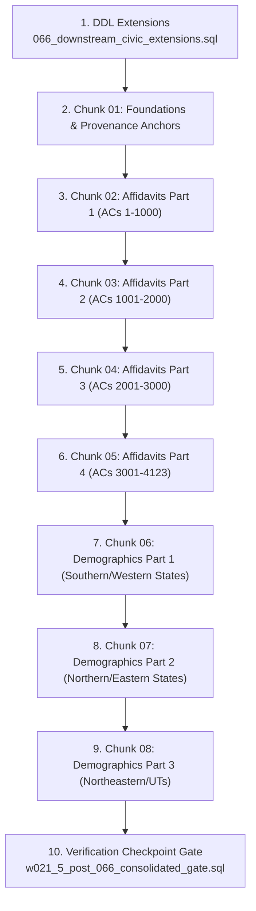

# W021.5 Stage B: Migration 066 Staging Review Packet
**Downstream Civic Extensions & Canonical Demographics/Affidavits Population**
**Target Database**: Staging Supabase (`fkpigozcqnmcvofuksar` / `panIN-staging`)
**Authoritative Governance Directive**: CTO DIRECTIVE 154 / Master Execution Framework Amendment v1.6
**Precedent References**: Directive 038 (Invariant Reconciliation), Directive 121 (Geographic Capability)

---

## 1. Executive Summary & Verification Objective

Migration 066 transitions the national political database from raw structural geography into rich downstream civic, demographic, affidavit, and lineage entities. This packet establishes the machine-verifiable staging execution procedure and cryptographic validation inventory for:

1. **DDL Extensions (`066_downstream_civic_extensions.sql`)**:
   - `public.constituency_demographics` (assembly constituency demographic profiles, census linkages, literacy/urbanization/elector counts).
   - `public.candidate_affidavits` (Form 26 statutory disclosures, criminal cases, educational qualifications, movable/immovable assets, liabilities).
   - Row-Level Security (RLS) policies enforcing public read and service-role write.
2. **Authoritative Population (`066_b2_2e_authoritative_population.sql` / Chunked Parts 01–08)**:
   - Population of **4,123 canonical Assembly Constituency demographic records**.
   - Population of **4,523 candidate affidavit records** (reconciled per Directive 038 invariant after deduplicating the Basavaraj Bommai Shiggaon dual-filing record).
   - Population of **126 delimitation lineage transitions** (Assam 2008 $\rightarrow$ 2023 statutory delimitation under ECI Notification).
3. **Consolidated Gate Verification (`w021_5_post_066_consolidated_gate.sql`)**:
   - 11 structured automated SQL verification checks.

---

## 2. Environment Boundary & Air-Gap Guarantees

In strict adherence to the **Prime Axiom** and **Environment Separation Protocol**:
- **Production Supabase (`ehfafcnimmjusyvplbah`)**: Strictly air-gapped. Zero queries, zero mutations, zero direct connections.
- **Staging Supabase (`fkpigozcqnmcvofuksar`)**: Zero ad-hoc mutations. Deployment occurs strictly via reviewable, hash-verified SQL scripts executed through staging service credentials or migration CLI.

---

## 3. Cryptographic Artifact Manifest (SHA-256)

All scripts must be verified against their SHA-256 hashes prior to staging database execution.

| File Path | Size (Bytes) | SHA-256 Checksum |
| :--- | :--- | :--- |
| `supabase/migrations/066_downstream_civic_extensions.sql` | 12,522 | `6C923A4467A0FA605AB3092C452AA94B391431081FDC35FB2926E5538C691DDA` |
| `supabase/staging_packages/066_downstream_civic_extensions.sql` | 12,522 | `6C923A4467A0FA605AB3092C452AA94B391431081FDC35FB2926E5538C691DDA` |
| `supabase/staging_packages/066_b2_2e_authoritative_population.sql` | 2,218,369 | `2CC9554F41EB0596E78DCC4EC7E7F03D7147899C84D879E89461DEBA99F40BFC` |
| `supabase/staging_packages/066_b2_2e_chunked/066_b2_2e_chunk_01_foundations.sql` | 6,402 | `E4A66DDF6EF88EABD1F72A5747D3FEF4641793C760E36BA4E6731D1D90020C3A` |
| `supabase/staging_packages/066_b2_2e_chunked/066_b2_2e_chunk_02_affidavits_part1.sql` | 376,884 | `FFBCB0ED88D8DEC536F0144B3953A94B29BB9F18D93D8725105033D443AE44C3` |
| `supabase/staging_packages/066_b2_2e_chunked/066_b2_2e_chunk_03_affidavits_part2.sql` | 409,919 | `FFCCB22AC3F89528356819CAC2039B2EA9943134DF281128C28050799572DDD1` |
| `supabase/staging_packages/066_b2_2e_chunked/066_b2_2e_chunk_04_affidavits_part3.sql` | 363,863 | `A18FA9BE1A1ECAF8462263CF482828628232605FC14BC7D0B813D21E27EE6269` |
| `supabase/staging_packages/066_b2_2e_chunked/066_b2_2e_chunk_05_affidavits_part4.sql` | 280,830 | `C4591FD382E6B420D9D5BC0A7F10B60673093082CB581C25F929C60767159D26` |
| `supabase/staging_packages/066_b2_2e_chunked/066_b2_2e_chunk_06_demographics_part1.sql` | 176,067 | `E3D0F3F8F49F2F0D01EE38BE52D9E3A6DB86375804614F92A7944C9F7DEE2F96` |
| `supabase/staging_packages/066_b2_2e_chunked/066_b2_2e_chunk_07_demographics_part2.sql` | 212,718 | `B4CEEFC7A07BCB75C832E51515CA411F0A6E89F72096F27556E8490151144CE1` |
| `supabase/staging_packages/066_b2_2e_chunked/066_b2_2e_chunk_08_demographics_part3.sql` | 342,595 | `6E50B6100A01945332AAFE69895F3F37F5503CB260823B26C15463F1E1F930A9` |
| `supabase/staging_checkpoints/w021_5_post_066_consolidated_gate.sql` | 14,773 | `9B52A2715423C79EC7D6340FE5F60322BC741C67323E92FE1EC3290DA99A2810` |

---

## 4. Pre-Flight Verification Checklist

Before applying any Migration 066 SQL script to staging:
1. **Migration 065 Consolidated Gate**:
   Verify that `supabase/staging_checkpoints/w021_5_post_065_consolidated_gate.sql` executes with status `PASS`.
2. **Schema Prerequisite Check**:
   Confirm existence of `public.states` (36), `public.parliamentary_constituencies` (543), and `public.constituencies` (4,123).
3. **Transaction Context**:
   Execute chunk scripts within explicit transaction blocks (`BEGIN; ... COMMIT;`) or ensure idempotency via `ON CONFLICT DO NOTHING`.

---

## 5. Execution Sequencing & Chunk Order

To avoid statement timeouts on Supabase web editor / connection pools, execution should proceed in order:



---

## 6. Consolidated Verification Gate Invariants (Checks 01–11)

Execution of `supabase/staging_checkpoints/w021_5_post_066_consolidated_gate.sql` returns a unified 11-row result set with exact expectations:

| Check ID | Invariant Verified | Expected Outcome | Ground Truth Precedent |
| :--- | :--- | :--- | :--- |
| `check_01` | Datasets (3) & Dataset Versions (3) registered in catalog | `PASS` (`3/3`, `3/3`) | `myneta_candidate_disclosures`, `eci_constituency_lineage_regimes`, `eci_constituency_demographics_turnout` |
| `check_02` | Provenance anchor `0215b22e-0000-0000-0000-000000000001` present & linked | `PASS` (`anchor_match: 1`) | Root batch anchor |
| `check_03` | Candidate affidavits FK integrity to persons, candidacies & provenance | `PASS` (`orphans: 0, batch_affidavits: 4523`) | Directive 038 Invariant: 4,523 unique affidavits (after Bommai deduplication) |
| `check_04` | Demographics FK enforcement to `public.constituencies(internal_id)` | `PASS` (`nulls: 0, dangling: 0, distinct_acs: 4123`) | 100% relational integrity |
| `check_05` | Delhi AC coverage & zero ward contamination | `PASS` (`dl_acs: 70, dl_wards_over_70: 0`) | Exactly 70 Vidhan Sabha ACs (zero municipal ward pollution) |
| `check_06` | Candidate affidavits row count & status integrity | `PASS` (`batch_affidavits: 4523, official_status: 4523`) | 100% `OFFICIAL` status |
| `check_07` | Delimitation lineage succession records count | `PASS` (`total: 126, assam: 126, invalid: 0`) | Assam 2008 $\rightarrow$ 2023 transitions under ECI Notification |
| `check_08` | State election turnout capability status | `NOT_APPLICABLE` | Decoupled per Option 2 (deferred from PASS aggregate) |
| `check_09` | Zero synthetic independent entity leakage | `PASS` (`synthetic_independents: 0`) | Zero fake parties |
| `check_10` | RLS enabled on `constituency_demographics` and `candidate_affidavits` | `PASS` (`rls: true, demo_policies: >=2, aff_policies: >=2`) | Public read, service-role write |
| `check_11` | Consolidated aggregate gate verdict | `PASS` (`required: 9, passed: 9, na: 1, failed: 0`) | **POST_066_PASS** |

---

## 7. Rollback & Disaster Recovery Procedures

If any chunk fails during execution:
1. **Per-Chunk Atomic Rollback**: Each chunk script is self-contained. Any constraint violation terminates the chunk transaction, leaving prior chunks committed.
2. **DDL Teardown (if required)**:
   ```sql
   DROP TABLE IF EXISTS public.candidate_affidavits CASCADE;
   DROP TABLE IF EXISTS public.constituency_demographics CASCADE;
   DELETE FROM public.provenance_records WHERE id = '0215b22e-0000-0000-0000-000000000001'::uuid;
   DELETE FROM public.dataset_versions WHERE dataset_id IN (
     'myneta_candidate_disclosures',
     'eci_constituency_lineage_regimes',
     'eci_constituency_demographics_turnout'
   );
   DELETE FROM public.datasets WHERE id IN (
     'myneta_candidate_disclosures',
     'eci_constituency_lineage_regimes',
     'eci_constituency_demographics_turnout'
   );
   ```
