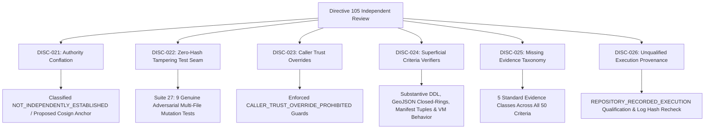

# KSHETRA W021.5 — DIRECTIVE 105 DISCREPANCY REGISTER & REMEDIATION MATRIX

**Milestone:** W021.5  
**Governing Directive:** CTO Directive 106  
**Register ID:** `W021.5-DIRECTIVE-105-DISCREPANCY-REGISTER-V1.0`  
**Governance Standard:** Master Execution Framework Amendment v1.2 / Rule IV-001 (Non-Self-Acceptance)  
**Execution Context:** Repository-Only / Offline-First / Strictly Zero Database Mutation  

---

## 1. Executive Summary

During independent review of **CTO Directive 105**, six substantiated discrepancies and verification seams were identified across the authority chain, adversarial testing harness, verifier trust guards, criteria verification procedures, evidence classification taxonomy, and test execution provenance.

This register documents all six findings (`DISC-021` through `DISC-026`), traces their historical origin, provides the canonical committed remediation, and establishes fail-closed enforcement under **CTO Directive 106**.

---

## 2. Comprehensive Discrepancy & Remediation Matrix

| Discrepancy ID | Item Key & Category | Discrepancy Type | Affected Entity | Prior Directive 105 Value / Seam | Canonical Remediation under Directive 106 | Status |
|:---|:---|:---|:---|:---|:---|:---|
| **DISC-021** | `GOVERNING_AUTHORITY:independentApprovalAnchor` *(Governing Authority Boundary)* | `AUTHORITY_CONFLATION_GIT_HISTORY_AS_APPROVAL` | Governing Documents Approval Authority | Treated Git commit history (`be4ba41`) and same-repository manifest digests as independent approval evidence. | Explicitly classified authority as `NOT_INDEPENDENTLY_ESTABLISHED` across all 15 governing documents. In-repo trust anchor status classified as `IN_REPOSITORY_INTEGRITY_ONLY`. Defined `PROPOSED_NOT_ACTIVE` out-of-band cryptographic anchor architecture. | **RESOLVED** |
| **DISC-022** | `VERIFICATION_TESTS:coordinatedTamperingZeroHashSeam` *(Adversarial Tampering)* | `NON_ADVERSARIAL_TEST_SEAM` | `tests/political-intelligence-directive-105.test.mjs` | Coordinated tampering test supplied an all-zero `expectedHashOverride` parameter, merely testing an invalid hash rather than a coordinated mutation attack. | Replaced with 9 genuine adversarial test cases in Suite 27 (`tests/political-intelligence-directive-106.test.mjs`) mutating multiple artifacts simultaneously and exercising the public verification path. | **RESOLVED** |
| **DISC-023** | `VERIFIER_ENGINE:callerTrustOverrideAcceptance` *(Verifier Trust Guards)* | `PRODUCTION_VERIFIER_TRUST_OVERRIDE_SEAM` | `scripts/reconcile_execution_ledger.mjs` | Verification functions accepted caller-provided hash and commit overrides in options (`expectedHashOverride`, `historicalOriginCommitOverride`). | Added strict caller-trust override prohibition guards to `verifyHistoricalArtifactIntegrity`, `verifyAuthorityBoundary`, `verifyGoverningSpecificationProvenance`, and `reconcileExecutionLedger` throwing `CALLER_TRUST_OVERRIDE_PROHIBITED`. | **RESOLVED** |
| **DISC-024** | `TASK_SPECIFICATIONS:superficialCriteriaVerifiers` *(Substantive Criteria)* | `SUPERFICIAL_CRITERIA_VERIFICATION` | `CRIT-B101-01`, `CRIT-B104-01`, `CRIT-C02-01`, `CRIT-G02-01` | Criteria verifiers used superficial string matching (e.g. checking `"1207"` in SQL text, checking `"stateCode === 'TS' ? 2023"` absence without behavioral testing). | Implemented substantive domain verification: SQL DDL constraint/nullability/relationship checks & 4,123 seat inserts (B101-01); GeoJSON 120-feature bbox, closed-rings & AC 119 defect preservation (B104-01); 107 canonical orgs & 1,043 aliases between JSON and SQL CTE (C02-01); and VM-based behavioral testing across mapped, unmapped, and null inputs (G02-01). | **RESOLVED** |
| **DISC-025** | `CRITERION_REGISTER:missingEvidenceClassTaxonomy` *(Evidence Class Taxonomy)* | `MISSING_EVIDENCE_CLASS_CLASSIFICATION` | `governance/specifications/w021_5_criterion_evidence_register.json` | Register lacked standardized evidence class taxonomy across all 50 criteria. | Assigned all 50 criteria to one of 5 standard classes: 32 `STATIC_SEMANTIC_VERIFICATION`, 5 `ARTIFACT_PRESENCE_ONLY`, 5 `DATABASE_STAGING_VERIFICATION`, 5 `EXTERNAL_AUTHORITY_VERIFICATION`, 3 `EXECUTABLE_BEHAVIOR_VERIFICATION`. Enforced schema validation in `evaluateTaskCriteria`. | **RESOLVED** |
| **DISC-026** | `TEST_MANIFEST:unqualifiedExecutionClaims` *(Test Execution Provenance)* | `UNQUALIFIED_TEST_EXECUTION_PROVENANCE` | `reports/w021_5_test_execution_manifest.json` | Manifest recorded test runs without explicit execution qualification distinguishing repository-recorded from CI-reproduced or independently reproduced results. | Added explicit `REPOSITORY_RECORDED_EXECUTION` qualification to manifest and suite records; enhanced `parseTestOutput` with skipped test parsing; hardened `validateManifestIntegrity` to enforce zero-skipped verification against captured raw process logs. | **RESOLVED** |

---

## 3. Discrepancy Detail Records

### DISC-021: Authority Conflation (Git History & In-Repo Hash as Approval)
- **Affected Area:** Governing documents authority verification in `scripts/reconcile_execution_ledger.mjs`, `governance/specifications/w021_5_master_specification.json`, and `reports/w021_5_governing_source_inventory_audit.json`.
- **Finding:** Directive 105 treated Git commit `be4ba41` and same-repository SHA-256 hashes as proof of approved governing authority. A Git commit or hash verifies repository integrity and change history, but does not self-authenticate who approved the document, under what external mandate, or whether the authority was granted.
- **Remediation:** 
  1. Top-level authority across all 15 governing documents is explicitly classified as `NOT_INDEPENDENTLY_ESTABLISHED`.
  2. Commit `be4ba41` is explicitly classified as `HISTORICAL_COMPARISON_BASELINE_NOT_EXTERNAL_APPROVAL_AUTHORITY`.
  3. Trust anchor status is set to `IN_REPOSITORY_INTEGRITY_ONLY`.
  4. An out-of-band cryptographic signing mechanism (Cosign/GPG root authority manifest) is formally documented and marked `PROPOSED_NOT_ACTIVE` until externally provisioned.

### DISC-022: Non-Adversarial Coordinated-Tampering Test Seam
- **Affected Area:** `tests/political-intelligence-directive-105.test.mjs` Test 3.3.
- **Finding:** The test purporting to prove coordinated tampering resilience passed `expectedHashOverride: '0000000000000000000000000000000000000000000000000000000000000000'`. This merely tested an invalid hash parameter, bypassing actual multi-file coordinated tampering attacks.
- **Remediation:** Replaced with 9 genuine adversarial test cases in Suite 27 (`tests/political-intelligence-directive-106.test.mjs`), which mutate files and data structures in isolated fixtures and assert fail-closed rejection by the real public reconciliation path.

### DISC-023: Production Verifier Acceptance of Caller Trust Overrides
- **Affected Area:** `scripts/reconcile_execution_ledger.mjs` verification function options.
- **Finding:** Verification functions allowed callers to supply `expectedHashOverride`, `historicalOriginCommitOverride`, or raw byte overrides, creating an architectural bypass seam where an attacker or corrupted script could supply arbitrary expectations.
- **Remediation:** Enforced strict caller-trust override prohibition guards in `verifyHistoricalArtifactIntegrity`, `verifyAuthorityBoundary`, `verifyGoverningSpecificationProvenance`, and `reconcileExecutionLedger`. Any caller attempting to pass trust overrides receives `CALLER_TRUST_OVERRIDE_PROHIBITED`.

### DISC-024: Superficial SQL and String-Inclusion Checks in Criteria Verifiers
- **Affected Area:** `TASK_SPECIFICATIONS` in `scripts/reconcile_execution_ledger.mjs`.
- **Finding:** Multiple criteria verifiers used existence-only or superficial string matching:
  - `CRIT-B101-01` checked string inclusions in migration 059 without verifying constituencies table constraints or nullability.
  - `CRIT-B104-01` checked GeoJSON parsing without enforcing 120 features, bounding box, closed rings, or explicitly isolating the AC 119 duplicate defect.
  - `CRIT-C02-01` checked `sql.includes('1207')` rather than reconciling inserted rows and CTE aliases against manifest metadata.
  - `CRIT-G02-01` checked absence of `stateCode === 'TS' ? 2023` without evaluating TypeScript AST or testing behavioral execution for mapped, unmapped, and null inputs.
- **Remediation:** Replaced all 4 verifiers with substantive executable procedures matching all requirements.

### DISC-025: Absence of Standard Evidence Classes in Criterion Register
- **Affected Area:** `governance/specifications/w021_5_criterion_evidence_register.json` and `.md`.
- **Finding:** Criteria lacked an explicit, standardized evidence classification taxonomy distinguishing artifact presence from semantic verification, behavioral verification, database staging, and external authority.
- **Remediation:** Classified all 50 criteria under 5 standard classes:
  - `STATIC_SEMANTIC_VERIFICATION`: 32 criteria
  - `ARTIFACT_PRESENCE_ONLY`: 5 criteria
  - `DATABASE_STAGING_VERIFICATION`: 5 criteria
  - `EXTERNAL_AUTHORITY_VERIFICATION`: 5 criteria
  - `EXECUTABLE_BEHAVIOR_VERIFICATION`: 3 criteria

### DISC-026: Unqualified Test Execution Provenance Claims
- **Affected Area:** `reports/w021_5_test_execution_manifest.json` and `scripts/capture_test_execution.mjs`.
- **Finding:** Manifest recorded execution results without qualifying execution provenance, treating in-repository log commits as evidence of independent test execution.
- **Remediation:** Added explicit `REPOSITORY_RECORDED_EXECUTION` qualification to the manifest schema and suite records, parsed and validated skipped counts against raw process outputs, and enforced zero-skipped verification in `validateManifestIntegrity`.

---

## 4. Governance Sign-off & Invariants

Under **Rule IV-001 (Non-Self-Acceptance)**, this discrepancy register and remediation matrix constitutes factual, reproducible evidence of corrective action and does **NOT** constitute formal CTO acceptance.

- **Formal CTO Acceptance:** `0.0%` / `UNACCEPTED`
- **Live Database Staging Execution:** `0.0%` / `UNEXECUTED`
- **Financial Defect `DQ-W021.5-B2.2E-001`:** `STRICTLY OPEN` (0.0% earned, 5.0% blocked)
- **Telangana AC 119 Defect:** `STRICTLY OPEN / BLOCKED` (1.5% blocked)
- **SQL Migration Baseline:** 68 files identical to `0ea572d` (0 diff)
- **MLA Profile Seed Baseline:** 31 files identical to `fb408ce` (0 diff)
