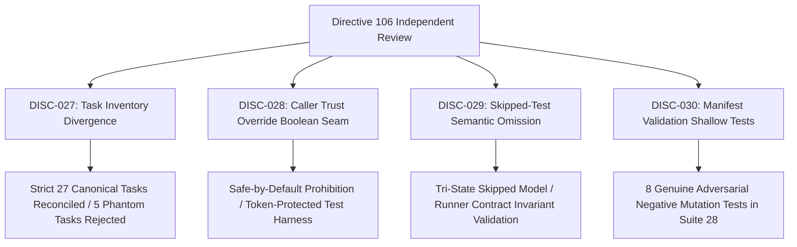

# KSHETRA W021.5 — DIRECTIVE 106 DISCREPANCY REGISTER & REMEDIATION MATRIX

**Milestone:** W021.5  
**Governing Directive:** CTO Directive 107  
**Register ID:** `W021.5-DIRECTIVE-106-DISCREPANCY-REGISTER-V1.0`  
**Governance Standard:** Master Execution Framework Amendment v1.2 / Rule IV-001 (Non-Self-Acceptance)  
**Execution Context:** Repository-Only / Offline-First / Strictly Zero Database Mutation  

---

## 1. Executive Summary

During independent review of **CTO Directive 106**, four substantiated discrepancies and verification gaps were identified across task inventory alignment, safe-by-default verifier trust protections, skipped-test parsing semantics, and manifest validation adversarial test coverage.

This register documents all four findings (`DISC-027` through `DISC-030`), traces their historical origin, provides the canonical committed remediation, and establishes fail-closed enforcement under **CTO Directive 107**.

---

## 2. Comprehensive Discrepancy & Remediation Matrix

| Discrepancy ID | Item Key & Category | Discrepancy Type | Affected Entity | Prior Directive 106 Value / Seam | Canonical Remediation under Directive 107 | Status |
|:---|:---|:---|:---|:---|:---|:---|
| **DISC-027** | `TASK_INVENTORY:directive106ReportTable32Tasks` *(Canonical Task Inventory)* | `PHANTOM_TASK_INCLUSION_REPORT_MISMATCH` | `reports/W021.5-CTO-DIRECTIVE-106-IMPLEMENTATION-REPORT.md` Section 3 table (32 rows, 99.0% sum) | Report table erroneously included 32 rows containing 5 phantom task IDs (`W021.5-B2-01`, `W021.5-B2-02`, `W021.5-I-03`, `W021.5-EXT-01`, `W021.5-EXT-02`) summing to 99.0%, diverging from the 27 canonical tasks (100.000%). | Reconciled task inventory strictly to 27 canonical tasks (100.000% weight). Enforced programmatic equality across master specification, traceability matrix, canonical metadata, criteria specifications, and execution ledger. Rejected phantom tasks without governing approval authority. | **RESOLVED** |
| **DISC-028** | `VERIFIER_ENGINE:safeByDefaultTrustGuards` *(Safe-by-Default Trust Guards)* | `CALLER_CONTROLLED_TRUST_FLAG_SEAM` | `scripts/reconcile_execution_ledger.mjs` verification functions (`verifyHistoricalArtifactIntegrity`, `verifyAuthorityBoundary`, `verifyGoverningSpecificationProvenance`, `reconcileExecutionLedger`) | Verifiers checked `productionVerificationMode` or `productionMode` before throwing `CALLER_TRUST_OVERRIDE_PROHIBITED`, allowing ordinary callers omitting the flag to pass trust overrides. | Refactored public verification entry points to reject caller trust overrides unconditionally by default. Test harness dependency injection separated behind explicit `__testOnly_*` interfaces protected by an unforgeable Symbol token (`TEST_HARNESS_PROTECTION_TOKEN`). | **RESOLVED** |
| **DISC-029** | `TEST_PARSER:triStateSkippedTestSemantics` *(Test Output Parsing Semantics)* | `BINARY_SKIPPED_STATE_ASSUMPTION` | `scripts/capture_test_execution.mjs` (`parseTestOutput`, `validateManifestIntegrity`) | Test runner output parser used binary assumptions where omitted skipped counts could lead to default assumptions of zero skipped tests without verifying runner contract. | Enforced strict tri-state skipped model (`EXPLICIT_ZERO_SKIPPED`, `SKIPPED_COUNT_REPORTED_NONZERO`, `SKIPPED_COUNT_NOT_REPORTED`). `zeroSkippedEvidenced` set to true only when explicitly zero or runner contract independently guarantees omission means zero (e.g. Jest `total === passed + failed`). Rejects conflicting summaries and inconsistent totals. | **RESOLVED** |
| **DISC-030** | `VERIFICATION_TESTS:manifestValidationAdversarialCoverage` *(Manifest Validation Adversarial Coverage)* | `SHALLOW_MANIFEST_VALIDATION_TESTS` | `tests/political-intelligence-directive-106.test.mjs` / `tests/political-intelligence-directive-107.test.mjs` | Tests only asserted manifest existence or minimum suite counts, without exercising negative mutation paths on manifest/log fixtures. | Authored 8 dedicated adversarial negative test cases in Suite 28 mutating isolated manifest and log fixtures, exercising `validateManifestIntegrity` directly and asserting exact fail-closed rejection reason codes. | **RESOLVED** |

---

## 3. Discrepancy Detail Records

### DISC-027: Canonical Task Inventory Reconciliation (32 Rows vs 27 Canonical Tasks)
- **Affected Area:** `reports/W021.5-CTO-DIRECTIVE-106-IMPLEMENTATION-REPORT.md` Section 3 table and inventory accounting.
- **Finding:** The Directive 106 implementation report contained an errant 32-row table with 5 phantom tasks:
  1. `W021.5-B2-01` (3.0% weight)
  2. `W021.5-B2-02` (4.0% weight)
  3. `W021.5-I-03` (2.0% weight)
  4. `W021.5-EXT-01` (1.0% weight)
  5. `W021.5-EXT-02` (1.0% weight)
  The rows summed to 99.0%, whereas all machine-readable governance files (`w021_5_master_specification.json`, `w021_5_governing_traceability_matrix.json`, `historical_w021_5_origin_ledger.json`, `reports/w021_5_execution_ledger.json`, `CANONICAL_TASK_METADATA`, and `TASK_SPECIFICATIONS`) define exactly 27 canonical tasks summing to 100.000%.
- **Remediation:** 
  1. Removed the 5 phantom tasks from the task inventory.
  2. Confirmed that every canonical task has an exact 1:1 mapping between master specification, traceability matrix, metadata, criteria specifications, and execution ledger.
  3. Added an automated programmatic equality test in Suite 28 (`tests/political-intelligence-directive-107.test.mjs`) asserting exact 27-task identity, criteria membership, stage assignment, weights, and classification across all sources.

### DISC-028: Safe-by-Default Trust Verification & Protection Token
- **Affected Area:** `scripts/reconcile_execution_ledger.mjs` exported verifiers.
- **Finding:** Trust override checks in `verifyHistoricalArtifactIntegrity`, `verifyAuthorityBoundary`, `verifyGoverningSpecificationProvenance`, and `reconcileExecutionLedger` were conditional on `options.productionVerificationMode` or `options.productionMode`. A caller omitting these Boolean flags could pass `expectedHashOverride` or `historicalOriginCommitOverride`.
- **Remediation:**
  1. Public verification entry points call `assertNoCallerTrustOverrides` unconditionally. Attempted caller overrides throw `CALLER_TRUST_OVERRIDE_PROHIBITED` immediately.
  2. Dedicated test fixtures must use explicit test-only functions (`__testOnly_verifyHistoricalArtifactIntegrity`, `__testOnly_verifyAuthorityBoundary`, `__testOnly_verifyGoverningSpecificationProvenance`, `__testOnly_reconcileExecutionLedger`).
  3. Test functions require passing `TEST_HARNESS_PROTECTION_TOKEN` (`Symbol.for('KSHETRA_TEST_ONLY_HARNESS_PROTECTION_TOKEN')`), preventing ordinary callers from invoking them.

### DISC-029: Tri-State Skipped-Test Semantics & Runner Output Parsing
- **Affected Area:** `scripts/capture_test_execution.mjs` (`parseTestOutput`, `validateManifestIntegrity`).
- **Finding:** Test output parsing collapsed skipped states into a binary assumption. If a test runner omitted the skipped count, the parser could inadvertently consider it zero without independent evidence from the runner's execution contract.
- **Remediation:**
  1. Established three mutually exclusive states:
     - `EXPLICIT_ZERO_SKIPPED`: Runner explicitly reported 0 skipped tests.
     - `SKIPPED_COUNT_REPORTED_NONZERO`: Runner explicitly reported >0 skipped tests.
     - `SKIPPED_COUNT_NOT_REPORTED`: Runner output omitted skipped test count.
  2. Verified runner contracts: for Jest, when `total === passed + failed`, omission of skipped count guarantees zero skipped tests (`zeroSkippedEvidenced: true`, `skippedState: 'EXPLICIT_ZERO_SKIPPED'`). For custom summaries, omission results in `SKIPPED_COUNT_NOT_REPORTED` and `zeroSkippedEvidenced: false`.
  3. Reconciled passed, failed, skipped, and total counts. Parser fails closed on internally inconsistent totals (`INTERNALLY_INCONSISTENT_TOTALS`) and conflicting multiple summaries (`CONFLICTING_TEST_SUMMARIES`).

### DISC-030: Manifest Validation Adversarial Coverage & Negative Mutation Testing
- **Affected Area:** Test battery validation in `scripts/capture_test_execution.mjs` and `tests/political-intelligence-directive-106.test.mjs`.
- **Finding:** Manifest validation was only tested positively (asserting that a valid manifest parses and has at least N suites). It lacked negative mutation coverage testing that tampered fixtures are properly rejected.
- **Remediation:**
  1. Added 8 genuine adversarial mutation tests in Suite 28 (`tests/political-intelligence-directive-107.test.mjs`):
     - Case 1: Changed test result with unchanged log (`LOG_DIGEST_MISMATCH`).
     - Case 2: Changed log with recomputed manifest digest (`LOG_CONTENT_CONTRADICTS_MANIFEST`).
     - Case 3: Path escaping repository or traversing symlink (`PATH_TRAVERSAL_DETECTED`).
     - Case 4: Duplicate suite entries (`DUPLICATE_SUITE_ENTRY`).
     - Case 5: Inconsistent exit code and status fields (`EXIT_CODE_STATUS_MISMATCH`).
     - Case 6: Incorrect passed/failed/skipped/total counts (`TOTAL_COUNT_MISMATCH` / `TEST_COUNT_SUM_MISMATCH`).
     - Case 7: Output log hash matches but test contents contradict manifest (`LOG_CONTENT_CONTRADICTS_MANIFEST`).
     - Case 8: Manifest claiming a suite ran when command/suite identity does not match (`SUITE_IDENTITY_MISMATCH`).
  2. Exercised `validateManifestIntegrity` directly and asserted the exact fail-closed rejection reason.

---

## 4. Governance Sign-off & Invariants

Under **Rule IV-001 (Non-Self-Acceptance)**, this discrepancy register and remediation matrix constitutes factual, reproducible evidence of corrective action and does **NOT** constitute formal CTO acceptance.

- **Formal CTO Acceptance:** `0.0%` / `UNACCEPTED`
- **Live Database Staging Execution:** `0.0%` / `UNEXECUTED`
- **Financial Defect `DQ-W021.5-B2.2E-001`:** `STRICTLY OPEN` (0.0% earned, 5.0% blocked)
- **Telangana AC 119 Defect:** `STRICTLY OPEN / BLOCKED` (1.5% blocked)
- **SQL Migration Baseline:** 68 files identical to `0ea572d` (0 diff)
- **MLA Profile Seed Baseline:** 31 files identical to `fb408ce` (0 diff)
- **Canonical Tasks:** 27 tasks, 50 criteria, 100.000% weight
