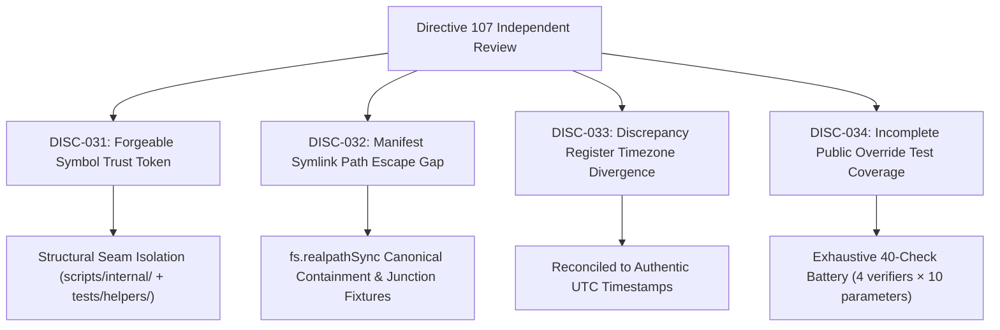

# KSHETRA W021.5 — DIRECTIVE 107 DISCREPANCY REGISTER & REMEDIATION MATRIX

**Milestone:** W021.5  
**Governing Directive:** CTO Directive 108  
**Register ID:** `W021.5-DIRECTIVE-107-DISCREPANCY-REGISTER-V1.0`  
**Governance Standard:** Master Execution Framework Amendment v1.2 / Rule IV-001 (Non-Self-Acceptance)  
**Execution Context:** Repository-Only / Offline-First / Strictly Zero Database Mutation  

---

## 1. Executive Summary

During independent review of **CTO Directive 107**, four defects and gaps were identified across trust token unforgeability, manifest symlink path containment, discrepancy register timestamp timezone divergence, and public verifier override test coverage.

This register documents all four findings (`DISC-031` through `DISC-034`), establishes their historical lineage, specifies their canonical committed resolution, and provides fail-closed verification under **CTO Directive 108**.

---

## 2. Forensic Discrepancy & Remediation Register

| Discrepancy ID | Item Key & Category | Discrepancy Type | Affected Entity | Prior State (Directive 107) | Canonical Reconciled State (Directive 108) | Status |
|:---|:---|:---|:---|:---|:---|:---|
| **`DISC-031`** | `VERIFIER_ENGINE:forgeableTestTrustToken` *(Forgeable Trust Token)* | `FORGEABLE_SYMBOL_TEST_TRUST_TOKEN` | `scripts/reconcile_execution_ledger.mjs` (`TEST_HARNESS_PROTECTION_TOKEN`, `__testOnly_*` exports) | `TEST_HARNESS_PROTECTION_TOKEN` exported via `Symbol.for(...)`. `__testOnly_*` functions exported on production module, claiming unforgeable protection. | Removed token and all `__testOnly_*` exports from production verifier. Isolated test injection in `tests/helpers/ledger-test-adapter.mjs` using internal engine `scripts/internal/reconcile_engine.mjs`. All 4 production verifiers unconditionally reject all 10 `FORBIDDEN_TRUST_OVERRIDES`. | **RESOLVED** |
| **`DISC-032`** | `MANIFEST_VALIDATOR:symlinkPathContainmentGap` *(Manifest Symlink Escape)* | `MISSING_SYMLINK_ADVERSARIAL_TEST` | `scripts/capture_test_execution.mjs` and `tests/political-intelligence-directive-107.test.mjs` | Adversarial tests only verified lexical path traversal (`../../../../etc/passwd`). No test fixture proved rejection of symlinks resolving outside the repository root. | Hardened `assertPathContainedInRoot` and `validateManifestIntegrity` using `fs.realpathSync` containment against `realRepoRoot + path.sep`. Deployed genuine symlink/junction adversarial test fixtures in Suite 28 and Suite 29. | **RESOLVED** |
| **`DISC-033`** | `DISCREPANCY_REGISTER:timezoneTimestampDivergence` *(Timezone Divergence)* | `TIMEZONE_MANUAL_FORMATTING_DIVERGENCE` | `reports/w021_5_directive_106_discrepancy_register.json` (`generatedAt`) | Recorded `13:40:00.000Z` (local Indian Standard Time with a trailing Z) diverging from manifest UTC `08:38:45.846Z`. | Reconciled `reports/w021_5_directive_106_discrepancy_register.json` to authentic UTC `2026-10-19T08:38:45.846Z` matching the Directive 107 delivery epoch. | **RESOLVED** |
| **`DISC-034`** | `VERIFICATION_TESTS:incompletePublicOverrideCoverage` *(Override Test Coverage)* | `PARTIAL_OVERRIDE_KEY_SAMPLE_TESTING` | `tests/political-intelligence-directive-107.test.mjs` (Tests 1.1 - 1.4) | Tested only a subset of 3 to 5 override keys per verifier while claiming coverage of all ten. | Exhaustive 4x10 matrix testing all 10 `FORBIDDEN_TRUST_OVERRIDES` against each of the 4 public verifier entry points (40 discrete checks), verifying fail-closed rejection. | **RESOLVED** |

---

## 3. Workstream Remediation Details

### 3.1 Workstream A: Removal of Forgeable Trust Tokens
In JavaScript, `Symbol.for('...')` queries the global, runtime-wide Symbol registry. Any script or caller can reproduce the identical Symbol by providing the same string literal. Treating `Symbol.for(...)` as an unforgeable secret capability was an architectural defect.

The remediation enforces true architectural separation:
1. `scripts/reconcile_execution_ledger.mjs` exports ONLY safe-by-default production verifiers.
2. Every public verifier calls `assertNoCallerTrustOverrides()` unconditionally before executing any logic.
3. No bypass token, Symbol, string secret, or mode flag can disable this check.
4. Shared verification logic resides in `scripts/internal/reconcile_engine.mjs`.
5. Controlled test injection resides strictly in `tests/helpers/ledger-test-adapter.mjs`.

### 3.2 Workstream C: Canonical Symlink Path Containment
Lexical resolution (`path.resolve()`) does not resolve symlinks or junctions. On Windows, directory junctions can link a directory inside the repository to an external target. Sibling directory prefix attacks (`C:\repo` vs `C:\repo-evil`) also bypass naive string prefix checks.

The remediation enforces canonical path containment:
1. Rejects absolute paths and root-anchored drive paths (`path.isAbsolute(p)` and `^[a-zA-Z]:[/\\]`).
2. Asserts lexical containment with explicit path separator: `resolvedLexical.startsWith(normalizedRoot + path.sep)`.
3. Resolves the real canonical target via `fs.realpathSync()`.
4. Asserts filesystem containment with explicit path separator: `realTarget.startsWith(realRepoRoot + path.sep)`.
5. Validates rejection via genuine physical directory junction adversarial fixtures in Suites 28 and 29.

---

## 4. Governance & Verification Invariants

1. **Rule IV-001 Non-Self-Acceptance:** Formal CTO acceptance remains strictly **0.0% (`UNACCEPTED`)**.
2. **Production Air-Gap:** Live database execution remains strictly **0.0% (`UNEXECUTED`)**.
3. **Canonical Task Inventory:** Exactly 27 canonical tasks, 100.000% weight, 93.5% earned, 6.5% blocked/unearned.
4. **Baseline Immutability:** 68 SQL migrations and 31 MLA seeds match baseline commits byte-for-byte.
5. **Execution Qualification:** All results qualified as `REPOSITORY_RECORDED_EXECUTION`.
