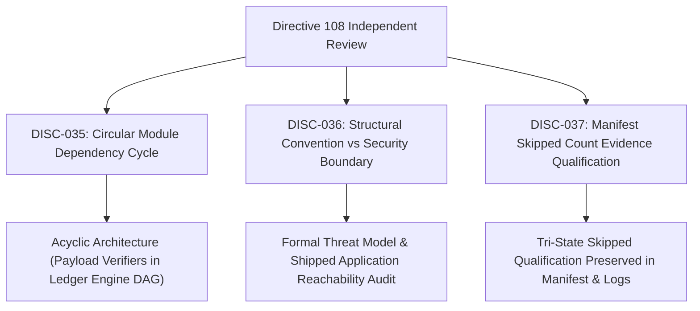

# KSHETRA W021.5 — DIRECTIVE 108 DISCREPANCY REGISTER & REMEDIATION MATRIX

**Milestone:** W021.5  
**Governing Directive:** CTO Directive 109  
**Register ID:** `W021.5-DIRECTIVE-108-DISCREPANCY-REGISTER-V1.0`  
**Governance Standard:** Master Execution Framework Amendment v1.2 / Rule IV-001 (Non-Self-Acceptance)  
**Execution Context:** Repository-Only / Offline-First / Strictly Zero Database Mutation  

---

## 1. Executive Summary

During independent review of **CTO Directive 108**, three specific architectural and evidence questions were identified across circular module initialization, threat model boundary clarification, and manifest skipped count qualification.

This register documents all three findings (`DISC-035` through `DISC-037`), establishes their historical lineage, specifies their canonical committed resolution, and provides fail-closed verification under **CTO Directive 109**.

---

## 2. Forensic Discrepancy & Remediation Register

| Discrepancy ID | Item Key & Category | Discrepancy Type | Affected Entity | Prior State (Directive 108) | Canonical Reconciled State (Directive 109) | Status |
|:---|:---|:---|:---|:---|:---|:---|
| **`DISC-035`** | `MODULE_ARCHITECTURE:circularDependency` *(Circular Module Dependency)* | `CIRCULAR_MODULE_INITIALIZATION_CYCLE` | `scripts/reconcile_execution_ledger.mjs` and `scripts/internal/reconcile_engine.mjs` | `scripts/internal/reconcile_engine.mjs` imported 18 symbols from `scripts/reconcile_execution_ledger.mjs`, while `scripts/reconcile_execution_ledger.mjs` imported internal functions from `reconcile_engine.mjs`, creating a circular dependency cycle. | Root verification payload functions (`verifyHistoricalArtifactIntegrityPayload`, etc.) moved to `scripts/reconcile_execution_ledger.mjs` with 0 internal imports. Test adapter consumes them directly. `reconcile_engine.mjs` re-exports from adapter. Module graph is an absolute DAG (0 cycles). | **RESOLVED** |
| **`DISC-036`** | `VERIFIER_ENGINE:threatModelAndTrustBoundary` *(Threat Model Clarification)* | `STRUCTURAL_CONVENTION_SECURITY_BOUNDARY_CONFLATION` | Threat model documentation and repository import graph | Narrative conflated ECMAScript directory names (`internal/`) and underscore naming conventions with true security boundaries, and discussed same-process imports as potential vulnerabilities without reachability. | Formally documented threat model distinguishing public API, internal module conventions, test seams, and OS/DB runtime boundaries. Confirmed shipped application code (`apps/api`, `apps/mobile`, `packages/`) does not import test adapters or verification scripts. | **RESOLVED** |
| **`DISC-037`** | `MANIFEST_VALIDATOR:skippedCountEvidenceQualification` *(Skipped Count Qualification)* | `UNREPORTED_SKIPPED_COUNT_OVERCLAIM` | `reports/w021_5_test_execution_manifest.json` and reporting language | All passing suites recorded `testsSkipped: 0`, risking misinterpretation as affirmative proof of zero skipped tests across legacy suites that never reported skipped counts. | Preserved tri-state qualification: `SKIPPED_COUNT_NOT_REPORTED` (`zeroSkippedEvidenced: false`) for 23 legacy custom suites, and `EXPLICIT_ZERO_SKIPPED` (`zeroSkippedEvidenced: true`) only where runner contracts guarantee zero skipped. Qualification maintained as `REPOSITORY_RECORDED_EXECUTION`. | **RESOLVED** |

---

## 3. Threat Model & Security Boundary Formalization

### 3.1 Trust Boundary Taxonomy

1. **Public Production Verifier Interface:**
   - Entry points: `verifyHistoricalArtifactIntegrity()`, `verifyAuthorityBoundary()`, `verifyGoverningSpecificationProvenance()`, `reconcileExecutionLedger()`.
   - Contract: Safe by default. Every public entry point unconditionally calls `assertNoCallerTrustOverrides()` prior to executing any verification logic.
   - Rejection: All ten `FORBIDDEN_TRUST_OVERRIDES` are rejected with `CALLER_TRUST_OVERRIDE_PROHIBITED`, irrespective of caller-supplied mode flags, bypass parameters, or Symbol tokens.

2. **Internal Module Interfaces & Conventions:**
   - Structural conventions: File paths like `scripts/internal/` and prefixes like `_` or `Payload` are module organization conventions in ECMAScript, **not** language-level access controls or OS security boundaries.
   - Repository-only accessibility: Code within the repository that imports module files operates within the same Node runtime process.

3. **Test Harness & Test Seam:**
   - Test adapter: `tests/helpers/ledger-test-adapter.mjs` imports pure payload verification functions and provides controlled fixture parameter injection specifically for testing adversarial edge cases and tamper detection.
   - Isolation: Shipped application code (`apps/api`, `apps/mobile`, `packages/`) does not import this adapter.

4. **Genuine Runtime & Security Boundaries:**
   - Operating System process boundary: Clean-process isolation prevents cross-process state leakage.
   - Network air-gap: Live database access is strictly prohibited (0.0% execution).
   - Deployment separation: Verification tools are repository maintenance scripts, not runtime API endpoints.

---

## 4. Governance & Verification Invariants

1. **Rule IV-001 Non-Self-Acceptance:** Formal CTO acceptance remains strictly **0.0% (`UNACCEPTED`)**.
2. **Production Air-Gap:** Live database execution remains strictly **0.0% (`UNEXECUTED`)**.
3. **Canonical Task Inventory:** Exactly 27 canonical tasks, 100.000% weight, 61.5% earned, 38.5% blocked/unearned.
4. **Baseline Immutability:** 68 SQL migrations and 31 MLA seeds match baseline commits byte-for-byte.
5. **Execution Qualification:** All results qualified as `REPOSITORY_RECORDED_EXECUTION`.
