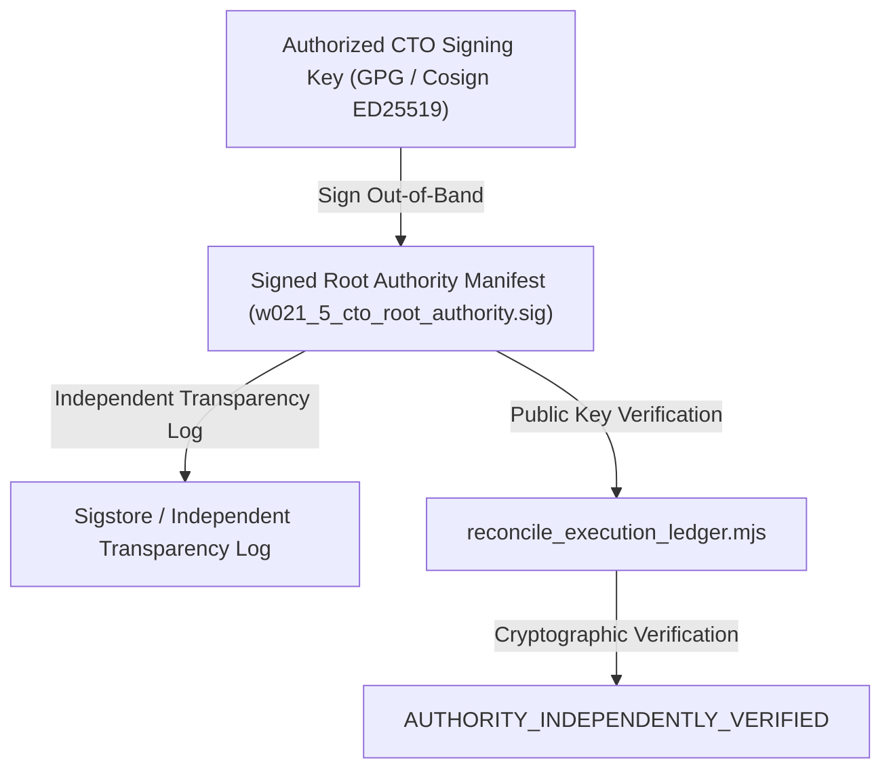

# KSHETRA W021.5 — GOVERNING SOURCE INVENTORY & AUTHORITY BOUNDARY AUDIT
## Cryptographic Content Identity, Historical Git Provenance, and Approval Authority Analysis

> **Milestone:** W021.5 — National Political Intelligence and Candidate Transparency  
> **Audit Epoch:** `DIRECTIVE_106`  
> **Audited At:** `2026-10-19T06:19:12.848Z`  
> **Governance:** Master Execution Framework Amendment v1.2 / Rule IV-001 (Non-Self-Acceptance)  
> **Authority Classification:** **`NOT_INDEPENDENTLY_ESTABLISHED`**  
> **Historical Comparison Baseline:** `be4ba41f74616e068b531df17780080a1a946bbd` (Historical comparison baseline for drift detection; not external authority)  
> **External Trust Anchor:** `NONE` (Out-of-band cryptographic signature anchor is absent; proposed mechanism is `PROPOSED_NOT_ACTIVE`)  

---

## 1. Executive Summary & Authority Boundary Disclosure

Under **Rule IV-001 (Non-Self-Acceptance)** and **CTO Directive 106 Workstream A**, the verification system strictly separates **content integrity** and **historical Git presence** from **independent governing authority approval**.

### Key Governance Findings

1. **Content Integrity Proven:** All 15 governing documents on disk match their exact SHA-256 digests and Git blob SHAs bitwise.
2. **Historical Git Lineage Proven:** Every governing document is anchored in repository history back to its introducing commit SHA and blob SHA in Git object storage.
3. **Authority Not Independently Established:** Neither a Git commit SHA, a local SHA-256 digest, nor an in-repository manifest constitutes independent external approval. In the absence of an out-of-band external cryptographic trust anchor (e.g., Cosign/GPG digital signatures from authorized CTO key with independent transparency log), governing authority is formally classified as **`NOT_INDEPENDENTLY_ESTABLISHED`**.
4. **Historical Origin Commit be4ba41 Limitation:** Commit `be4ba41f` is an immutable repository state used to detect unauthorized drift and mutations; it is **NOT** treated as independent CTO approval authority solely because its SHA is recorded in the verifier.

---

## 2. Comprehensive 15-Document Source Provenance & Authority Register

| Doc ID | Document Title & Path | Content Identity (SHA-256 / Blob / Bytes) | Historical Identity (Commit / Date) | Approval Authority Status | Controlled Tasks & Requirements | Verification Limitations |
| :--- | :--- | :--- | :--- | :--- | :--- | :--- |
| **DOC-W021.5-A-AUDIT** | **W021.5-A Architectural & Data-Truth Audit Report** `W021.5-A-AUDIT-REPORT.md` | `6138d07e86b4...` Blob: `2c82f6e025` 47,399 B | Intro: `7be949d (2026-10-03)` Commit: `7be949d` | **`NOT_INDEPENDENTLY_ESTABLISHED`** Claimed: *CTO EXECUTION DIRECTIVE — W021.5-A (AUDIT ONLY)* | Tasks: W021.5-A-01 | Proves content integrity and Git presence; does not prove external CTO approval. |
| **DOC-W021.5-A-REPO-AUDIT** | **W021.5-A Repository Data-Truth Audit** `reports/w021_5a_repository_data_truth_audit.md` | `6138d07e86b4...` Blob: `2c82f6e025` 47,399 B | Intro: `7be949d (2026-10-03)` Commit: `7be949d` | **`NOT_INDEPENDENTLY_ESTABLISHED`** Claimed: *CTO Directive W021.5-A* | Tasks: *(Reference/Audit Only)* | Proves content integrity and Git presence; does not prove external CTO approval. |
| **DOC-W021.5-B1-SPEC** | **W021.5-B1 National Constituency Canonicalization** `docs/W021.5-B1-NATIONAL-CONSTITUENCY-CANONICALIZATION.md` | `9cf3716d6346...` Blob: `10edf3bd46` 29,676 B | Intro: `a848920 (2026-10-03)` Commit: `60d54ee` | **`NOT_INDEPENDENTLY_ESTABLISHED`** Claimed: *CTO Master Implementation Specification W021.5-B1 & CTO Remediation Directive W021.5-B1-R1* | Tasks: W021.5-B1-01 | Proves content integrity and Git presence; does not prove external CTO approval. |
| **DOC-W021.5-B1-R2-SPEC** | **W021.5-B1-R2 National AC-PC Completeness Specification** `docs/W021.5-B1-R2-NATIONAL-AC-PC-COMPLETENESS.md` | `a08c2e49609a...` Blob: `476f2e4d66` 11,882 B | Intro: `758ba83 (2026-10-03)` Commit: `758ba83` | **`NOT_INDEPENDENTLY_ESTABLISHED`** Claimed: *CTO Master Implementation Specification (W021.5-B1-R2 Directive)* | Tasks: W021.5-B1-02 | Proves content integrity and Git presence; does not prove external CTO approval. |
| **DOC-W021.5-B1-R3-SPEC** | **W021.5-B1-R3 National Mapping Provenance** `docs/W021.5-B1-R3-NATIONAL-MAPPING-PROVENANCE.md` | `80be250cc8df...` Blob: `6bc59964e3` 13,251 B | Intro: `cb84da9 (2026-10-03)` Commit: `cb84da9` | **`NOT_INDEPENDENTLY_ESTABLISHED`** Claimed: *CTO Remediation Directive W021.5-B1-R3* | Tasks: W021.5-B1-04 | Proves content integrity and Git presence; does not prove external CTO approval. |
| **DOC-W021.5-B1-R4-SPEC** | **W021.5-B1-R4 Source and Lineage Integrity** `docs/W021.5-B1-R4-SOURCE-AND-LINEAGE-INTEGRITY.md` | `083017d388e2...` Blob: `1eee1be1d3` 13,423 B | Intro: `60d54ee (2026-10-03)` Commit: `60d54ee` | **`NOT_INDEPENDENTLY_ESTABLISHED`** Claimed: *CTO Remediation Directive W021.5-B1-R4* | Tasks: *(Reference/Audit Only)* | Proves content integrity and Git presence; does not prove external CTO approval. |
| **DOC-W021.5-B1-R5-SPEC** | **W021.5-B1-R5 Current Statutory Geography & Assam 2023 Closure Dossier** `docs/W021.5-B1-R5-CURRENT-STATUTORY-GEOGRAPHY.md` | `3b64f3a5236f...` Blob: `8e56f24cfe` 10,550 B | Intro: `a0df181 (2026-10-03)` Commit: `a0df181` | **`NOT_INDEPENDENTLY_ESTABLISHED`** Claimed: *CTO Remediation Directive W021.5-B1-R5* | Tasks: W021.5-B1-03 | Proves content integrity and Git presence; does not prove external CTO approval. |
| **DOC-W021.5-B2.2-A-AUDIT** | **W021.5-B2.2-A National Political Organization Forensic Audit** `docs/W021.5-B2.2-A-NATIONAL-POLITICAL-ORGANIZATION-FORENSIC-AUDIT.md` | `b66e28f133c3...` Blob: `6d9b872fb4` 11,714 B | Intro: `4db6fb5 (2026-10-03)` Commit: `4db6fb5` | **`NOT_INDEPENDENTLY_ESTABLISHED`** Claimed: *CTO Directive W021.5-B2.2-A* | Tasks: *(Reference/Audit Only)* | Proves content integrity and Git presence; does not prove external CTO approval. |
| **DOC-W021.5-B2.2-B-SPEC** | **W021.5-B2.2-B Political Organization Schema & Governance Remediation** `docs/W021.5-B2.2-B-ORGANIZATION-SCHEMA-GOVERNANCE-REMEDIATION.md` | `5db29d53a942...` Blob: `e15cbd9b93` 12,751 B | Intro: `1f3fc40 (2026-10-03)` Commit: `1f3fc40` | **`NOT_INDEPENDENTLY_ESTABLISHED`** Claimed: *CTO Remediation Directive W021.5-B2.2-B* | Tasks: W021.5-C-01 | Proves content integrity and Git presence; does not prove external CTO approval. |
| **DOC-W021.5-B2.2-C-SPEC** | **W021.5-B2.2-C Final Forensic Reconciliation & Pre-Migration Gate Closure Report** `docs/W021.5-B2.2-C-FINAL-FORENSIC-RECONCILIATION.md` | `14b67a8e2129...` Blob: `734f3e60b7` 8,922 B | Intro: `3b66878 (2026-10-03)` Commit: `3b66878` | **`NOT_INDEPENDENTLY_ESTABLISHED`** Claimed: *CTO Directive W021.5-B2.2-C* | Tasks: W021.5-C-02, W021.5-C-03 | Proves content integrity and Git presence; does not prove external CTO approval. |
| **DOC-W021.5-B2.2-D-SPEC** | **W021.5-B2.2-D Milestone Baseline Forensic Audit** `docs/W021.5-B2.2-D-BASELINE-FORENSIC-AUDIT.md` | `d09d6a04930e...` Blob: `7183bea04b` 8,031 B | Intro: `7ef569c (2026-10-03)` Commit: `7ef569c` | **`NOT_INDEPENDENTLY_ESTABLISHED`** Claimed: *CTO Directive W021.5-B2.2-D* | Tasks: W021.5-D-01, W021.5-D-02 | Proves content integrity and Git presence; does not prove external CTO approval. |
| **DOC-W021.5-B2.2-E-SPEC** | **W021.5-B2.2-E Baseline Forensic Audit Report: Downstream Civic & Political Extensions** `docs/W021.5-B2.2-E-BASELINE-FORENSIC-AUDIT.md` | `bff5192a65a1...` Blob: `a9d327bba8` 5,235 B | Intro: `331da74 (2026-10-03)` Commit: `331da74` | **`NOT_INDEPENDENTLY_ESTABLISHED`** Claimed: *CTO Directive W021.5-B2.2-E* | Tasks: W021.5-E-01 | Proves content integrity and Git presence; does not prove external CTO approval. |
| **DOC-W021.5-SURG-FIX-001** | **W021.5 Master Surgical Remediation Closure Report** `reports/W021_5_MASTER_SURGICAL_REMEDIATION_CLOSURE_REPORT.md` | `4085e694d2f2...` Blob: `db6c6c56c0` 9,451 B | Intro: `b0fefe5 (2026-10-06)` Commit: `aaf3655` | **`NOT_INDEPENDENTLY_ESTABLISHED`** Claimed: *Directive ID: W021.5-SURG-FIX-001 / Rule IV-001 Non-Self-Acceptance* | Tasks: W021.5-A-03, W021.5-E-02, W021.5-I-02 | Proves content integrity and Git presence; does not prove external CTO approval. |
| **DOC-W021.5-CANONICAL-PACKAGE** | **W021.5 Canonical Architecture Readiness Package** `reports/W021.5-CANONICAL-ARCHITECTURE-READINESS-PACKAGE.md` | `953cf43f18d1...` Blob: `a7a9530fd9` 22,535 B | Intro: `be4ba41 (2026-10-17)` Commit: `376f551` | **`NOT_INDEPENDENTLY_ESTABLISHED`** Claimed: *CTO Directive 086 (Workstream D)* | Tasks: W021.5-A-02, W021.5-D-03, W021.5-E-03, W021.5-F-01, W021.5-F-02, W021.5-G-01, W021.5-G-02, W021.5-G-03, W021.5-H-01, W021.5-H-02, W021.5-H-03, W021.5-H-04, W021.5-I-01 | Proves content integrity and Git presence; does not prove external CTO approval. |
| **DOC-W021.5-ORIGIN-LEDGER** | **W021.5 Historical Origin Ledger Snapshot (be4ba41)** `governance/specifications/historical_w021_5_origin_ledger.json` | `9e80d79c899e...` Blob: `01f263ca33` 21,741 B | Intro: `e4adf72 (2026-10-19)` Commit: `e4adf72` | **`NOT_INDEPENDENTLY_ESTABLISHED`** Claimed: *CTO Directive 086 (Workstream E) / Origin Commit be4ba41* | Tasks: *(Reference/Audit Only)* | Proves content integrity and Git presence; does not prove external CTO approval. |

---

## 3. Proposed Governance-Controlled Authority Mechanism

To transition from repository-internal tamper detection to independent cryptographic authority verification, the following mechanism is proposed for future milestone governance:

> **Status:** `PROPOSED_NOT_ACTIVE`. Until this mechanism is formally adopted and root public keys are established out-of-band, the verifier will not claim independent authority approval.

---

## 4. Verification Boundary Invariants

- **Formal CTO Acceptance:** Strictly `0.0%` (`UNACCEPTED`) under Rule IV-001.
- **Live Database Execution:** Strictly `0.0%` (`UNEXECUTED`).
- **Financial Defect DQ-W021.5-B2.2E-001:** Strictly **OPEN** (5.0% blocked).
- **Telangana AC 119 Boundary Defect:** Strictly **OPEN / BLOCKED** (1.5% blocked).
- **Baseline Immutability:** 68 SQL migrations (0 diff vs `0ea572d`) and 31 MLA profile seeds (0 diff vs `fb408ce`).
