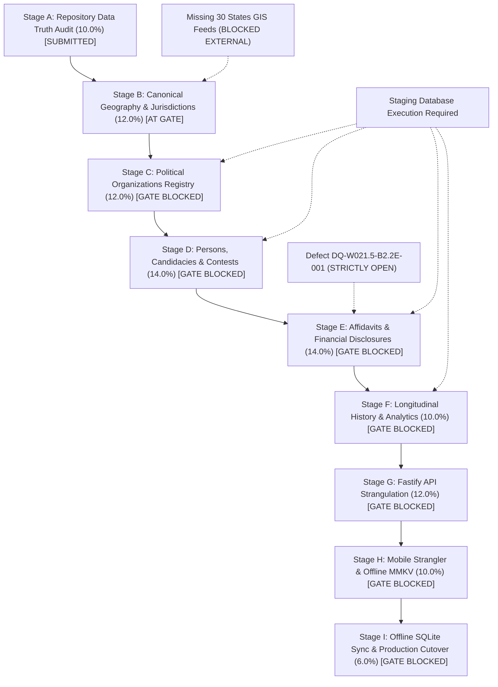

# KSHETRA W021.5 — STAGES A–I COMPLETION ROADMAP
## Dependency-Aware Architecture, Critical Path, and Stage-Gated Implementation Plan

**Directive:** CTO Directive 118  
**Predecessor:** CTO Directive 117  
**Repository:** `https://github.com/kshetra-app/Kshetra`  
**Governing Authority:** Master Execution Framework Amendment v1.6 / Rule IV-001 Non-Self-Acceptance  
**Current Governing Boundary:** Stopped at Stage B Gate; Stages C through I are strictly **NOT AUTHORIZED** for implementation.  
**Formal CTO Acceptance:** `0.0% — PENDING INDEPENDENT ADJUDICATION`  

---

## 1. Executive Summary & Purpose

This roadmap establishes the complete, dependency-aware architectural blueprint for executing the remaining scope of W021.5 (Stages C through I) upon receipt of explicit stage-gate authorization.

**Key Governing Principles:**
1. **Sequential Stage Gates:** No subsequent stage may commence implementation until the predecessor stage has undergone independent evidence adjudication and received explicit authorization.
2. **Rule IV-001 Non-Self-Acceptance:** Implementation agents never award acceptance credit to their own deliverables.
3. **Zero Production Mutation:** Production remains strictly `AIR_GAPPED_UNEXECUTED`.
4. **Zero Synthetic Data:** Authoritative external boundaries and records must come from verifiable statutory sources; zero synthetic boundaries are permitted.

---

## 2. Master Specification Stage Hierarchy

| Stage | Stage Title | Task Count | Allocated Weight | Verified Earned | DB Pending | Blocked / Unimpl | Stage Gate Status |
|---|---|---:|---:|---:|---:|---:|---|
| **Stage A** | Repository & National Data-Truth Audit | 3 | 10.0% | 10.0% | 0.0% | 0.0% | Submitted for Independent Review |
| **Stage B** | Canonical Jurisdiction & Geography Modeling | 4 | 12.0% | 10.5% | 0.0% | 1.5% | **SUBMITTED FOR CTO ADJUDICATION (Current Gate)** |
| **Stage C** | Canonical Political Organization Registry | 3 | 12.0% | 9.5% | 2.5% | 0.0% | BLOCKED PENDING STAGE B ADJUDICATION |
| **Stage D** | Candidacies, Contests & Multi-Election Normalization | 3 | 14.0% | 7.0% | 3.0% | 4.0% | BLOCKED PENDING STAGE C COMPLETION |
| **Stage E** | Candidate Affidavits, Demographics & Financial Disclosures | 3 | 14.0% | 2.0% | 2.0% | 10.0% | BLOCKED PENDING STAGE D & FINANCIAL ADJUDICATION |
| **Stage F** | Multi-Election History & Longitudinal Results Normalization | 2 | 10.0% | 5.5% | 3.0% | 1.5% | BLOCKED PENDING STAGE E COMPLETION |
| **Stage G** | Fastify API Layer Strangulation & Contract Hardening | 3 | 12.0% | 8.0% | 0.0% | 4.0% | BLOCKED PENDING STAGES C–F NORMALIZATION |
| **Stage H** | Mobile Client Strangler Migration & Provenance Precedence | 4 | 10.0% | 9.0% | 0.0% | 1.0% | BLOCKED PENDING STAGE G API HARDENING |
| **Stage I** | Offline SQLite Sync Engine & Final Production Synchronization | 2 | 6.0% | 0.0% | 0.0% | 6.0% | BLOCKED PENDING FINAL STAGES A–H READINESS |
| **TOTAL** | **Full W021.5 Scope (27 Tasks)** | **27** | **100.0%** | **61.5%** | **10.5%** | **28.0%** | **STRICT STAGE-GATED EXECUTION** |

---

## 3. Dependency Graph & Critical Path

### 3.1 Critical Path Analysis
1. **Gate 1 (Immediate Critical Path):** Independent CTO Adjudication of Stage B Evidence Package (4,123 ACs, 543 PCs, Migration 061, Migration 062).
2. **Gate 2 (Database Execution Authorization):** Staging database deployment for Migrations 058 (Organizations), 051 (Normalized Elections), 061 (Jurisdictions), 062 (Assam). Unblocks 10.5% DB-pending weight.
3. **Gate 3 (Financial Adjudication Gate):** Explicit CTO adjudication of Defect `DQ-W021.5-B2.2E-001` regarding movable/immovable candidate asset valuation. Unblocks 5.0% in Stage E.
4. **Gate 4 (API Strangulation Gate):** Fastify route retirement and deprecation of direct Supabase client calls in mobile. Unblocks Stages G and H.
5. **Gate 5 (Production Sync Gate):** Offline SQLite packaging verification and final air-gapped production cutover plan.

---

## 4. Phase-by-Phase Execution Plan for Stages C through I

### Stage C: Canonical Political Organization Registry (12.0%)
- **Scope:** Tasks `W021.5-C-01` (4.0%), `W021.5-C-02` (5.0%), `W021.5-C-03` (3.0%).
- **Existing Foundation:** Migration 058 defines `political_organizations` and `organization_aliases`. Catalog of 1,207 parties compiled in seed.
- **Missing Implementation:** Execution and reconciliation against live PostgreSQL catalog; formal party merger and split lineage DAG.
- **Required Authorization:** Explicit CTO authorization to execute staging migrations and advance to Stage C.
- **Estimated Effort:** 2–3 execution sprints.

### Stage D: Candidacies, Contests & Multi-Election Normalization (14.0%)
- **Scope:** Tasks `W021.5-D-01` (4.0%), `W021.5-D-02` (6.0%), `W021.5-D-03` (4.0%).
- **Existing Foundation:** Migration 051 defines `canonical_persons`, `candidacies`, `election_contests`. `electionService.ts` provides normalized query methods.
- **Missing Implementation:** Staging database population of historical candidate registries; cross-election candidate deduplication verification.
- **Required Authorization:** Successful closure of Stage C gate and explicit Stage D authorization.
- **Estimated Effort:** 3–4 execution sprints.

### Stage E: Candidate Affidavits, Demographics & Financial Disclosures (14.0%)
- **Scope:** Tasks `W021.5-E-01` (5.0%), `W021.5-E-02` (5.0%), `W021.5-E-03` (4.0%).
- **Existing Foundation:** Affidavit schema in Migration 052/053. Criminal case extraction pipelines.
- **Critical Blocker:** Defect `DQ-W021.5-B2.2E-001` (`STRICTLY_OPEN`). Cannot award 5.0% on financial disclosures until separate explicit CTO adjudication is granted.
- **Required Authorization:** Stage D closure and separate CTO adjudication on financial schema.
- **Estimated Effort:** 3 execution sprints.

### Stage F: Multi-Election History & Longitudinal Results Normalization (10.0%)
- **Scope:** Tasks `W021.5-F-01` (5.0%), `W021.5-F-02` (5.0%).
- **Existing Foundation:** Multi-state historical election seeds for TS (2014, 2018), AP (2019), KA (2018), MH (2019), TN (2016), KL (2016), WB (2016), UP (2017).
- **Missing Implementation:** Longitudinal margin and swing analytics tables; multi-election turnout time-series pipeline.
- **Required Authorization:** Stage E closure.
- **Estimated Effort:** 2 execution sprints.

### Stage G: Fastify API Layer Strangulation & Contract Hardening (12.0%)
- **Scope:** Tasks `W021.5-G-01` (5.0%), `W021.5-G-02` (4.0%), `W021.5-G-03` (3.0%).
- **Existing Foundation:** 137 Fastify route registrations; fail-closed DM unread-count implementation; state data service.
- **Missing Implementation:** Complete strangler migration for remaining Class B mobile mutations; legacy schema route retirement.
- **Required Authorization:** Stage F closure.
- **Estimated Effort:** 2–3 execution sprints.

### Stage H: Mobile Client Strangler Migration & Provenance Precedence (10.0%)
- **Scope:** Tasks `W021.5-H-01` (3.0%), `W021.5-H-02` (3.0%), `W021.5-H-03` (2.0%), `W021.5-H-04` (2.0%).
- **Existing Foundation:** MMKV offline storage; audit of 85 methods in `supabaseDataService.ts`.
- **Missing Implementation:** Full cutover of remaining direct Supabase callers to Fastify API endpoints; visual provenance badging on mobile screens.
- **Required Authorization:** Stage G closure.
- **Estimated Effort:** 2 execution sprints.

### Stage I: Offline SQLite Sync Engine & Final Production Synchronization (6.0%)
- **Scope:** Tasks `W021.5-I-01` (3.0%), `W021.5-I-02` (3.0%).
- **Existing Foundation:** Production sync manifest v1, prestate snapshots.
- **Missing Implementation:** Production SQLite database packaging pipeline; dry-run migration execution on staging; final production cutover playbook.
- **Required Authorization:** Stages A–H complete; explicit CTO authorization for production readiness.
- **Estimated Effort:** 2 execution sprints.

---

## 5. Governance Checkpoints & Authorization Stop Conditions

Execution must halt and request explicit CTO review at the following mandatory gates:
1. **Current Gate (End of Stage B):** Stop and submit complete Stage B evidence package. Zero work on Stage C may begin until formal authorization is issued.
2. **Database Mutation Gate:** Zero execution of SQL migrations on staging or production without explicit authorization.
3. **Defect Adjudication Gate:** Zero unilateral closure of open defects (`DQ-W021.5-B2.2E-001`, AC 119 polygon defect, or missing GIS feeds).
4. **Boundary Promotion Gate:** Zero promotion of unverified or synthetic GIS geometry into canonical status.
